# Proyecto de Desaparecidos

Este repositorio contiene el pipeline de procesamiento, integración, análisis y visualización de información sobre personas desaparecidas, centralizando fuentes como RNPDNO, BANCI y PUI (Plataforma Única de Identidad).

## Objetivo del Proyecto

El objetivo principal de este proyecto es realizar la limpieza, cruce (matching) y conciliación de bases de datos de personas desaparecidas para la generación de indicadores analíticos y presentaciones automatizadas (diapositivas) a nivel estatal y nacional.

## Estructura Principal del Proyecto

```text
desaparecidos/
├── 1_funciones/       # Scripts de visualización (barras, líneas, treemaps)
├── docs/              # Documentación detallada del proyecto
├── input/             # Bases de datos y catálogos fuente (RNPDNO, BANCI, PUI, INEGI)
├── notebooks/         # Interfaz ejecutable: ETL y notebooks que arman cada PPT
├── output/            # Resultados y caché regenerable del pipeline
├── perfiles/          # Configuración como datos: un TOML por variante de reporte
└── src/               # Lógica del proyecto (pipeline, matching, limpieza, PPT)
```

## Configuración y Requisitos

Para ejecutar el pipeline, se recomienda utilizar un entorno virtual de Python.

1.  Instalar las dependencias del proyecto:
    ```bash
    pip install -r requirements.txt
    ```
2.  Ajustar rutas base y catálogos en `config.py` solo si cambia la infraestructura.
3.  Para configurar una corrida (archivo fuente, reglas, entidad, períodos), editar o crear
    un perfil en [`perfiles/`](perfiles/) — no `config.py`.

## Pipeline de Ejecución

**1. Fase ETL** — cada notebook deja un Parquet de nombre fijo en `output/`

| Notebook | Salida |
|---|---|
| `1_Procesamiento_ETL_RNPDNO.ipynb` | `Resultado_1_Procesamiento_ETL_RNPDNO.parquet` |
| `2_Procesamiento_ETL_BANCI.ipynb` | `Resultado_2_Procesamiento_ETL_BANCI.parquet` |
| `3_Procesamiento_ETL_PUI.ipynb` | `Resultado_3_Procesamiento_ETL_PUI.parquet` |

Los tres son independientes entre sí, con una excepción: **el 3 necesita el Parquet del 1**
(usa el RNPDNO para resolver clasificación, fecha de hechos y CURP).

El notebook 3 consolida las tres entregas de la PUI —coincidencias administrativas,
confrontas manuales y defunciones— en una marca por persona. Es el origen de las banderas
`cind` / `sind` y, con ellas, de los indicadores de *información suficiente*
(`sisf` / `cisf`). El recorrido completo, desde el archivo de entrada hasta el marcador de
la plantilla, está en [`docs/8_indicios_de_vida.md`](docs/8_indicios_de_vida.md).

**2. Fase de análisis y reportes**

*   `4_Generacion_Indicadores.ipynb`: construye el **universo** (RNPDNO + BANCI cruzados,
    con banderas derivadas) y lo deja cacheado.
*   `5_PPT_Reporte_Estatal.ipynb` y `6_PPT_Reporte_Diario.ipynb`: **consumen** ese universo.
    Cada uno declara su perfil de configuración y la lista de rebanadas que necesita.

Los notebooks de PPT no dependen entre sí y pueden ejecutarse en cualquier orden: el
primero que corra construye el universo, los siguientes lo leen del caché. Si entre uno y
otro cambia `config.py`, el perfil, el código o un insumo, el caché ya no vale y el
siguiente lo recalcula.

### Configuración por perfiles

La configuración variable no vive en `config.py` sino en `perfiles/*.toml`. `config.py`
conserva solo lo invariante (rutas base, mapeos de columnas, catálogos de regex, entidades).

```python
from src.settings import Settings
from src.pipeline import Universo
from src.slices import Slice

cfg = Settings.desde_perfil("reporte_diario")
u   = Universo.construir(cfg)          # acierto de caché si ya se construyó

u.contar(Slice("rn", "01oct24-max", estatus="des"))            # nacional
u.contar(Slice("rn", "01oct24-max", estatus="des", estado=17)) # Morelos
```

Dos perfiles pueden coexistir en el mismo kernel; ya no hace falta editar `config.py`
ni hacer `importlib.reload`.

### Las tres capas y el caché

| Capa | Qué hace | Costo | Se invalida con |
|---|---|---|---|
| A. Matching | carga de fuentes, 3 motores, reglas, cascada | minutos | perfil, `config.py`, código de los motores, insumos leídos |
| B. Derivadas | banderas `is_*`, dimensiones de rebanada | segundos | lo anterior + modalidad de carpeta + código de las derivadas |
| C. Rebanadas | máscaras por base/período/estatus/subfiltro/entidad | µs | nada |

Cambiar período, estatus, subfiltro o entidad **no vuelve a ejecutar el matching**.
La entidad dejó de ser un filtro previo a los motores y ahora es una dimensión de corte,
así que una sola corrida alimenta las 32 PPT estatales.

Para precalentar el caché fuera de Jupyter:

```bash
python -m src.pipeline info  --perfil reporte_diario
python -m src.pipeline build --perfil reporte_diario
```

Detalle completo en [`docs/6_arquitectura.md`](docs/6_arquitectura.md).

### El cruce BANCI ↔ RNPDNO en una tabla

Tres motores corren **siempre y sobre el universo completo**; la cascada decide después
quién se queda con cada expediente. `manual` va primero: cuando una revisión humana y el
algoritmo señalan a personas distintas, gana la revisión.

| Motor | Cómo decide | Gana |
|---|---|---:|
| **manual** | pares que el SESNSP validó uno por uno | 561 |
| **estandar** | embudo FUB → CURP → nombre corroborado | 6,082 |
| **refinado** | folio de carpeta normalizado + guardianes anti-homónimo | 5,243 |
| *sin match* | permanece sólo en BANCI | 22,891 |

Metodología completa en [`docs/3_metodologia_de_matching.md`](docs/3_metodologia_de_matching.md).

## Manual de Usuario y Documentación Detallada

Este repositorio cuenta con un **Manual de Usuario Conceptual** integrado para comprender las lógicas institucionales, los universos de datos y la metodología de unificación (matching) sin necesidad de revisar líneas de código.

*   [Manual de Usuario Conceptual: Lógicas de Procesamiento y Universos de Información](#manual-de-usuario-conceptual-lógicas-de-procesamiento-y-universos-de-información)

Para comprender a fondo la metodología técnica y la arquitectura del proyecto, consulta la documentación detallada en la carpeta [`docs/`](docs/):

1.  [Fuentes de Información y Catálogos](docs/1_fuentes_de_informacion.md)
2.  [Flujo y Pipeline de Datos](docs/2_flujo_y_pipeline.md)
3.  [Metodología de Matching](docs/3_metodologia_de_matching.md)
4.  [Generación de Reportes y Visualización](docs/4_generacion_de_reportes.md)
5.  [Diccionario de Variables](docs/5_diccionario_de_variables.md)
6.  [Arquitectura del Repositorio](docs/6_arquitectura.md)
7.  [Llaves de cruce entre BANCI y RNPDNO](docs/7_llaves_de_cruce.md)
8.  [Indicios de vida: del ETL de PUI al indicador](docs/8_indicios_de_vida.md)

La nomenclatura de los marcadores (`reg_rn_01oct24-max_des`…) vive aparte, en
[`catalogo_abreviaturas.md`](catalogo_abreviaturas.md).

---

# Manual de Usuario Conceptual: Lógicas de Procesamiento y Universos de Información

Este manual tiene como objetivo explicar de manera intuitiva y conceptual (independiente de cualquier lenguaje de programación como R o Python, de repositorios de código o bases de datos físicas) el funcionamiento analítico, los criterios de unificación y la interpretación cualitativa de los datos sobre personas desaparecidas en este proyecto.

---

## 1. Los Tres Universos de Información

Para comprender las métricas sobre desaparición en el país, es fundamental entender que la información proviene de tres fuentes principales con orígenes, objetivos y culturas institucionales totalmente distintas. Cada una representa una "faceta" diferente del mismo fenómeno.

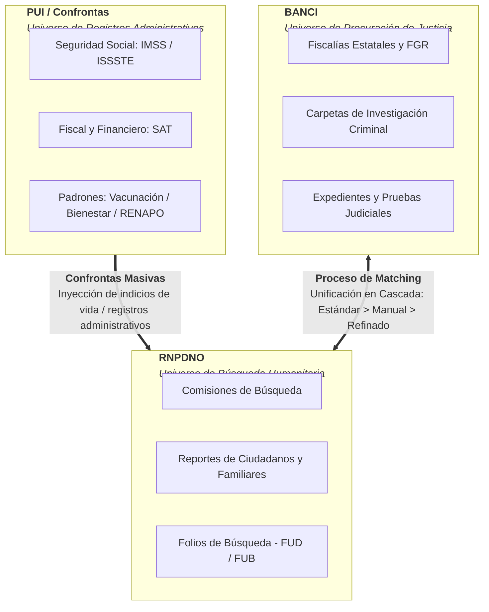

### A. RNPDNO (Registro Nacional de Personas Desaparecidas y No Localizadas)
Base de datos de registros de personas desaparecidas y no localizadas del país. No cuenta con Folio Único de Búsqueda (FUB). 

*   **Origen:** Es gestionado por la Comisión Nacional de Búsqueda (CNB) y las comisiones locales. Se alimenta de reportes ciudadanos, llamadas telefónicas, denuncias anónimas, portales web y reportes institucionales.

### B. BANCI (Banco Nacional de Carpetas de Investigación de Personas Desaparecidas y No Localizadas)
Base de datos de carpetas de investigación iniciadas por delitos de **desaparición forzada** y **desaparición cometida por particulares**.

*   **Origen:** Es consolidado por el Secretariado Ejecutivo y proviene directamente de las Fiscalías Generales de las entidades federativas y de la Fiscalía General de la República (FGR).

### C. PUI (Plataforma Única de Identidad)
Es una plataforma por medio de la cual es posible consultar si una persona reportada como desaparecida en RNPDNO ha generado registros en instituciones públicas o privadas en una fecha posterior a la fecha de desaparición. Dicha información puede ser utilizada como **indicios de vida**.

*   **Origen:** No llega como un solo archivo, sino como tres entregas que el proceso consolida en una sola marca por persona:
    1.  **Coincidencias administrativas.** El listado automático de eventos detectados en otras instituciones (IMSS, ISSSTE, SAT, RENAPO, SEP, Bienestar, INM, PEMEX, SRE, entre otras). Viene por evento: una misma persona puede aparecer decenas de veces.
    2.  **Confrontas manuales.** Las coincidencias que además fueron revisadas y validadas por una persona. Sirven para distinguir el hallazgo automático del hallazgo corroborado.
    3.  **Defunciones por institución.** Actas de defunción localizadas para personas que siguen registradas como desaparecidas.
*   **Advertencia de lectura:** las tres entregas terminan bajo la misma etiqueta de "registro administrativo", **incluidas las defunciones**. La marca dice que *existe una huella administrativa posterior a la desaparición*, no que la persona esté necesariamente con vida.
*   **Periodicidad:** la descarga del archivo de coincidencias es **manual**; no hay un proceso automático que la traiga. Cada corte del reporte depende de que alguien la haya colocado en su carpeta.

---

## 2. Entidades de Conteo: ¿Qué estamos contando realmente?

Uno de los errores analíticos más comunes es confundir la cantidad de *personas* con la cantidad de *registros* o *carpetas*. Para interpretar correctamente la información cualitativa detrás de los números, debemos comprender la jerarquía de las entidades:

1.  **La Persona (RNPDNO):** Registros de persona desaparecida. Idealmente se identifica por una única CURP válida o, en su defecto, por la combinación exacta de Nombre(s), Primer Apellido, Segundo Apellido y Fecha de Nacimiento.

2.  **La Carpeta de Investigación (Expediente en BANCI):** Es el archivo judicial del caso.
    *   **Cardinalidad compleja:** Una sola carpeta de investigación puede involucrar a *múltiples personas desaparecidas* (por ejemplo, un evento donde desaparecen tres amigos juntos). Por otro lado, una sola persona desaparecida puede tener *múltiples carpetas de investigación* abiertas si desapareció en un estado y se denunció tanto a nivel local como federal, o en múltiples entidades federativas.

---

## 3. El Análisis de la Intersección (La Sintonía de los Universos)

Al cruzar simétricamente el universo de búsqueda (RNPDNO) contra el de procuración de justicia (BANCI), surgen cuatro sub-universos que nos revelan el estado real de la coordinación institucional y la atención de los casos:

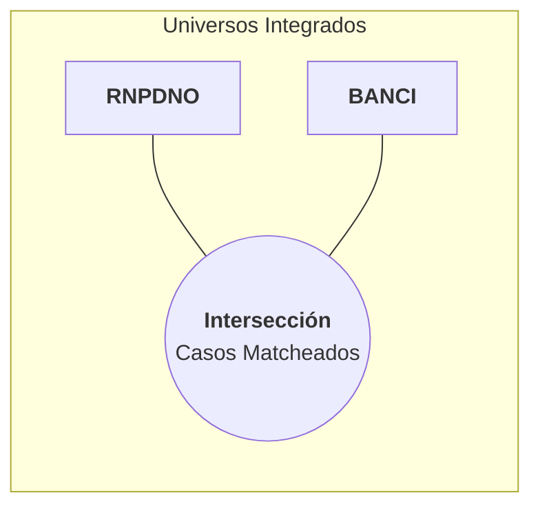

### Se identifican cuatro bases de interés:
*   **Registros de RNPDNO que no están en BANCI**
*   **Registros de BANCI que no están en RNPDNO**
*   **Registros de RNPDNO que sí están en BANCI**
*   **Registros de BANCI que sí están en RNPDNO**

Debido a que el match se hace tanto a nivel **persona** como a nivel **carpeta de investigación**, los registros de RNPDNO que están en BANCI tienen diferente cardinalidad de los registros de BANCI que están en RNPDNO.

---

## 4. Las Categorías Cualitativas de Análisis.


### A. Con Delito vs. Sin Delito
*   No todas las personas desaparecidas son víctimas de un delito.
    *   **Sin Delito.** Casos de ausencias voluntarias (disputas familiares, decisiones personales), desorientación (personas de la tercera edad, condiciones de salud mental) o accidentes, donde la persona simplemente no es localizada pero no hay indicios criminales.
    *   **Con Delito.** Casos donde se acredita o sospecha fuertemente la comisión de un ilícito como privación ilegal de la libertad, secuestro, trata de personas, o desaparición forzada.
*   **Importancia:** Permite al analista separar los fenómenos de movilidad social/familiar de la crisis de violencia criminal.

### B. Con Indicios de Vida vs. Sin Indicios de Vida.
*   Esta clasificación surge directamente del universo **PUI** y de los datos de **confrontas**.
    *   **Con Indicios.** La persona tiene registros administrativos recientes (por ejemplo, movimientos del IMSS o transacciones del SAT posteriores a su fecha reportada de desaparición). Esto sugiere con un alto grado de probabilidad que la persona está viva y activa en algún lugar del país.
    *   **Sin Indicios.** Casos donde no existe absolutamente ninguna huella en las bases de datos gubernamentales o del sector privado desde la fecha del hecho.
*   **Importancia:** Los casos sin indicios representan el núcleo más crítico e histórico de la desaparición, mientras que los con indicios representan la oportunidad más clara para una localización, por ejemplo, mediante visitas de campo focalizadas.
*   **Dos matices que cambian la interpretación de la cifra:**
    *   La categoría agrupa el hallazgo automático y el corroborado a mano: una vez consolidada, el indicador no distingue entre ambos.
    *   Las **defunciones** entran en "con indicios". El nombre de la categoría es histórico; lo que realmente mide es la existencia de un registro administrativo posterior a la desaparición.

### B bis. "Indicios de vida" en el seguimiento de campo

Hay un segundo uso del término, que conviene no mezclar con el anterior. Para el seguimiento operativo se trabaja con un **directorio congelado** de las personas que tenían indicio de vida a una fecha determinada, acompañado de domicilio y números de contacto, que se entregó a las entidades participantes en la **Búsqueda Generalizada**.

Ese directorio no se actualiza: es una fotografía. Lo que sí se actualiza es el estatus de cada persona en el RNPDNO, y de ahí sale la pregunta de gestión que reporta la lámina correspondiente: **de aquellos indicios entregados, ¿a cuántos les siguió efectivamente una localización registrada?** A esos casos se les llama indicios **formalizados**.

Dos criterios de lectura:

*   Una persona del directorio que hoy **no aparece** en el RNPDNO se cuenta como todavía desaparecida: no hay evidencia de localización, y descartarla inflaría artificialmente el porcentaje de éxito.
*   El indicador se acota a las entidades que participan en la Búsqueda Generalizada, y se reporta junto al total nacional para poder compararlos.

### C. Registros Sin Datos.
*   **Concepto:** Son registros con niveles críticos de omisión de datos: no cuentan con una CURP válida y tampoco registran actividad administrativa alguna en el PUI o en confrontas.


### D. Desaparición Forzada vs. Desaparición Cometida por Particulares.
Información de delito proporcionada por BANCI.

*   **Desaparición Forzada.** Involucra la participación directa, indirecta o la aquiescencia de servidores públicos o agentes del Estado.
*   **Cometida por Particulares.** Llevada a cabo por individuos o grupos delictivos organizados sin la participación del Estado.
*   **Importancia:** Permite medir la responsabilidad del Estado.

---

## 5. Ventanas Temporales y su Sentido Político-Administrativo

El pipeline segmenta la información en periodos de tiempo muy específicos. Estas fechas no son arbitrarias; responden a hitos políticos, administrativos e institucionales de suma trascendencia:

1.  **Periodo Histórico Completo.**
    *   *Lógica:* Muestra la magnitud acumulada de la crisis de desaparición en México a lo largo de las décadas.

2.  **Periodo Histórico Reciente (a partir de enero de 2006).**
    *   *Lógica:* Muestra la magnitud acumulada de la crisis de desaparición en México a lo largo de las décadas.

3.  **Cierre de la Administración Anterior (menor a octubre de 2024).**
    *   *Lógica:* Marca el fin de la administración federal anterior. Ayuda a entender el panorama antes de la administración anterior. 

4.  **Gestión de la Nueva Administración Federal (mayor a octubre de 2024).**
    *   *Lógica:* Esta ventana temporal es de vital importancia analítica para:
        *   Medir la velocidad de generación de nuevos casos de desaparición bajo las políticas actuales.
        *   Evaluar el desempeño y efectividad de las nuevas estrategias de búsqueda y localización implementadas en la gestión actual.
        *   Rendir cuentas de manera transparente sobre los resultados propios, evitando mezclar los datos actuales con el acumulado histórico de administraciones previas.
5.  **Periodo a partir de la creación de BANCI (mayor a agosto de 2025):**
    *   *Lógica:* En julio de 2025 se publicó una reforma en el Diario Oficial de la Federación (DOF) por la que, al momento de la presentación de una denuncia, se iniciaría una carpeta de investigación y se le asignaría la carpeta correspondiente.

---

## 6. Proceso Conceptual de Tratamiento de la Información

Para transformar los datos crudos en inteligencia accionable, la información fluye a través de seis etapas lógicas consecutivas:

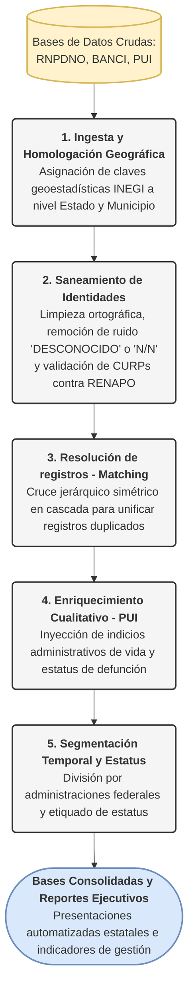

1.  **Ingesta y Homologación Geográfica:** Se leen las fuentes crudas y se asocian las entidades y municipios reportados con el catálogo nacional del INEGI, garantizando que no haya discrepancias por variaciones de nombres de municipios o estados.
2.  **Saneamiento de Identidades:** Se limpian los nombres (se eliminan acentos, abreviaturas espurias y espacios duplicados) y se remueve el "ruido" de registros mal capturados (ej. registros nombrados como "DESCONOCIDO", "N/N", "ALIA", etc.). Asimismo, se evalúa si las CURPs registradas cumplen con la validación de estructura de RENAPO.
3.  **Resolución de registros (Matching / Cruzamiento):** Es el corazón del procesamiento. Determina si el registro A y el registro B pertenecen a la misma persona física, unificando el universo de búsqueda y el judicial.
4.  **Enriquecimiento Cualitativo (PUI):** Se inyectan las marcas de "indicios de vida" o "registros administrativos" a los expedientes vigentes, lo que refina el entendimiento cualitativo del estatus de la persona. Esta etapa consolida por sí sola las tres entregas de la PUI —coincidencias automáticas, confrontas manuales y defunciones—, descarta las coincidencias que no corresponden a ningún expediente del RNPDNO y conserva únicamente los casos que siguen vigentes como desaparecidos o pendientes.
5.  **Segmentación Temporal y Clasificación:** Se aplican las etiquetas cualitativas descritas en la sección 4 y se segmentan las bases según las ventanas temporales de gestión gubernamental.
6.  **Generación de Entregables Ejecutivos:** Los números agregados se convierten en indicadores clave y se inyectan directamente en gráficos interactivos y presentaciones de PowerPoint (PPTX) personalizadas para cada uno de los 32 estados de la República, permitiendo que los tomadores de decisiones entiendan de un vistazo el panorama cualitativo de su región.

---

## 7. Lógica Detallada del Proceso de Matching (Cruce de Identidades)

El *matching* responde a una pregunta fundamental: **¿el expediente iniciado por una fiscalía en BANCI y el reporte registrado en la comisión de búsqueda en RNPDNO corresponden a la misma persona?** Cuando se confirma la identidad, ambos registros se unifican para evitar duplicidades en el conteo nacional y enriquecer la información disponible de cada caso.

El sistema contempla **tres métodos de matching** que se ejecutan de manera secuencial y complementaria mediante un **proceso de cascada por descarte**:

| Criterio | Fundamento | Naturaleza | Prioridad | Aporta hoy |
| :--- | :--- | :--- | :--- | ---: |
| **Manual** | Pares que una persona del SESNSP revisó y validó uno por uno. | Documental | **1ª (máxima)** | 561 |
| **Estándar** | Identificadores duros oficiales (Folio RNPDNO, CURP, nombre exacto corroborado). | Determinista y conservador | 2ª | 6,082 |
| **Refinado** | Números de carpeta normalizados, similitud de nombres y evidencia contextual. | Heurístico con guardianes | 3ª | 5,243 |

De 34,777 carpetas de BANCI, **11,886 encuentran a su persona** en el RNPDNO y 22,891
quedan sin vínculo.

---

### 7.1. Proceso de Cascada (Fallback Secuencial)

Conviene precisar algo que suele malentenderse: **los tres métodos se ejecutan siempre y
sobre el universo completo**. No se van pasando los sobrantes. Cada uno emite su veredicto
para cada expediente de BANCI, y sólo al final se decide quién se queda con él.

La cascada es, por tanto, un **orden de prioridad**, no un orden de ejecución:

1. **Prioridad 1 · Manual.** Si una persona revisó ese par y lo validó, ese vínculo manda.
2. **Prioridad 2 · Estándar.** Si no hay revisión humana, gobierna el identificador duro.
3. **Prioridad 3 · Refinado.** Si ninguno de los anteriores resolvió, entra la evidencia
   reconstruida a partir del número de carpeta.
4. **Sin match.** El expediente permanece sólo en el universo judicial de BANCI.

**¿Por qué el criterio humano va por delante del algoritmo?** Porque a veces señalan a
personas **distintas** —ocurre en 78 expedientes—, y en esos casos la revisión documental
es mejor evidencia. Cuando el estándar iba al frente, se perdían 54 validaciones humanas
sin dejar rastro: el algoritmo pisaba al revisor.

Antes de decidir el ganador, cada método pasa por un **control de calidad propio** (§7.4):
se anulan sus vínculos inválidos. Así, si el método preferente queda descalificado en un
caso concreto, **cede el turno** al siguiente en vez de dejar el expediente sin match.

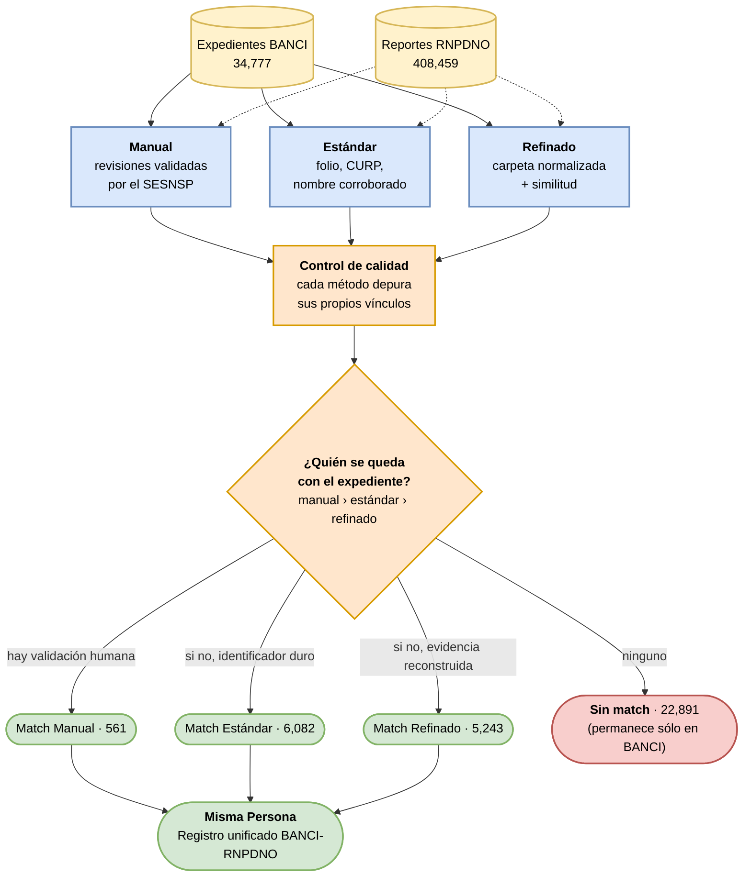

---

### 7.2. Proceso de Matching Estándar (Tradicional)

El **criterio estándar** es la columna vertebral del cruce entre **BANCI** y **RNPDNO**. Su principio rector es **estrictamente conservador**: *es preferible no unificar dos registros con información dudosa antes que unir por error a dos personas distintas (falsos positivos)*.

Funciona a través de un **embudo jerárquico de tres niveles de certeza decreciente**. Todo expediente de BANCI que encuentra coincidencia en un nivel queda vinculado con su reporte correspondiente de RNPDNO y no continúa descendiendo en el embudo.

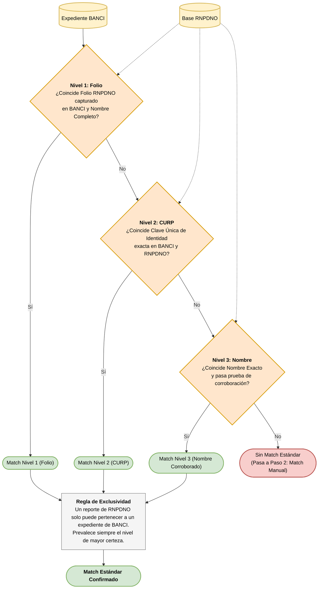

#### 7.2.1. Nivel 1: Vinculación por Folio de Búsqueda
Es el nivel de máxima certeza. Ocurre cuando el expediente de **BANCI** ya cuenta con el identificador del reporte de búsqueda de **RNPDNO** asignado previamente.
*   **Mecanismo:** Se verifica la igualdad exacta del folio de búsqueda en RNPDNO.
*   **Regla de seguridad:** Para evitar falsos positivos causados por errores tipográficos al capturar el folio en BANCI, se exige adicionalmente que el nombre de la persona coincida de manera exacta.

#### 7.2.2. Nivel 2: Vinculación por Clave Única de Identidad (CURP)
Aplica para aquellos expedientes de **BANCI** que no se vincularon por folio y que cuentan con una clave oficial de identidad con estructura válida.
*   **Mecanismo:** Se realiza una comparación de igualdad exacta de la CURP entre **BANCI** y **RNPDNO**.
*   **Regla de unicidad:** Se procesa de forma unívoca para evitar que duplicados internos en una misma fuente distorsionen las parejas generadas.

#### 7.2.3. Nivel 3: Vinculación por Nombre con Corroboración Contextual
Es el nivel más sensible del proceso, ya que **el nombre de pila y apellidos por sí solos no garantizan la identidad debido a la existencia de homónimos**. Por ello, el nombre abre posibles candidatos, pero el vínculo solo se confirma si se aprueba una prueba de corroboración:

1.  **Comparación Nominal Exacta:** Se identifican candidatos entre **BANCI** y **RNPDNO** con nombres y apellidos exactamente idénticos (no se permiten aproximaciones ni similitudes parciales en este criterio).
2.  **Prueba de Corroboración:**
    *   **Si ambas bases cuentan con fecha de nacimiento:** Si las fechas coinciden (con tolerancia de pocos días por captura), el match es aceptado siempre que las fechas de desaparición sean consistentes. **Si las fechas de nacimiento difieren, el candidato se rechaza de forma terminante**, evitando homónimos (dos personas pueden llamarse igual, pero no nacer en fechas distintas).
    *   **Si alguna base carece de fecha de nacimiento:** Se exige como prueba sustituta que los hechos hayan ocurrido en la misma entidad federativa y que las fechas de desaparición se encuentren dentro de un margen temporal admisible (hasta un año).
    *   **En registros de personas ya localizadas:** Las tolerancias temporales son mucho más estrictas (margen máximo de un mes) para evitar alterar los conteos de localización indebidamente.

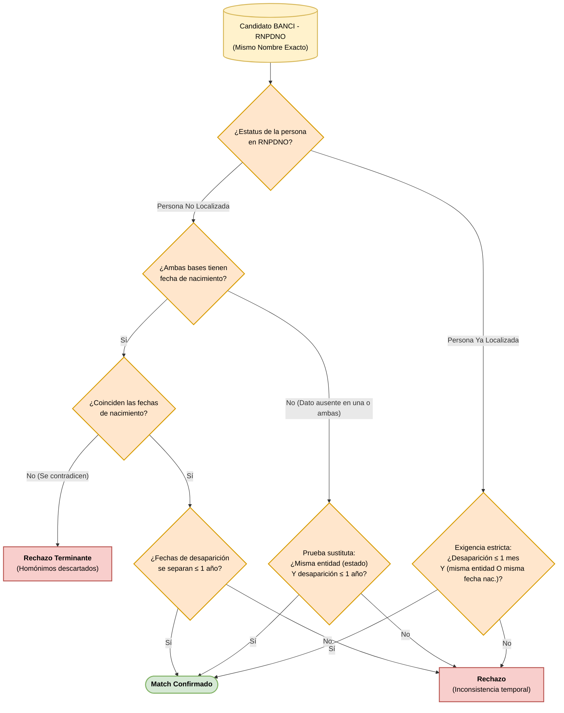

#### 7.2.4. Reglas de Exclusividad y Trazabilidad
*   **Exclusividad (1 a 1):** Un reporte de **RNPDNO** no puede asignarse a más de un expediente judicial de **BANCI**. Si dos expedientes reclaman el mismo reporte, se preserva el vínculo originado en el nivel de mayor jerarquía (Folio > CURP > Nombre).
*   **Trazabilidad:** Cada coincidencia confirmada almacena metadatos explicativos: el nivel que originó el vínculo, las variables coincidentes y la diferencia en días entre las fechas reportadas, permitiendo auditorías puntuales de cada caso.

---

### 7.3. Proceso de Matching Manual (Validación Humana)

Este criterio **no busca nada**: transcribe decisiones que ya tomó una persona. Es el de
mayor prioridad porque un par revisado expediente por expediente es mejor evidencia que
cualquier coincidencia automática.

#### 7.3.1. De dónde salen esos vínculos

Del **Secretariado Ejecutivo (SESNSP)**, en dos revisiones documentales: una sobre las
fechas de los hechos y otra sobre los casos que el algoritmo dejó en zona dudosa. Cada
renglón es un dictamen de una persona sobre un par concreto.

**Sólo el veredicto afirmativo crea vínculo.** Un rechazo también cuenta, pero al revés:
significa que ese par **fue examinado y descartado**, así que el caso se cierra y se retira
de la búsqueda automática, sin asignar ninguna pareja. Es información valiosa: evita que el
sistema vuelva a proponer algo que una persona ya desechó.

#### 7.3.2. Una precisión: el folio pre-asignado NO cuenta

Algunos expedientes de BANCI ya traen escrito un folio del RNPDNO, asignado río arriba.
**Ese dato no se acepta como vínculo.** Aceptarlo daría por unificados dos registros sin
comparar un solo rasgo de identidad: ni nombre, ni CURP, ni fecha de nacimiento, ni carpeta.
Lo único comprobable es que el folio exista, y eso no es evidencia de que se trate de la
misma persona.

Además hacía daño: al ocupar el expediente, tapaba vínculos mejor sustentados, incluidos
pares que el propio SESNSP ya había confirmado a mano.

Desactivarlo no tira el dato. El folio **sigue siendo una pista** para el método refinado,
que lo usa para proponer candidatos; pero allí tiene que superar los controles de identidad
como cualquier otra hipótesis.

#### 7.3.3. Una carpeta, varias personas

Una carpeta de investigación puede tener **varias víctimas**, y una revisión puede haber
validado varios folios para ese mismo expediente. Como cada expediente sólo puede apuntar a
un folio, los demás se conservan aparte y se reclaman **desde el lado del RNPDNO**, donde
cada folio es una persona distinta con vínculo confirmado. De lo contrario se perderían
personas por una limitación del formato, no por falta de evidencia.

---

### 7.4. Proceso de Matching Refinado (Reconstrucción por Carpeta)

Parte de una observación práctica: **el número de carpeta de investigación identifica muy
bien, pero se escribe de mil formas distintas**. La misma carpeta aparece con guiones o
diagonales, con ceros de relleno, con el año delante o detrás, con el código de la oficina
intercalado. Un cruce exacto no encuentra nada; normalizando, aparecen coincidencias reales.

Es el método de mayor alcance —aporta 5,243 vínculos— y por eso es también el que más
controles lleva encima.

#### 7.4.1. Qué se le quita al folio antes de compararlo

Se descarta todo lo que **no distingue un caso de otro**: separadores, ceros a la izquierda,
el año y los **códigos de oficina** — números que aparecen en muchas carpetas distintas y
que por tanto identifican a la unidad administrativa, no al expediente. Lo que queda es el
consecutivo, que es lo que de verdad singulariza.

#### 7.4.2. Cómo se proponen candidatos

Comparar cada expediente contra los 408,459 reportes es inviable. El sistema agrupa por seis
señales y sólo compara dentro de cada grupo: folio de búsqueda, CURP completa, **los diez
primeros caracteres de la CURP** (que codifican nombre y fecha de nacimiento), consecutivo
de carpeta, primer apellido y fecha de nacimiento. Compartir cualquiera de ellas basta para
ser candidato.

Ser candidato **no es ser match**: sólo significa "merece que lo revisemos".

#### 7.4.3. Los guardianes anti-homónimo

Aquí está el corazón del método, y su diferencia con un simple parecido de texto: **que el
folio coincida no basta para afirmar que es la misma persona.**

*   **Guardián de identidad.** Si el nombre no es idéntico, o si las fechas de desaparición
    se separan más de un año, se exige un **ancla dura**: misma fecha de nacimiento, o los
    diez primeros caracteres de la CURP iguales. Sin esa ancla, no hay vínculo.
*   **Excepción por carpeta colectiva.** Cuando un expediente agrupa a varias víctimas, la
    fecha es genérica y no sirve como prueba; el guardián lo tiene en cuenta y no la exige.
*   **Guardián de "otra carpeta".** Para afirmar que dos expedientes distintos son la misma
    persona sin CURP completa ni folio, se pide más: si las entidades se contradicen, hacen
    falta a la vez fecha de nacimiento coincidente **y** nombre completo idéntico.

#### 7.4.4. Tres desenlaces posibles

| Resultado | Qué significa |
| :--- | :--- |
| **Definitivo** | El folio coincide y la identidad está anclada. Se acepta. |
| **Parcial** | El folio coincide salvo algún carácter, con nombre fuerte y ancla. Se acepta, marcado como tal. |
| **Revisión manual** | Hay indicios, pero **no** evidencia suficiente. **No se acepta.** |

> La categoría *revisión manual* es deliberada y merece subrayarse: son los casos que el
> sistema **no se atreve a resolver solo**. No cuentan como vínculo ni entran en ninguna
> cifra; quedan a la espera de que una persona los dictamine. Es la puerta por la que estos
> casos pueden convertirse mañana en matches manuales.

---

### 7.5. Control de Calidad y Reglas de Exclusión

Antes de decidir qué método se queda con cada expediente, **cada método depura sus propios
vínculos**. Dos controles operan hoy:

*   **Los candidatos a revisión no cuentan.** Lo descrito en 7.4.4: sin validación humana,
    fuera.
*   **Coherencia temporal y de estatus.** Se anula el vínculo si las fechas de desaparición
    se separan más de la tolerancia admitida, o si el folio del RNPDNO corresponde a una
    persona ya **localizada** (en cuyo caso no debería estar en el universo de búsqueda).

**Por qué el control va por método y no sobre el ganador.** Si se aplicara al final, sobre
el vínculo ya elegido, anularlo dejaría el expediente **sin match aunque otro método tuviera
uno válido esperando detrás**. Un vínculo anulado no debe matar el caso: debe ceder el turno.

#### Exclusividad y trazabilidad

*   **Del lado del RNPDNO se cuentan personas.** Una misma persona puede aparecer en varias
    carpetas, y distintos métodos pueden alcanzarla por vías distintas. En ese caso se
    registran **todos** los métodos que la sostienen, en vez de quedarse con el de la primera
    carpeta que aparezca en el archivo: ese desempate dependía del orden del fichero, no de
    un criterio, y movía la atribución de un corte a otro sin que nada hubiera cambiado.
*   **Trazabilidad.** Cada vínculo guarda por qué existe: el método que lo originó, las
    variables que coincidieron y la diferencia en días entre las fechas. Cualquier caso
    puede auditarse uno por uno.

---

# 1. Fuentes de Información y Catálogos

Insumos que consume el pipeline. Todos viven bajo `input/`, que está en `.gitignore`: son
archivos que llegan de fuera y **no se versionan**.

## Fuentes principales

### RNPDNO — Registro Nacional de Personas Desaparecidas y No Localizadas

```
input/rnpdno/reporte_personas_completo_DDMMAAAA.parquet   ← el que baja el modo drive
input/rnpdno/reporte_personas_DDMMAAAA.xlsx               ← el Excel de tres hojas (modo local)
```

El reporte de búsqueda que levantan las comisiones. Es el universo de **personas**
(408,459 registros en el corte vigente). Lo consume `1_Procesamiento_ETL_RNPDNO.ipynb`,
que lo deja en `output/Resultado_1_Procesamiento_ETL_RNPDNO.parquet`.

En modo `local` el archivo concreto se fija en `config.RNPDNO_LOCAL_FILE` — control
estricto, sin búsqueda por patrón, para que una corrida sea reproducible. En modo `drive`
el notebook baja el corte del día y lee el más reciente de `input/rnpdno/`.

El notebook acepta las dos presentaciones del RNPDNO y reconoce cuál es por la extensión
(`config.formato_rnpdno`):

| Formato | Cómo salen las tres hojas |
|---|---|
| Parquet (`.parquet`) | una tabla con las hojas apiladas; se reconstruyen con `estatus` + `conidentidad` |
| Excel (`.xlsx`) | se leen tal cual las hojas `ACTUALIZACION_PENDIENTE`, `LOCALIZADAS` y `DESAPARECIDAS` |

Los dos dejan la misma tabla para el resto del flujo (`src/lectura_rnpdno.py`): el Excel se
lee como texto, igual que el Parquet, y dos columnas se renombran a como vienen en el Parquet
(`curp_victima` → `curp_vic`, `expediente` → `Expedientes`; ver
`config.RNPDNO_EXCEL_A_PARQUET`). El mismo renombre se aplica al Parquet sin distinguir
mayúsculas, porque según el corte ha traído `expediente`, `Expediente` o `Expedientes`; si
no, la copia saldría como `expediente_rnpdno` y el notebook 1 se detendría al exportar
(`KeyError: ['expedientes_rnpdno'] not in index`). Una diferencia de contenido, no de lectura: el
`Expedientes` del Parquet puede juntar varias carpetas (`… @| …`) y viene lleno más seguido
que el `expediente` del Excel, que trae una sola.

### BANCI — Banco Nacional de Carpetas de Investigación

```
input/banci/
```

Las carpetas de investigación abiertas por las fiscalías. Es el universo **judicial**
(34,777 registros). Lo consume `2_Procesamiento_ETL_BANCI.ipynb` → `output/Resultado_2_Procesamiento_ETL_BANCI.parquet`.

### PUI — Plataforma Única de Identidad

Coincidencias con registros administrativos de otras instituciones (IMSS, SAT, RENAPO,
SEBIEN…) posteriores a la fecha de desaparición: son los **indicios de vida**. Son tres
archivos, no uno:

| Constante en `config.py` | Objeto en el script de R | Qué aporta |
|---|---|---|
| `PUI_COINCIDENCIAS_FILE` | `coincidencias_admin_con_inactivas` | un renglón por evento detectado en otra institución (CSV, 16 columnas exigidas) |
| `PUI_REGISTROS_FILE` | `registros` (confrontas manuales) | las confrontas que se revisaron a mano (Excel, 5 columnas) |
| `PUI_DEFUNCIONES_FILE` | `defunciones_df` | actas de defunción por institución (Excel, 2 columnas) |

Los tres los consume `3_Procesamiento_ETL_PUI.ipynb` →
`output/Resultado_3_Procesamiento_ETL_PUI.parquet`, que es a lo que apunta
`config.CONFRONTAS_FILE`. Ese cuaderno necesita además el Parquet del notebook 1 como
`comprimido`, del que toma `clasificacion_des`, `fecha_hechos_modificada` y la **CURP
imputada** (`curp_vic_derivada_rnpdno`): es la única dependencia entre notebooks de ETL.

El CSV de coincidencias llega comprimido desde una carpeta de Google Drive, bajo el patrón
`reporte_coincidencias_validas_YYYY-MM-DD.zip`. En modo `drive` —el de por omisión— el propio
cuaderno lo baja y lo descomprime en `input/pui/`; en modo `local` se lee el archivo que
declare `config.PUI_LOCAL_FILE`, sin tocar Drive. Los dos modos son excluyentes y se eligen
con `config.MODO_INSUMOS`; el detalle está en [9_credenciales_google_drive.md](docs/9_credenciales_google_drive.md).
La fecha del nombre es también la que etiqueta la corrida, salvo que `config.PUI_FECHA_CORTE`
la fije a mano.

> ⚠️ **No confundir** `registros_con_pui_DDMMYYYY.xlsx` (insumo, 5 columnas) con
> `registros_con_pui_activos_*.xlsx`, que son salidas antiguas del flujo en R.

El recorrido completo —qué hace el cuaderno con cada archivo y cómo termina siendo la
bandera `cind`— está en [8. Indicios de vida](docs/8_indicios_de_vida.md).

### Revisiones del SESNSP *(opcionales)*

```
input/input_reporte_diario/matches_verif_fecha_hechos_SESNSP.xlsx
input/input_reporte_diario/revision_manual_score_SESNSP.xlsx
```

Pares BANCI–RNPDNO que una persona revisó y dictaminó. Alimentan el motor **manual** y los
descuentos del **refinado** (ver [3. Metodología de Matching](docs/3_metodologia_de_matching.md)).
Si no existen, el pipeline no falla: el descuento se omite y el motor manual no aporta.

## Todos los insumos se declaran en `config.py`

**No hay autodetección.** Ningún notebook busca "el archivo más reciente" ni resuelve rutas
por patrón: cada insumo es una constante con el archivo exacto, igual que
`RNPDNO_LOCAL_FILE` y `BANCI_FILE`. Copiar un archivo nuevo a `input/` no cambia lo que
lee el pipeline mientras no se edite `config.py`.

Cada insumo tabular lleva además su **mapeo de columnas exigidas**, con la misma estructura
que `RNPDNO_COLUMN_MAPPING` y `BANCI_COLUMN_MAPPING` — `'nombre_interno': ['alias', ...]`:

```python
PUI_REGISTROS_COLUMN_MAPPING = {
    'fub':                            ['fub'],
    'curp_victima':                   ['curp_victima', 'curp'],
    'indicadora_indicio_de_vida':     ['indicadora_indicio_de_vida'],
    'institucion_indicadora_de_vida': ['institucion_indicadora_de_vida'],
    'numero_instituciones':           ['numero_instituciones'],
}
```

`src/validacion.py` es lo que lo hace cumplir. Si falta **el archivo, la hoja o una
columna**, el proceso se detiene con un error que dice qué falta y qué hay en su lugar:

```
❌ A defunciones por institución le faltan 1 columna(s) exigida(s).
   Archivo: input/pui/tabla_defunciones_por_institucion_05052026.xlsx
     - tipo_defuncion: se buscó ['tipo_defuncion', 'tipo_def']
   El archivo trae estas columnas (2):
     ['fub', 'tipo_defuncion_institucion']
   Si el archivo cambió de nombres, actualiza el mapeo en config.py.
```

El mapeo fija el **mínimo exigido**, no el máximo: una columna extra en el archivo no
estorba. Y el DataFrame vuelve con las columnas renombradas al nombre interno, de modo que
el cuaderno no tiene que saber qué alias traía la entrega de ese mes.

### Al cambiar de BANCI

Las columnas no bastan: un archivo equivocado —más viejo, recortado, de otra ventana de
fechas— trae las mismas columnas y cambiaría las cifras sin que nadie lo notara. Por eso el
notebook 2 revisa además el **contenido** de la entrega y lo compara con la última que
procesó ([`src/validacion_banci.py`](src/validacion_banci.py)).

La **fecha de corte** de una entrega es su fecha de inicio (`FHA_DE_INI`) más reciente, que
siempre cae en el último día del mes que cubre. Con ella se distingue una entrega de otra
fecha de una versión corregida del mismo corte. Una fecha de inicio posterior al día en que
se procesa es un error de captura y no cuenta: la entrega de agosto de 2026 trajo un 5 de
octubre, que habría hecho parecer más vieja a la de septiembre.

| Revisión | Detiene | Avisa |
|---|---|---|
| Registros | el archivo viene vacío; **de un corte a otro la base no crece** | crece más de 50 %; mismo corte con distinto número de registros (¿versión corregida?) |
| Fecha de corte | es **anterior** a la de la última entrega procesada; no se puede leer ninguna | hay más de un mes entre cortes (¿falta una entrega?); cambia la fecha de inicio más antigua (otra ventana) |
| Entidades | alguna **desaparece** (tenía 10 o más registros); un valor sin clave INEGI | alguna baja más de 5 % y al menos 10 registros |
| Estatus | un valor distinto de `LOCALIZADA` / `NO LOCALIZADA`, o vacío: se contaría en silencio como desaparecido | — |
| `LLAVE` | más de 5 % vacía | alguna vacía |
| Otros | — | categorías de sexo nuevas; fechas de inicio posteriores a hoy; fechas de hechos posteriores al corte (el notebook les resta años) |

La entrega anterior no se vuelve a leer: el notebook guarda un resumen de cada entrega
(registros, corte, conteo por entidad) en los metadatos de `Resultado_2_…parquet`, y la
siguiente corrida compara contra él. **Si se borra `output/`, se pierde esa referencia** y la
entrega siguiente se procesa sin compararse (el notebook lo dice: "sin entrega anterior"). `LLAVE` no se compara entre entregas porque el
Secretariado la regenera cada vez, y las entidades se comparan por clave INEGI porque su
nombre cambia de una entrega a otra ("MÉXICO", "ESTADO DE MÉXICO", "MEXICO").

Los umbrales se calibraron con las siete entregas de enero a julio de 2026: el cambio real
de junio a julio pasa sin observaciones; la entrega de febrero, que llegó con el 89 % de
`LLAVE` vacía, se habría detenido; y la de mayo, que cambió la ventana de fechas y llegó
sin la de abril antes, pasa con cuatro avisos.

Si la entrega es correcta y aun así no cumple (por ejemplo, el Secretariado depuró
registros), `config.VALIDACION_BANCI_ESTRICTA = False` la deja pasar con los errores
convertidos en avisos. Hay que volver a ponerlo en `True` después.

## Catálogos complementarios

| Ruta | Uso |
|---|---|
| `input/catalogos_inegi/catalogo_municipios_inegi.csv` | traduce `CVE_ENT` + `CVE_MUN` → `NOM_MUN`. Sin él, el motor refinado no puede usar el municipio: compara **nombres**, no claves |
| `input/cruces_curp/` | cruces determinísticos por CURP; alimenta la **imputación** de CURP del ETL (`src.cleaning.imputar_curp`) |
| `input/datos_marzo/` | corte congelado del 25/03/2026, un Excel por marcador. **No pasa por el pipeline**: se cuenta aparte y se resta (`config.CORTE_25MAR26_FILES`) |
| `input/datos_julio/` | corte congelado del 01/07/2026, mismas tres rebanadas y mismo uso que el de marzo; trae el identificador como `fub_rnpdno` (`config.CORTE_01JUL26_FILES`) |
| `input/plantillas/` | plantillas PPTX con los marcadores `{{...}}`; se declaran en `PLANTILLA_REPORTE_DIARIO` y `PLANTILLA_REPORTE_ESTATAL` |

## Insumos externos que no pasan por el pipeline

Dos archivos alimentan láminas del reporte diario sin entrar al matching ni a las banderas:
su población no sale del RNPDNO ni de BANCI, y lo único que se le pide al universo es el
**estatus vigente de cada `fub`**.

| Ruta y constante | Alimenta | Detalle |
|---|---|---|
| `input/domicilios_y_numeros_contacto/base_combinada_con_domicilio_y_numeros_de_contacto_24062026.xlsx` — `DIRECTORIO_INDICIOS_FILE` | lámina 12: indicios ya formalizados como localización (`*_loc_fmz`) | corte congelado al 24/06/2026; de sus 37 columnas sólo se usan `FUB` y `Estado de Desaparición`. Ver [8.6](docs/8_indicios_de_vida.md) |
| `input/mj/MJ y RIPS (1062).xlsx` — `MJ_RIPS_FILE` | última lámina: detenciones penitenciarias (`reg_mr_*`) | dos hojas, `MJ UNICOS` y `RIPS UNICOS`, que se concatenan sin deduplicar |

## Salidas del ETL

Los tres notebooks de ETL dejan un Parquet de nombre fijo en `output/`. Son la entrada de
la CAPA A del pipeline:

| Constante | Archivo |
|---|---|
| `ETL_RNPDNO_OUTPUT_FILE` | `output/Resultado_1_Procesamiento_ETL_RNPDNO.parquet` |
| `ETL_BANCI_OUTPUT_FILE` | `output/Resultado_2_Procesamiento_ETL_BANCI.parquet` |
| `ETL_PUI_OUTPUT_FILE` | `output/Resultado_3_Procesamiento_ETL_PUI.parquet` (= `CONFRONTAS_FILE`) |

Las presentaciones también: `PPT_DIARIO_FILE` y `PPT_ESTATAL_DIR`.

---

# 2. Flujo y Pipeline de Datos

El proyecto es híbrido: los módulos de `src/` implementan la lógica y los notebooks la
**orquestan y declaran qué se quiere**. Un notebook no implementa pipeline; pide rebanadas.

## Diagrama general

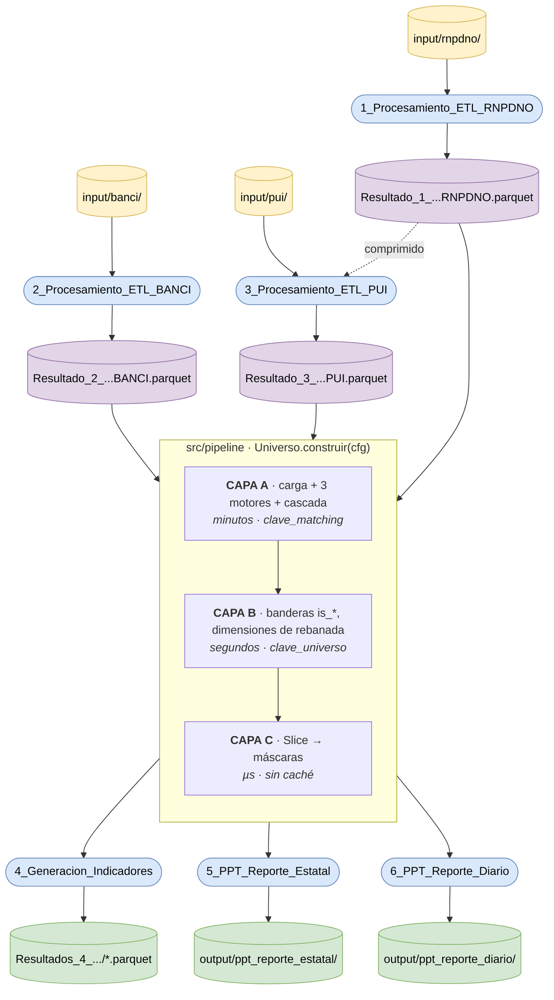

## Los notebooks

| Notebook | Qué hace | Salida |
|---|---|---|
| **1_Procesamiento_ETL_RNPDNO** | limpia el RNPDNO, deriva fechas, CURP (con imputación), nombre y clasificación. Exporta exactamente `config.RNPDNO_OUTPUT_COLUMNS` | `Resultado_1_*.parquet` |
| **2_Procesamiento_ETL_BANCI** | limpia BANCI, repara nombres, deriva folios y municipio. Exporta exactamente `config.BANCI_OUTPUT_COLUMNS` | `Resultado_2_*.parquet` |
| **3_Procesamiento_ETL_PUI** | cruza coincidencias de la PUI con confrontas manuales y defunciones; produce `indicadora_indicio_de_vida_derivada_pui` ([8. Indicios de vida](docs/8_indicios_de_vida.md)). Exporta con `config.PUI_NOMBRES_EXPORTADOS` | `Resultado_3_*.parquet` |
| **4_Generacion_Indicadores** | construye y cachea el universo; materializa rebanadas a Parquet | `Resultados_4_.../` |
| **5_PPT_Reporte_Estatal** | 32 presentaciones estatales desde una sola corrida | `output/ppt_reporte_estatal/` |
| **6_PPT_Reporte_Diario** | reporte diario nacional | `output/ppt_reporte_diario/` |
| **7_Exportacion_Bases_Con_Llave** | devuelve BANCI y RNPDNO idénticos a su origen, con la llave de cruce y la procedencia de cada match; arma la base de revisión de fecha de hechos para el Secretariado | `output/bases_con_llave/<perfil>/`, `output/revision_sesnsp/<perfil>/` |
| **8_Revision_Secretariado** | con el perfil `revision_secretariado` (flujo R → normalizar_folios), arma los candidatos a revisión manual y la verificación de fecha para el Secretariado | `output/revision_sesnsp/revision_secretariado/` |

Los notebooks 1, 2 y 3 son independientes entre sí, salvo que **el 3 necesita el Parquet
del 1** (usa el RNPDNO como `comprimido` para resolver clasificación, fecha de hechos y
CURP). Los notebooks 4, 5, 6 y 7 comparten la capa A: la primera corrida paga el matching y
las siguientes leen el caché, mientras siga valiendo (ver [6. Arquitectura](docs/6_arquitectura.md#qué-invalida-el-caché)).

> El Parquet del 3 no es una fuente más que se cruce con las otras dos: entra por
> `config.CONFRONTAS_FILE` y su única aportación al universo es la columna
> `indicadora_indicio_de_vida_derivada_pui`, que la CAPA B convierte en la bandera `is_cind_derivada_pui` (su negación, `sind`, la resuelve el rebanado). El
> recorrido completo está en [8. Indicios de vida](docs/8_indicios_de_vida.md).

> El **7 no vuelve a correr los motores para exportar**: toma la capa A del universo que
> construye (del caché, si sigue valiendo) con `exportar_bases_con_llave(u)` y la vuelca a
> los archivos de origen. Con el mismo perfil y los mismos insumos, la llave exportada y los indicadores
> salen del mismo cruce; la columna `version_match` de cada fila lleva la `clave_matching`
> para poder comprobarlo desde el propio Excel.

## Las tres capas

El pipeline está partido según **cuánto cuesta cada paso y de qué configuración depende**.
Esa separación define las llaves de caché:

| Capa | Qué hace | Costo | Llave | La invalida |
|---|---|---|---|---|
| **A · Matching** | carga fuentes, 3 motores, reglas, cascada | minutos | `clave_matching` | cualquier campo del perfil de la capa A (con el rango de `periodo_match`), `config.py`, el código de los motores, cualquier insumo leído |
| **B · Derivadas** | banderas `is_*`, dimensiones de rebanada, curación | segundos | `clave_universo` | lo anterior + modalidad de carpeta + código de las derivadas |
| **C · Rebanadas** | máscaras por base/período/estatus/subfiltro/entidad | µs | — | nada |

**Cambiar período, estatus, subfiltro o entidad no invalida ningún caché.** Por eso los
notebooks 5 y 6, con configuraciones distintas, comparten una sola corrida de motores.

## Cómo se pide un indicador

Un notebook declara rebanadas y pide sus conteos. No calcula nada por su cuenta:

```python
cfg = Settings.desde_perfil("reporte_diario")
u   = Universo.construir(cfg)

CONTEOS = [
    Slice("rn", "01oct24-max", estatus="des"),
    Slice("rn-no-ba", "01ago25-max", estatus="des", subfiltro="sfval_sfvac"),
]
vars_ppt = u.indicadores(CONTEOS, porcentajes=PORCENTAJES)
```

Cada `Slice` genera su nombre canónico (`reg_rn-no-ba_01ago25-max_des_sfval_sfvac`), que es
el marcador `{{...}}` de la plantilla PPTX. La nomenclatura completa está en
[`catalogo_abreviaturas.md`](catalogo_abreviaturas.md).

## Relación con el código fuente

| Módulo | Papel |
|---|---|
| `src/settings.py` | `Settings`: configuración inmutable y llaves de caché |
| `src/slices.py` | `Slice`: rebanadas declarativas, nombre canónico ↔ objeto |
| `src/pipeline/carga.py` | CAPA A · lee los tres Parquet e integra confrontas |
| `src/pipeline/motores.py` | CAPA A · orquesta los tres motores, consolida y deja sólo las columnas que se leen después |
| `src/pipeline/reglas.py` | reglas de invalidación registradas por nombre |
| `src/pipeline/derivadas.py` | CAPA B · banderas `is_*` y columnas derivadas |
| `src/pipeline/universo.py` | orquestador y caché de dos niveles |
| `src/pipeline/huella.py` | qué decide si un caché sigue valiendo: config, código e insumos leídos |
| `src/matching_r.py` | motor **estándar** |
| `src/matching_engine.py` | motor **manual**, cascada y auditoría |
| `src/motor_refinado.py` | motor **refinado** |
| `src/cleaning.py` | limpieza de cadenas, fechas, CURP y clasificación de carpeta |
| `src/validacion.py` | insumos: exige archivo, hoja y columnas |
| `src/validacion_banci.py` | BANCI: revisa el contenido de la entrega y la compara con la anterior |
| `src/ppt_engine.py` | sustitución de textos e imágenes en PPTX |
| `src/utils.py` | I/O, agregaciones, deltas contra el corte de marzo y el cruce externo de MJ y RIPS (`cruzar_mj_rips`) |
| `src/directorio_indicios.py` | indicios de vida ya formalizados (`indicios_formalizados`); fuera de la huella del caché, así que editarlo no repite el matching |
| `1_funciones/` | graficación (barras, líneas, treemap, heatmap) |

## Fuera de Jupyter

```bash
python -m src.pipeline info    --perfil reporte_diario   # configuración y estado del caché
python -m src.pipeline build   --perfil reporte_diario   # construye el universo
python -m src.pipeline limpiar --perfil base --nivel universo
```

Útil para dejar el caché caliente antes de abrir los notebooks.

---

# 3. Metodología de Matching

El matching responde a una sola pregunta: **¿la carpeta de investigación abierta por una
fiscalía (BANCI) y el reporte de búsqueda levantado en una comisión (RNPDNO) son de la
misma persona?**

Importa porque las dos bases se alimentan por vías independientes. Sin cruce, la misma
persona se cuenta dos veces; con un cruce mal calibrado, dos personas distintas se
fusionan en una. El sistema está construido para equivocarse hacia el primer lado: **es
preferible dejar dos registros sin unir que unir a dos personas distintas.**

Todo el código vive en la CAPA A del pipeline y se cachea con `cfg.clave_matching`
(ver [6. Arquitectura](docs/6_arquitectura.md)).

| Archivo | Papel |
|---|---|
| `src/pipeline/motores.py` | orquesta los tres motores, prepara los universos, consolida |
| `src/matching_r.py` | motor **estándar** (réplica del script R original) |
| `src/matching_engine.py` | motor **manual** + cascada + auditoría comparativa |
| `src/motor_refinado.py` | motor **refinado** (réplica de `normalizar_folios_v6.py`) |
| `src/pipeline/reglas.py` | reglas de invalidación aplicadas motor por motor |

---

## 3.1. Panorama: tres motores y una cascada

Por defecto los tres motores se ejecutan **sobre el universo completo**, cada uno por su
cuenta. No se pasan los sobrantes entre sí. Cada uno emite su veredicto para cada fila de
BANCI, y sólo al final se decide quién gana. (El perfil puede encadenarlos; ver más abajo.)

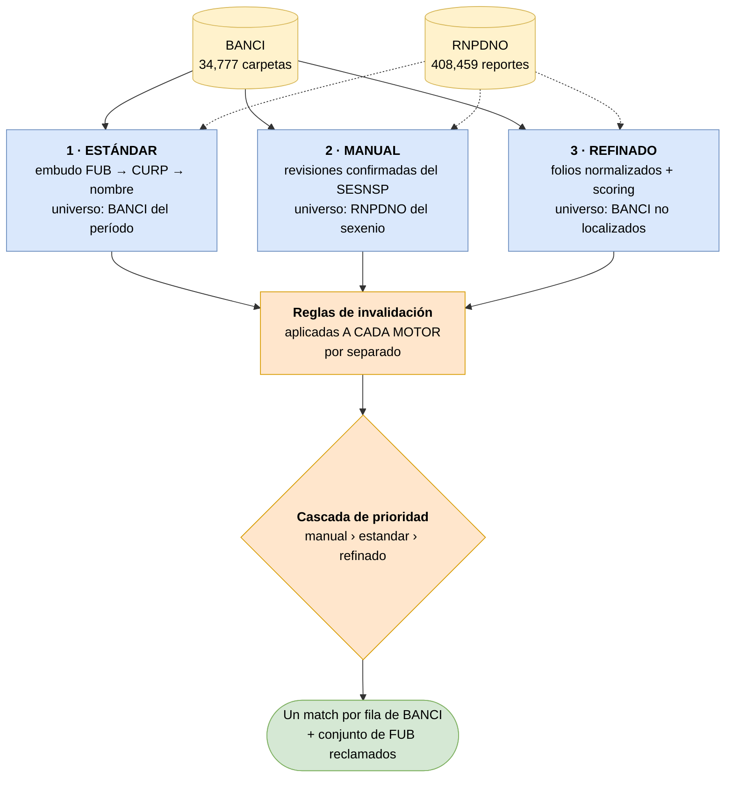

**Por qué corren los tres y no en cadena.** Si el estándar se llevara sus filas antes de
que el manual opinara, una confirmación humana nunca podría corregirlo. Corriéndolos en
paralelo, cuando dos motores señalan a **personas distintas** la cascada puede preferir al
de mayor autoridad. En la corrida actual eso pasa en 78 filas.

### La cadena, cuando el paralelo no cabe

Correr el refinado sobre el universo completo es caro, y con el RNPDNO entero (408,600
registros, ver §3.7) deja de ser viable. Para eso existe la perilla del perfil:

```toml
cascada_en_ejecucion = true   # default: false
```

En `true` los motores corren **en el orden de la prioridad** —`manual` → `estandar` →
`refinado`— y cada uno recibe sólo las filas que el anterior no resolvió. El refinado deja
de mirar las ya resueltas.

Dos condiciones lo hacen seguro:

1. **El orden de ejecución es el de prioridad, nunca al revés.** Con el estándar al frente
   una fila confirmada a mano saldría del flujo antes de que el motor manual opinara: el
   algoritmo pisaría al revisor, que es justo lo que la cascada existe para impedir. El
   manual va primero y no cuesta nada: no busca, transcribe.
2. **Las reglas de invalidación se aplican a cada motor antes de pasar el remanente.** Un
   match anulado devuelve la fila a la cadena en vez de matarla.

Lo que se pierde es la **corroboración cruzada**: si el estándar resuelve una fila, el
refinado ya no la ve y nunca se sabrá si coincidían. La columna `metodos_concurrentes` de
las bases exportadas (§7.3) queda con un solo motor, y la auditoría comparativa deja de
medir discrepancias. Por eso el default es `false` y el reporte diario no lo activa.

### El orden de prioridad

```toml
orden_prioridad_cascada = ["manual", "estandar", "refinado"]
```

> ⚠️ **`manual` va primero**, no el estándar. Son pares que una persona del SESNSP revisó
> y validó uno por uno; cuando el algoritmo y el revisor discrepan, gana el revisor. Con
> `estandar` al frente se perdían 54 validaciones humanas sin dejar rastro.

Es prioridad, **no** orden de ejecución: los motores ya corrieron todos. La cascada sólo
elige, para cada fila, el primer motor de la lista que tenga un match válido.

### Resultado de la corrida vigente

| Motor | Filas de BANCI que gana | Subcriterios |
|---|---:|---|
| **estandar** | 6,121 | `match_fub` 3,351 · `match_curp` 1,410 · `match_nombre` 1,360 |
| **refinado** | 571 | `definitivo` 555 · `parcial (algun caracter distinto)` 16 |
| **manual** | 561 | `match_confirmado_sesnsp` 561 |
| *sin match* | 27,524 | — |
| **Total** | **34,777** | |

Los dos motores algorítmicos **coinciden mucho más de lo que parecía**: en 5,290 filas el
estándar y el refinado señalan al MISMO FUB. Por eso el refinado gana pocas por su cuenta:
su aportación propia son los 571 casos que sólo el folio normalizado resuelve.

> Estos números cambiaron el 7 de septiembre de 2026 al corregir un defecto de
> **atribución** del motor estándar: sus matches se pegaban a la fila equivocada de
> BANCI. Los pares siempre fueron correctos; lo que estaba mal era de qué carpeta
> colgaban. Antes de la corrección el estándar aparentaba ganar 6,077 filas y el refinado
> 5,240, porque la desalineación los hacía parecer complementarios cuando en realidad
> coincidían.

---

## 3.2. Motor ESTÁNDAR — embudo de identificadores duros

`src/matching_r.py` · réplica del script R `funcion_tratamiento_banci_rnpdno_*.R`

Es el criterio de referencia: **determinista, sin similitud difusa**. Un embudo de tres
niveles de certeza decreciente. Quien casa en un nivel sale del embudo y no baja al
siguiente.

Antes de empezar, BANCI se **deduplica**: por CURP y por nombre + fecha de inicio, quedándose
con el registro más reciente. Es lo que hace el R original y evita que un duplicado interno
reclame dos veces el mismo reporte.

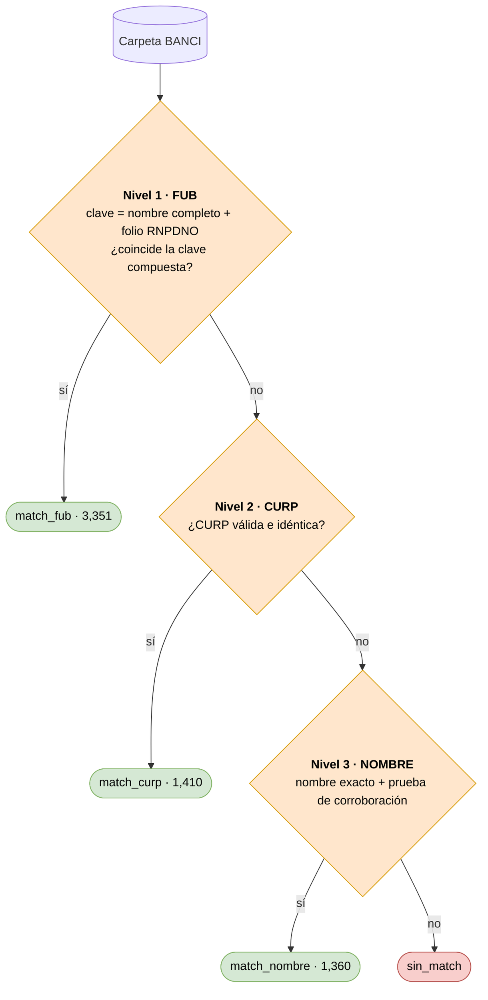

### Nivel 1 · FUB (folio de búsqueda)

BANCI a veces ya trae el folio del RNPDNO capturado en `folio_rnpdno`. No basta con que
coincida: **la llave de cruce es `normalizar(nombre_completo + " " + folio)`**. El nombre
va pegado al folio precisamente para que un error de captura en el folio no arrastre a un
reporte ajeno.

- Contra **no localizados**: coincidencia directa de la clave, sin condición de fecha.
- Contra **localizados**: la clave *más* tolerancia de fecha de hechos ≤ 30 días.

### Nivel 2 · CURP

Sólo entran registros de BANCI cuya CURP pasa la validación estructural
(`src.cleaning.es_curp_valida_vectorizado`), que el ETL calcula una sola vez en
`curp_valida_derivada_banci`. La comparación es de igualdad exacta sobre los 18
caracteres, después de limpiar las dos CURP de la misma forma: sin espacios y en mayúsculas
(`src.cleaning.limpiar_curp`).

Ambos lados se deduplican antes de cruzar: BANCI por `curp_limpia` quedándose con la fecha
de inicio más reciente, y el RNPDNO por CURP quedándose con la fecha de hechos más
reciente. Sin eso, una CURP repetida generaría un producto cartesiano de parejas.

### Nivel 3 · Nombre + corroboración

El más delicado, porque **el nombre no identifica**: los homónimos son frecuentes. Aquí el
nombre sólo **abre candidatos** (comparación exacta tras normalizar acentos y espacios —
no hay similitud parcial en este motor). El vínculo se confirma con una prueba aparte,
implementada como un `case_when` de casos **excluyentes**, no como un OR:

**Para personas no localizadas** (`_validar_match_nombre_r`, tipo `desaparecidos`):

| Caso | Condición | Veredicto |
|---|---|---|
| 1 | Ambas bases tienen fecha de nacimiento y difieren **≤ 5 días** | acepta si la fecha de hechos difiere ≤ **365 días** |
| 2 | Ambas tienen fecha de nacimiento y difieren **> 5 días** | **rechazo terminante** |
| 3 | A alguna le falta la fecha de nacimiento | acepta si **coincide la entidad** y la fecha de hechos difiere ≤ 365 días |

> El caso 2 es la guarda anti-homónimo del motor: dos personas pueden llamarse igual, pero
> no nacer en fechas distintas. Cuando el dato existe y contradice, **no** se pasa al caso 3
> a buscar una prueba más blanda.

**Para personas ya localizadas** las tolerancias se estrechan: fecha de hechos ≤ **30 días**
Y (fecha de nacimiento ≤ 5 días **O** misma entidad). Es más estricto porque un falso
positivo aquí mueve los conteos de localización.

La tolerancia de fecha se etiqueta además en categorías legibles
(`categorizar_tolerancia_fecha`): `Exacta`, `1-5 días`, `6-10 días`, `11-30 días (1 mes)`,
`2-5 meses`, `6-12 meses`, `Más de 1 año`.

### Trazabilidad

Cada match del estándar lleva el porqué: `variables_match`, `verif_nombre`, `verif_curp`,
`verif_fecha_nac`, `verif_entidad`, `verif_sexo`, `tolerancia_fecha_desaparicion`,
`diferencia_dias_desaparicion`, `fecha_hechos_status`, `evaluacion_match` y `score`. En el
frame de los motores llevan el sufijo `_estandar`; al caché sólo llegan `score` y
`variables_match` del ganador ([5. Diccionario](docs/5_diccionario_de_variables.md#caché-de-matching-cachematchingclavebanciparquet)).

`fecha_hechos_status` es `COINCIDE (N DIAS)` si la fecha de hechos de las dos bases difiere
10 días o menos, `DIFIERE (N DIAS)` si difiere más, y **nulo** si falta alguna de las dos
fechas y no hay diferencia que medir (el script de R escribía ahí `NA (NA DIAS)`). Es una
etiqueta descriptiva: la regla que anula por fecha (`regla_r_desfase_dias`, §3.5) usa el
número `diferencia_dias_desaparicion`.

---

## 3.3. Motor MANUAL — lo que una persona ya validó

`motor_match_manual` en `src/matching_engine.py`

No busca nada: **transcribe decisiones humanas**. Tiene tres fuentes posibles y sólo una
está activa por defecto.

| Fuente | Estado | Qué aporta |
|---|---|---|
| 1. FUB pre-asignado en BANCI | 🔴 **apagada** | el `folio_rnpdno` que BANCI ya trae |
| 2. DataFrame explícito (`df_manual`) | ⚪ opcional | pares de una fuente a medida |
| 3. Revisiones confirmadas del SESNSP | 🟢 **activa** | 561 pares validados uno por uno |

### Por qué la fuente 1 está apagada

```toml
manual_usar_fub_preasignado = false
```

Aceptar ese FUB marcaría el registro como match **sin comparar un solo atributo de
identidad** — ni nombre, ni CURP, ni fecha de nacimiento, ni carpeta. Lo único verificable
es que el folio exista en el RNPDNO, y eso no es evidencia. Peor aún: tapaba matches mejor
sustentados, incluidos pares que el SESNSP ya había confirmado a mano.

Apagada, esos registros quedan libres. El FUB **no se pierde como señal**: el motor
refinado lo sigue usando para generar candidatos y puede sostener un definitivo con él,
pero allí tiene que pasar por los guardianes anti-homónimo. Se reactiva sin tocar código
poniendo la clave del perfil en `true`.

### La fuente activa: revisiones del SESNSP

Dos archivos **opcionales** en `input/input_reporte_diario/`:

```
matches_verif_fecha_hechos_SESNSP.xlsx   ← revisiones de fecha de hechos
revision_manual_score_SESNSP.xlsx        ← revisiones manuales por score
```

Si no existen, el motor no falla: simplemente no aporta matches.

**Sólo el veredicto `SI` crea match.** Un `NO` significa que el par fue revisado y
rechazado: cierra el caso —el registro sale del universo del refinado— pero no asigna
ningún vínculo. Es el mismo criterio de `normalizar_folios_v6.py`.

#### Relación muchos a muchos

Una fila de BANCI sólo puede llevar un FUB ganador (`fub_derivada_rnpdno_banci`), pero una
revisión puede haber validado **varios FUB** para ese mismo registro (la misma carpeta con
varias víctimas). Los FUB sobrantes viajan en la columna
`fubs_confirmados_manual_derivada_rnpdno_banci` y se reclaman del lado del
RNPDNO, donde cada FUB es una persona distinta con match confirmado. Dejarlos fuera perdía
personas por una limitación del formato, no por falta de evidencia.

Un FUB confirmado se descarta si **no existe en el universo RNPDNO vigente** (apunta a un
localizado o a un caso pre-sexenio). Se descarta *ese FUB*, no el registro: así el refinado
puede buscarle su match real.

---

## 3.4. Motor REFINADO — folios normalizados y scoring

`src/motor_refinado.py` · réplica de `normalizar_folios_v6.py`

Los otros dos motores buscan a la **persona**: por CURP, por nombre, por FUB. El refinado
busca por el **expediente**. Parte del número de carpeta, lo limpia hasta dejar el número
que de verdad identifica el caso y, cuando dos registros comparten ese número, pregunta
*"¿y además son la misma persona?"* antes de aceptar nada.

Por eso existe: hay casos donde el RNPDNO y BANCI **no comparten ni CURP ni el nombre bien
escrito**, pero sí hablan de la misma carpeta. Lo que pasa es que la escriben distinto:

```
BANCI   →  "FED/MICH/URU/0001234/2019"
RNPDNO  →  "1234/2019"
```

Un `==` entre esas dos cadenas da `False`. El refinado existe para que dé `True`.

Su universo es más estrecho: sólo **BANCI no localizados** (`filtrar_banci_no_localizados`)
contra **RNPDNO del sexenio**. Un localizado puede casar con un desaparecido por folio y
generar matches espurios, y además ya no necesita búsqueda.

> **El caso que se sigue en todo el capítulo.** Sin CURP y con el nombre escrito distinto,
> ni el estándar ni el manual lo agarran; es exactamente el hueco que el refinado cubre.
>
> | | BANCI | RNPDNO |
> |---|---|---|
> | Carpeta | `FED/MICH/URU/0001234/2019` | `1234/2019` |
> | Nombre | `MARIA GPE DE LA CRUZ VAZQUEZ` | `MA GUADALUPE CRUZ VASQUEZ` |
> | CURP | *(vacía)* | *(vacía)* |
> | Fecha nac. | 1988-03-04 | 1988-03-04 |
> | Fecha hechos | 2019-05-02 | 2019-05-05 |

### Etapa 1 · Limpiar: sacar el consecutivo del folio

El folio se parte en trozos —por `- / _ . espacio` y en cada cambio letra↔dígito— y cada
trozo se clasifica:

```
"FED/MICH/URU/0001234/2019"
      ↓
   FED, MICH, URU  →  letras        → claves de oficina, no sirven de llave
   2019            →  año           → se guarda aparte (importante en la etapa 3)
   0001234         →  el más largo  → CONSECUTIVO → sin ceros → "1234"

"1234/2019"  →  consecutivo "1234", año "2019", sin claves
```

**Las dos bases llegan al mismo `1234`.** Eso es todo lo que hace la normalización: tirar
lo que no identifica el caso —formato, ceros, prefijos institucionales, el año— y quedarse
con el número. Si empatan en longitud gana el último, porque el folio suele terminar en
consecutivo antes del año.

A esa regla se le añaden dos correcciones, porque sola falla:

| Problema | Cómo se resuelve |
|---|---|
| Hay números que no son del caso sino de la oficina (`0044-101-**3003**-2025`) | un trozo numérico que aparece en ≥ `UMBRAL_TOKEN_CODIGO_OFICINA = 20` folios **distintos** (o en ≥ 0.05 % de la base) no puede ser un consecutivo: se descarta. Nunca se vacía un folio — si todos sus candidatos son códigos de oficina, se conservan |
| BANCI a veces trae consecutivos de 1 o 2 dígitos, inútiles como llave | si el consecutivo de la carpeta tiene ≤ 2 dígitos se usa en su lugar la columna `ID_CI` (`_consecutivo_banci`). Sin esto, el 34.6 % de los BANCI no localizados se queda sin consecutivo comparable |

El año se reconoce con `ANIO_MIN/MAX = 1990/2035`: una ventana estrecha a propósito, para
que un consecutivo de cuatro dígitos (`0345`, `4501`) no se confunda con un año. El margen
hacia adelante absorbe los errores de captura.

En la misma pasada se normalizan las demás columnas: entidad a nombre canónico, sexo, CURP
limpia, municipio sin acentos y FUB en mayúsculas.

### Etapa 2 · Proponer: no se compara todo contra todo

34,777 filas de BANCI × 400 mil del RNPDNO son 14 mil millones de comparaciones: inviable.
El RNPDNO se indexa por **seis llaves** y una fila de BANCI sólo se compara contra quien
comparta **al menos una**:

| Llave | Qué agrupa |
|---|---|
| `idx_fub_b` | FUB idéntico |
| `idx_curp_b` | CURP completa (18) |
| `idx_curp10_b` | primeros 10 de la CURP (nombre + fecha de nacimiento, sin entidad ni homoclave) |
| `idx_cons_b` | **el consecutivo de la etapa 1** |
| `idx_ape_b` | primer apellido (bloques de más de `MAX_BLOQUE_NOMBRE = 3000` se saltan) |
| `idx_fnac_b` | fecha de nacimiento |

En el caso de ejemplo, el consecutivo `1234` está en `idx_cons_b`, así que la fila del
RNPDNO entra a la lista de candidatos.

> Esto es *blocking*: no busca el match, busca **a quién vale la pena mirar**. Propone de
> más a propósito, porque las etapas siguientes filtran. El índice de apellido se salta los
> bloques enormes: "HERNÁNDEZ" propondría medio país y no descartaría nada.

### Etapa 3 · Clasificar el par: dos preguntas y una rejilla

Para cada par candidato se hacen **dos evaluaciones independientes**.

#### Pregunta A · ¿qué tan parecidos son los folios?

Cuatro respuestas posibles (`_folio_limpio_status`):

| Estado | Cuándo |
|---|---|
| `igual` | mismo consecutivo, mismo año (o falta el año en algún lado), sin choque de claves |
| `parcial` | mismo consecutivo y año, pero las claves de oficina no coinciden |
| `anio_distinto` | mismo consecutivo, **año distinto** |
| `no` | consecutivo distinto, o no hay consecutivo comparable |

`anio_distinto` merece detenerse: **los consecutivos se reinician cada año**, así que la
carpeta 1234/2019 y la 1234/2024 no tienen nada que ver. El script original midió que el
**55 % de los pares con "mismo consecutivo" eran de años distintos**; por eso el año es un
filtro duro y no un detalle de presentación.

En el ejemplo: mismo `1234`, mismo `2019`, y el RNPDNO no trae claves con las que chocar →
**`igual`**.

#### Pregunta B · ¿qué tan parecidos son los nombres?

No se comparan las cadenas enteras. Se parten en palabras, se expanden abreviaturas y se
quitan partículas:

```
"MARIA GPE DE LA CRUZ VAZQUEZ"  →  MARIA · GUADALUPE · CRUZ · VAZQUEZ
"MA GUADALUPE CRUZ VASQUEZ"     →  MARIA · GUADALUPE · CRUZ · VASQUEZ
                                     ✓        ✓         ✓      ✓ (0.93)
```

La similitud es **la proporción de palabras del nombre más corto que encuentran pareja** en
el otro, con tolerancia ortográfica de 0.85 (`VASQUEZ`/`VAZQUEZ` sí, `CASTAN`/`CASTAÑO`
no). Tolera el orden distinto y que una base traiga un apellido de más. Aquí casan 4 de 4 →
**similitud 1.00**.

El umbral que decide es **0.66**: por encima, el nombre por sí solo es evidencia suficiente
para proponer. Y siempre con un mínimo de **2 palabras**: coincidir sólo en "JOSÉ" no es
coincidir.

#### La rejilla

Cruzando las dos respuestas sale la decisión:

| Folio ↓ \ Nombre → | **fuerte** (≥ 0.66 y ≥ 2 palabras) | **débil** |
|---|---|---|
| `igual` | candidato a **definitivo** *(pasa por guardián)* | definitivo **sólo** con ≥ 2 corroboradores, uno fuerte (fecha nac. o CURP-10) |
| `parcial` / `anio_distinto` | candidato a **parcial** *(pasa por guardián)* | nada |
| `no` | CURP-18 o FUB idénticos → **definitivo** "misma persona, otra carpeta"; si no, guardián reforzado | nada |

Dos lecturas que conviene fijar: en la esquina inferior derecha **folio distinto + nombre
débil no produce nada** —el motor no inventa—, y la fila de arriba a la derecha es la
salida de emergencia para cuando el nombre viene mal capturado pero el folio coincide.

El mismo recorrido, completo:

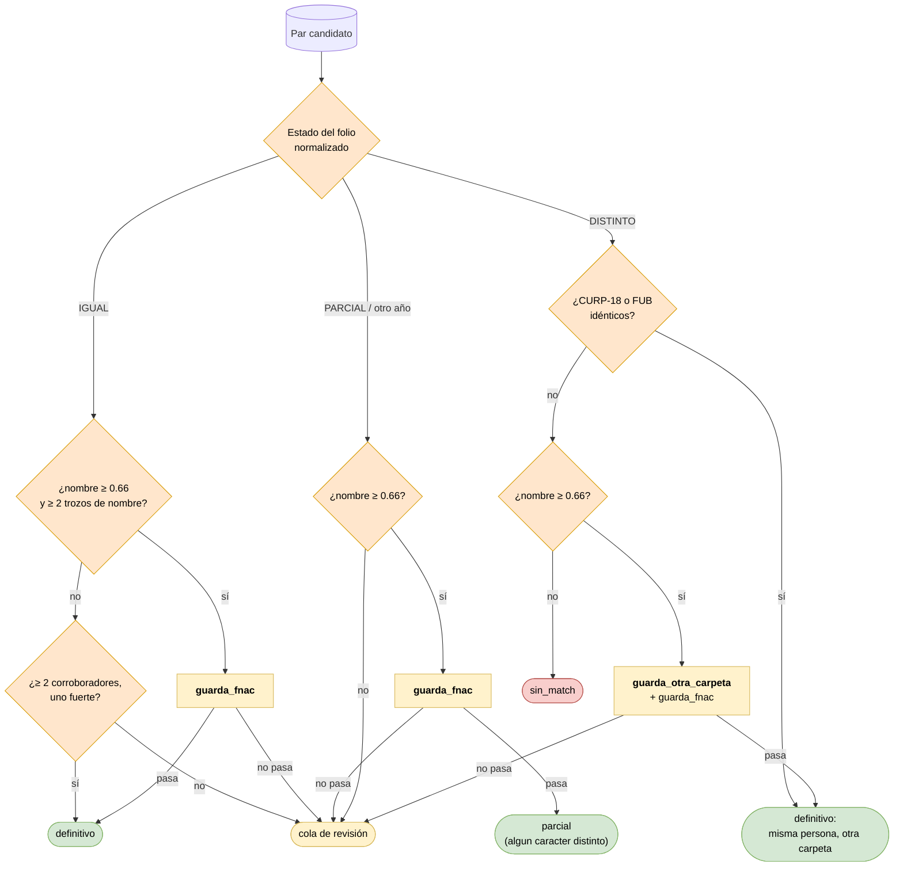

### Etapa 4 · Los guardianes anti-homónimo

Si hay una sola idea que llevarse de este motor, es ésta:

> **Un folio idéntico NO basta para afirmar que son la misma persona.**

Porque una carpeta puede cubrir a varias víctimas, porque los folios se capturan mal y
porque los homónimos existen. Antes de aceptar un definitivo, el par pasa por un guardián.

**`_guarda_fnac`** — el guardián normal. Su lógica es *"si algo no encaja del todo,
exígeme un ancla dura"*:

```
¿El nombre es idéntico al 100 %?            ─┐
¿Difieren las fechas de hechos ≤ 360 días?  ─┴→ las dos SÍ → pasa
                                                alguna NO  → exige fecha de nacimiento
                                                             igual, o CURP-10 igual
```

Ese umbral de 360 días es `DIAS_FHECHOS_EXIGE_FNAC`. En el ejemplo: nombre 1.00 y fechas a
3 días → pasa directo (y aunque no fuera así, las
fechas de nacimiento coinciden). Un caso donde el guardián sí muerde: dos
`JUAN PEREZ RAMIREZ` con el mismo consecutivo pero hechos separados 1,100 días. El nombre
es idéntico, la fecha no encaja → se exige fecha de nacimiento o CURP-10, y sin ellas no
hay definitivo: se va a la cola de revisión.

**La excepción de las carpetas colectivas.** Cuando una misma carpeta cubre a varias
personas distintas, su fecha de hechos es genérica y no es confiable, así que el guardián
se **relaja**: no tiene sentido exigirle coherencia a un dato que se sabe genérico. A
cambio se **cierra** la ruta de los corroboradores, porque en una carpeta colectiva
coincidir en "entidad + sexo" no dice nada: todas las víctimas del expediente coinciden en
eso.

**`_guarda_otra_carpeta`** — el guardián reforzado, sólo para el caso más delicado:
afirmar "es la misma persona, en otra carpeta" **sin** CURP completa ni FUB.

- Entidades que se contradicen → hace falta fecha de nacimiento o CURP-10 **y** nombre
  completo idéntico (≥ 3 palabras, mismas de los dos lados).
- Hay fechas de nacimiento en ambos lados y **difieren** → rechazo inmediato.
- No hay fechas de nacimiento → nombre completo idéntico **más** un apoyo: municipio,
  entidad o fecha de hechos a ≤ 10 días.

### Etapa 5 · Elegir un ganador por fila de BANCI

Una fila puede haber producido varios candidatos aceptados. Se escoge uno:

```
definitivo  >  parcial  >  revisión manual  >  sin match
```

y entre definitivos empatados gana el de mejor fecha de hechos:
`COINCIDE (≤ 10 días)` > `SIN DATO` > `DIFIERE`.

El caso de ejemplo termina como **`definitivo`**, con el motivo escrito en texto en
`variables_match_refinado`:

```
nombre 1.00 + folio limpio identico (formato/ceros ignorados); fuente: carpeta;
+fecha de hechos (+-10 dias)
```

#### La cola de revisión: aquí —y sólo aquí— entra el score

> ⚠️ **El score no decide los matches.** Todo definitivo o parcial sale con
> `score_refinado = 100` fijo. Los pesos de abajo sirven únicamente para **ordenar la cola
> de lo dudoso**, y ese score se topa en 99 justamente para que nunca se confunda con un
> match aceptado.

Antes de puntuar hay un colador: un candidato ni siquiera entra a la cola si no tiene un
folio específico (`igual`/`parcial` con consecutivo de ≥ 4 dígitos), o un nombre fuerte, o
un nombre razonable más algo no genérico, o dos señales de las cuales una sea dura. Sin ese
filtro la cola se llenaría de pares que sólo coinciden en sexo y entidad.

| Peso | Valor | Señal |
|---|---:|---|
| `W_FOLIO_LIMPIO` | 45 | folio normalizado idéntico |
| `W_FOLIO_PARCIAL` | 25 | folio parcialmente coincidente |
| `W_CURP10` | 25 | primeros 10 de la CURP |
| `W_NOMBRE` | 25 | similitud de nombre (se multiplica por la similitud) |
| `W_FNAC` | 15 | fecha de nacimiento |
| `W_PUENTE` | 15 | carpeta compartida con otro par ya resuelto |
| `W_MUNICIPIO` | 8 | municipio |
| *(sin constante)* | 8 | mismo consecutivo con año distinto |
| `W_ENTIDAD` | 3 | entidad — sólo desempate |
| `W_SEXO` | 2 | sexo — sólo desempate |
| — | **−5** | coincide **sólo un apellido**: se penaliza, no se premia |

El **puente** (`W_PUENTE`) es cómo el motor atrapa los casos colectivos: si la carpeta A de
BANCI ya casó definitivamente con la carpeta B del RNPDNO, las **otras** víctimas de la
carpeta B entran a la cola de A con bono.

#### Umbrales

```python
UMBRAL_NOMBRE_100  = 0.90   # sólo etiqueta verif_nombre como "COINCIDE"
UMBRAL_NOMBRE_SOLO = 0.66   # el nombre por sí solo basta para proponer
UMBRAL_NOMBRE_MIN  = 0.50   # piso para que el nombre sume en el score
UMBRAL_NOMBRE_EXACTO = 0.999
UMBRAL_MUNICIPIO   = 0.80   # fuzzy sobre NOMBRES de municipio, no claves
MIN_TOKENS_NOMBRE  = 2
CORROBORADORES_MIN_CARPETA = 2
```

> `municipio_derivada_rnpdno` se deriva al cargar, traduciendo la clave del RNPDNO a
> **nombre** con el catálogo INEGI. El motor compara nombres con fuzzy match; comparar
> claves daba intersección cero y el municipio nunca sumaba.

### Salidas del refinado

Una fila por cada fila de BANCI, con cuatro resultados posibles:

| `tipo_match_refinado` | Significado |
|---|---|
| `definitivo` | pasa folio/identidad y los guardianes |
| `parcial (algun caracter distinto)` | folio casi igual + nombre fuerte + guardián |
| `revision manual` | candidato plausible **sin** evidencia suficiente |
| `sin_match` | nada |

**`revision manual` no es un match.** La regla `excluir_revision_manual` lo retira de la
oferta del motor antes de la cascada. En `normalizar_folios_v6.py` esos casos van a un
Excel para que una persona los valide; aquí simplemente no cuentan.

Sólo después entra la cascada, donde el refinado compite con los otros dos. La mayoría de
sus matches señalan al mismo FUB que ya encontró el estándar; su aportación propia son los
casos que **sólo** el folio normalizado resuelve (ver §3.1).

### El motor en un vistazo

```
       folio crudo, escrito distinto en cada base
                   │
   [1] LIMPIAR ────┤  tirar formato, ceros, prefijos, código de oficina, año
                   │  → queda el CONSECUTIVO
                   ▼
   [2] PROPONER ───┤  6 índices: quién comparte consecutivo, CURP, CURP-10,
                   │  FUB, apellido o fecha de nacimiento
                   ▼
   [3] CLASIFICAR ─┤  folio: igual / parcial / otro año / no
                   │  nombre: ¿≥ 0.66 y ≥ 2 palabras?
                   ▼
   [4] GUARDIANES ─┤  "folio igual NO basta": ancla dura si algo no encaja
                   │  (fecha de nacimiento o CURP-10)
                   ▼
   [5] ELEGIR ─────┤  definitivo > parcial > revisión > nada
                   │  (el score sólo ordena la revisión)
                   ▼
          una fila de resultado por registro de BANCI
```

Cada guardián, cada umbral y cada "→ nada" de la rejilla son la misma frase del inicio de
este capítulo aplicada: **es preferible dejar dos registros sin unir que unir a dos
personas distintas.**

---

## 3.5. Reglas de invalidación

Se aplican **a cada motor por separado y ANTES de consolidar**. El orden lo fija el perfil:

```toml
reglas_post = ["excluir_revision_manual", "regla_r_desfase_dias", "actualizar_rn_con_banci"]
```

| Regla | Capa | Qué hace |
|---|---|---|
| `excluir_revision_manual` | A · motor | anula los candidatos `revision manual` |
| `regla_r_desfase_dias` | A · motor | anula matches con desfase > `tolerancia_desfase_dias` (10 días) o cuyo FUB está `Localizados` en RNPDNO |
| `actualizar_rn_con_banci` | B · RNPDNO | un FUB reclamado por BANCI pasa a "Con carpeta" y dependencia de fiscalía |

> **Por qué por motor y no sobre el ganador.** Antes se aplicaban después de consolidar. Si
> el estándar ganaba y la regla lo invalidaba, la fila quedaba en `sin_match` **aunque el
> manual o el refinado tuvieran un match válido esperando detrás**. Un match anulado no
> debe matar la fila: debe ceder el turno. Depurando la oferta de cada motor antes de
> elegir, la prioridad hace lo que promete.

Añadir una regla es escribir una función con `@regla_motor` y nombrarla en el perfil.
Quitar su nombre de la lista la desactiva. Así se obtienen variantes del pipeline sin
bifurcar el notebook.

---

## 3.6. Consolidación

`combinar_matches_cascada` recorre los motores en orden de prioridad y asigna a cada fila
el primero con match válido. Al salir de la capa A (`motores._salida`) el resultado queda
con el sufijo de las dos bases de las que sale: `fub_derivada_rnpdno_banci` (el FUB
ganador), `tipo_match_derivada_rnpdno_banci` (los motores que lo sostienen),
`metodo_origen_derivada_rnpdno_banci` (el que ganó la fila),
`subcriterio_match_derivada_rnpdno_banci`, `score_derivada_rnpdno_banci` y
`variables_match_derivada_rnpdno_banci`. El detalle de cada motor y las copias
`*_consolidado` de la cascada no salen de la capa: nadie los lee
([5. Diccionario](docs/5_diccionario_de_variables.md#caché-de-matching-cachematchingclavebanciparquet)).

Después se pasa **del lado de BANCI al lado del RNPDNO**, que es donde se cuentan personas:

- Un mismo FUB puede ser alcanzado por motores distintos **a través de filas distintas de
  BANCI** (la misma persona en varias carpetas). Se listan **todos** los métodos que lo
  sostienen, en el orden de la cascada, en vez de quedarse con el de la primera fila: ese
  desempate dependía del orden del archivo, no de una regla, y movía la atribución entre
  cortes sin que nada más cambiara.
- Se suman los FUB extra de `fubs_confirmados_manual_derivada_rnpdno_banci` (§3.3).

El resultado es `ResultadoMatching`: el BANCI consolidado, el conjunto `fubs_matcheados`,
el mapa FUB → métodos y la auditoría comparativa entre motores.

Ese conjunto de FUB es lo que alimenta las bases derivadas
`rn-si-ba` / `rn-no-ba` / `ba-si-rn` / `ba-no-rn` (ver
[catálogo de abreviaturas](catalogo_abreviaturas.md)).

---

## 3.7. Los universos que ve cada motor

No todos miran lo mismo, y es deliberado:

| Motor | Universo BANCI | Universo RNPDNO |
|---|---|---|
| estándar | sólo no localizados | completo, separando localizados de no localizados |
| manual | completo | del sexenio y no localizado (`_universo_rnpdno`) |
| refinado | sólo no localizados | del sexenio y no localizado |

### Las perillas que abren el universo

Ninguno de esos recortes está fijo en el código: los cinco salen del perfil, y apagarlos
todos da el **cruce total** (perfil `cruce_total`). El perfil `revision_secretariado`
(notebook 8) apaga los mismos salvo el de BANCI localizados: es la lógica con que se armaba
la lista de candidatos para el Secretariado ([7. Llaves de cruce §7.8](docs/7_llaves_de_cruce.md#78-bases-para-la-revisión-del-secretariado)).

| Qué recorta | Perilla | Dónde se aplica |
|---|---|---|
| BANCI localizados | `filtrar_banci_no_localizados` | filtro interno del motor estándar **y** universo del refinado |
| RNPDNO localizados | `filtrar_rnpdno_clasificacion` | motores manual y refinado |
| RNPDNO pre-sexenio | `fecha_sexenio` | motores manual y refinado |
| Matches con desfase o FUB localizado | `reglas_post` (`regla_r_desfase_dias`) | después de cada motor |
| Fechas de BANCI en el estándar | `periodo_match` | ver la advertencia de abajo |

> ⚠️ **`periodo_match` hoy no llega al motor.** `motores.py` se lo pasa a
> `motor_match_estandar`, pero éste no lo reenvía a `ejecutar_confronta`, así que el motor
> estándar **nunca acota BANCI por fecha**. Es un cabo suelto anterior a la refactorización
> y se dejó como está a propósito: reenviarlo ahora *añadiría* un filtro que hoy no existe y
> movería los conteos del reporte diario. Corregirlo es una decisión aparte, no un descuido.

`_universo_rnpdno` filtra por clasificación **y por prefijo sin acentos**:

```python
CLASIF_UNIVERSO = ("DESAPARECID", "PENDIENTE", "NO LOCALIZAD")
```

> Va `"NO LOCALIZAD"` y **nunca** `"LOCALIZAD"` a secas: son opuestos y uno contiene al
> otro. El prefijo salva la ambigüedad, porque `"NO LOCALIZADA"` no empieza con
> `"LOCALIZAD"`. Si aparece una clasificación nueva que debería entrar, el pipeline la
> **avisa por pantalla** en vez de excluirla en silencio.

Las fechas nulas **se incluyen**: no se puede descartar que caigan en el rango. Hoy no hay
ninguna, y mantenerlas evita que un corte futuro encoja el universo sin avisar.

---

## 3.8. La entidad no filtra: es una dimensión

El universo se construye **siempre nacional**. Antes, `config.ESTADO` filtraba antes de los
motores: cada PPT estatal exigía su propia corrida (32 para 32 entidades) y un caso de
BANCI de una entidad no podía casar con un reporte capturado en otra.

Hoy la clave de entidad viaja como columna (`idestado_derivada_rnpdno`,
`cve_entidad_derivada_banci`) y la entidad se aplica al rebanar:

```python
Slice("rn", "01oct24-max", estatus="des", estado=17)   # Morelos
```

Una sola corrida alimenta las 32 entidades, y el matching entre entidades ya es posible.
Consecuencia a tener presente: los conteos estatales pueden salir **ligeramente mayores**
que con el esquema anterior. Es un resultado más completo, no un error.

`_verificar_universo_nacional` aborta la corrida si `config.ESTADO` quedó activo, porque si
no los Parquet del ETL vendrían filtrados y el universo sería parcial en silencio.

---

## 3.9. Rendimiento del motor refinado

El refinado era el techo del sistema: con el universo acotado del reporte diario
(20,251 registros del RNPDNO) tardaba minutos, pero con el RNPDNO completo
(408,600) el costo crecía como **n^1.7** —duplicar el universo triplicaba el
tiempo— y un cruce total proyectaba **más de 100 horas**.

### Dónde se iba el tiempo

| Medición | RNPDNO | Tiempo (300 filas de BANCI) |
|---|---:|---:|
| antes | 25,000 | 30.4 s |
| antes | 50,000 | 83.4 s |
| antes | 100,000 | 259.2 s |
| antes | 200,000 | 1,041.5 s |

`cProfile` señaló dos culpables, ninguno de ellos el que parecía:

**1 · Accesos escalares a columnas Arrow (≈40% del tiempo).** `_g` y `_conteos`
leían celda por celda con `df.at[i, col]` / `df[col].iat[i]`. Las columnas del
RNPDNO vienen respaldadas por Arrow, donde un acceso escalar cuesta ~40 µs en vez
de ~50 ns: con 408 mil registros por diez columnas eran millones de accesos.
Ahora cada columna se materializa a lista **una vez** y se indexa por posición.

**2 · Un cálculo cuadrático en `_conteos` (≈53%).** Por cada registro se
reconstruían los conjuntos "carpetas de esta persona" y "personas de esta
carpeta", que dependen sólo del GRUPO, y luego se restaba un elemento con
`len(S - {x})`, que recorre todo el conjunto. El costo era la suma de |grupo|².

Lo que hacía explotar esa suma: **los registros del RNPDNO sin expediente caen
todos bajo la misma llave**. `str(nan).strip().upper()` produce la cadena
`"NAN"`, que no es vacía, así que 44,747 de cada 100,000 registros quedaban
agrupados como si compartieran carpeta: 2,000 millones de operaciones.

La corrección de rendimiento memoiza el conjunto por grupo y sustituye la resta
por una prueba de pertenencia (`|S| - 1` si el elemento está). El resultado es
idéntico; sólo deja de repetirse el mismo cálculo.

> ⚠️ **La llave `"NAN"` sigue siendo un defecto de fondo, no sólo de velocidad.**
> Al agrupar como una sola carpeta a todos los registros sin expediente, esos
> registros quedan marcados como *carpeta colectiva*, y `_guarda_fnac` desactiva
> el guardián anti-homónimo para las carpetas colectivas (§3.4). Es el mismo
> problema que ya se documentó del lado de BANCI con `NTRA_CI = '0'`, aquí a
> mayor escala. Corregirlo cambia matches, así que está pendiente de decisión.

### Resultado

| RNPDNO | Antes | Después | Mejora |
|---|---:|---:|---:|
| 25,000 | 30.4 s | 8.1 s | 3.8× |
| 50,000 | 83.4 s | 11.4 s | 7.3× |
| 100,000 | 259.2 s | 15.5 s | 16.7× |
| 200,000 | 1,041.5 s | 18.6 s | **55.9×** |

El crecimiento pasó de n^1.7 a prácticamente lineal. **El cruce total —todo BANCI
contra todo el RNPDNO— corre hoy en 13.4 minutos.**

Las tres optimizaciones (materializar columnas, memoizar `_conteos`, y memoizar
`similitud_nombres` con poda por cota exacta del ratio de difflib) se verificaron
con una corrida completa del perfil `reporte_diario`: los once conteos por motor y
subcriterio son iguales y **ninguna de las 34,777 filas cambió de FUB**.

---

## 3.10. Cómo se verifica, y qué se sabe que falla

### La batería de verificación

Los conteos no delatan un matching roto: el defecto de atribución corregido el 7 de
septiembre de 2026 convivió con
totales perfectamente plausibles. Lo que lo destapó fue preguntarle a los datos si **el
criterio declarado se cumple de verdad**. Ésa es la forma de auditar este sistema:

| Grupo | Qué se comprueba |
|---|---|
| Integridad | BANCI conserva filas y orden del ETL · toda fila con match tiene FUB y al revés · todo FUB asignado existe en el RNPDNO · `fubs_matcheados` cuadra con las filas |
| Motor estándar | nivel 1: el FUB asignado es el capturado en BANCI **y** el nombre coincide · nivel 2: **CURP idéntica de 18 caracteres** · nivel 3: nombre normalizado idéntico, sin fechas de nacimiento contradictorias, con entidad coincidente cuando falta la fecha |
| Motor manual | los pares marcados como revisión confirmada del SESNSP |
| Atribución | el nombre de la carpeta se parece al de la persona del FUB asignado, por motor |
| Reglas | ningún match sobreviviente con desfase mayor a la tolerancia, ni apuntando a un FUB Localizado, ni con un candidato `revision manual` |
| Cascada | ningún motor de menor prioridad le ganó a uno de mayor |

En la corrida del 7 de septiembre de 2026 pasan **18 de 18**. La prueba más sensible es la
del nivel 2: `match_curp` exige igualdad exacta de CURP, así que cualquier desalineación la
tumba de inmediato —pasó de 0 % a 100 % al corregir esa atribución—.

> Dos verificaciones fallaron en el primer intento por estar **mal planteadas**, no por el
> código: una comparaba la clave numérica de entidad del RNPDNO contra el nombre que usa
> BANCI (`15` contra `"ESTADO DE MEXICO"`), y otra exigía parecido de nombre al motor
> refinado, que precisamente existe para casar cuando el nombre no coincide. Vale la pena
> saberlo: al auditar, la primera sospecha debe ser la prueba.

### Limitaciones conocidas

**1 · Carpetas colectivas sin guardián.** `_guarda_fnac` empieza con
`if colectiva: return True, ""`: una carpeta colectiva **desactiva por completo** el
guardián anti-homónimo. La excepción existe porque en esas carpetas la fecha es genérica,
pero quita la protección justo donde más se necesita —cuando varios miembros de una familia
comparten expediente, los apellidos coinciden y el umbral de 0.66 pasa—.

De los 571 matches del refinado, **23 no tienen ni nombre parecido ni ancla dura** (fecha de
nacimiento, CURP-10, CURP-18 o FUB iguales):

| | |
|---|---:|
| Apellidos idénticos y nombre de pila distinto (firma de hermano) | 15 |
| De ésos, además con **sexo distinto** entre las dos bases | 6 |
| Variantes del mismo nombre (apellidos invertidos, segundo nombre) — legítimos | 8 |

Ejemplos: `ESTRELLA ROSALES PANZO` ↔ `MARCOS ROSALES PANZO`;
`EDUARDO LOMELI RIVERA` ↔ `MARIA SILVIA LOMELI RIVERA`.

Contradice el criterio declarado del sistema (*mejor dejar dos registros sin unir que unir a
dos personas distintas*). Dos guardas lo corregirían: que **el sexo no pueda contradecir**
—el motor ya lo calcula y hoy sólo lo usa como desempate de 2 puntos en el score— y que, con
apellidos idénticos y nombre de pila distinto, se exija ancla dura. Impacto: 23 de 7,253
matches (0.32 %). **Pendiente de decisión**, porque cambia la metodología heredada de
`normalizar_folios_v6.py`.

**2 · La llave `"NAN"` del RNPDNO.** Los registros sin expediente caen todos bajo la misma
llave de carpeta y quedan marcados como colectivos, lo que dispara la limitación anterior a
gran escala. Ver §3.9.

**3 · `periodo_match` no llega al motor estándar.** Ver §3.7.

---

# 4. Generación de Reportes y Visualización

Dos notebooks producen presentaciones: `5_PPT_Reporte_Estatal.ipynb` (32 entidades) y
`6_PPT_Reporte_Diario.ipynb` (nacional). Ambos siguen el mismo patrón: **declarar qué se
quiere, pedirlo al universo, armar la PPT**.

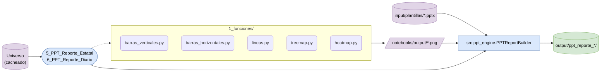

## Nombre de los archivos

El reporte diario lleva **la fecha de emisión** en el nombre, así que cada corrida deja su
propio archivo y no pisa la del día anterior:

```
output/ppt_reporte_diario/Reporte de personas desaparecidas - 07.09.2026.pptx
```

El patrón y el formato de fecha están en `config.PPT_DIARIO_NOMBRE` y
`config.PPT_DIARIO_FECHA_FORMATO`; `config.ppt_diario_file(fecha=None)` compone la ruta.

> El notebook llama a esa función al ejecutarse en lugar de usar la constante
> `PPT_DIARIO_FILE`, que se congela con la fecha en que se importó `config`: un kernel
> abierto de un día para otro seguiría escribiendo con la fecha de ayer.

Es la fecha en que se **emite** el reporte, no la del corte de los datos. Esa última viaja
dentro de la presentación, en los marcadores `fha_rn_*`.

Las estatales llevan clave y nombre de entidad —`Reporte_Estatal_17_Morelos.pptx`—, con la
nacional como `00` para que ordene primero.

## El contrato: marcadores `{{...}}`

La plantilla PPTX lleva marcadores de texto con el **nombre canónico** del indicador:

```
{{reg_rn-no-ba_01oct24-max_des_sfval_sfvac}}     → 5,782
{{pct_reg_rn_01oct24-max_loc_cvid}}              → 68.4%
{{fha_rn_dia_mes_anio}}                          → 4 de septiembre de 2026
{{gr_mes_rn-no-ba_01oct24-max_des_cfval}}        → imagen
```

El notebook declara los `Slice` correspondientes y `PPTReportBuilder` los sustituye. Añadir
un indicador es añadir una línea a `CONTEOS`: **cuesta microsegundos**, porque la rebanada
es una máscara booleana sobre el universo ya construido.

`render()` devuelve el reporte de qué marcadores se encontraron y cuáles no, que es la
herramienta para diagnosticar una plantilla.

### Cuando un marcador no se sustituye

Casi siempre es la plantilla, no el cálculo. Dos fallos habituales:

- **El marcador está partido.** PowerPoint puede dejar `{{reg_r` en un párrafo y el resto
  en otro (basta un Enter accidental). El motor busca `{{...}}` dentro de un mismo párrafo,
  así que ve dos trozos sueltos y no lo reconoce.
- **Errata en el nombre.** `..._dessfval_cfvac` en vez de `..._des_sfval_cfvac`. El nombre
  tiene que ser exactamente el que genera `Slice.nombre`.

Para auditar una plantilla, comparar los marcadores que pide contra las claves que produce
el notebook:

```python
rep = builder.render(SALIDA)
no_hallados = [k for k, v in rep["text_report"].items() if v == 0]
```

## Gráficas

**Una gráfica, un bloque**, en la sección de gráficas del cuaderno y con todos sus
parámetros escritos en la llamada:

```python
nombre = "gr_mes_rn-no-ba_01oct24-max_des_cfval"
tabla = serie_mensual(
    Slice("rn-no-ba", "01oct24-max", estatus="des", subfiltro="cfval"))
ancho_cm, alto_cm = dimensiones_placeholder(PLANTILLA, nombre)
barras_verticales(
    tabla, nombre=nombre, mostrar=False,
    ancho=ancho_cm, alto=alto_cm,
    colores=["#9b2347ff"],
    tam_valor_ejex=7,
    ...
)
registrar(nombre, tabla)
```

No hay diccionarios de estilo compartidos entre láminas parecidas: en la práctica ninguna
se deja ajustar con los parámetros de la de al lado —el tamaño del texto depende de cuántas
barras entren, la posición de la cápsula de qué tan largas sean—, y un estilo común obligaba
a tocar todas para mover una. Lo único compartido es la preparación de los datos
(`serie_mensual`, `tabulado_dependencia`), que no es estilo.

Para agregar una gráfica se copia el bloque más parecido, se le cambia la rebanada y el
nombre, y se ajustan sus parámetros. `registrar` apunta el nombre en `GRAFICAS_GENERADAS`,
que es la lista que el armado de la presentación inserta en la plantilla.

Cada gráfica sustituye al **cuadro de texto** que lleva su marcador, heredando su posición
y sus medidas (`dimensiones_placeholder`). Así la plantilla manda sobre la maquetación y el
código sólo aporta el contenido.

> ⚠️ `exportar_grafica` (en `1_funciones/funciones.py`) tiene `"output/<nombre>"` codificado
> y relativo al directorio de trabajo, así que los PNG caen en `notebooks/output/` sin
> importar lo que declare el notebook. `RUTA_GRAFICAS` apunta a esa ruta real.

## Marcadores derivados

Además de los conteos directos, las plantillas usan seis familias calculadas aparte:

| Familia | Qué es | Dónde se calcula |
|---|---|---|
| `pct_X` | `X` entre su denominador (por defecto `Slice.padre`) | `Universo.indicadores(porcentajes=…)` |
| `pct_X_v1` / `_v2` / `_v3` | porcentajes de un reparto, con las décimas ajustadas para que el grupo sume exactamente 100% | `particiones.porcentajes_particion` |
| `X-Y` | resta contra un corte congelado (25/03/2026 o 01/07/2026) | `utils.diferencias_vs_corte` |
| `X_ddes` / `X_dloc` / `X_dfub` | altas y bajas cruzando los `fub` de ambas fotos; con `_v2`, contra el corte de julio | `utils.deltas_vs_corte` |
| `reg_rn_24jun26-max_loc_fmz` y sus `_v2` / `_v3` / `_v4` | indicios de vida del directorio congelado que ya derivaron en una localización | `directorio_indicios.indicios_formalizados` |
| `reg_mr_min-max*` | estatus vigente de las personas con detención penitenciaria | `utils.cruzar_mj_rips` |

Las cuatro últimas necesitan un archivo que **no pasa por el pipeline**:

- los cortes de marzo y julio, que llegan como Excel ya rebanado en `input/datos_marzo/` e
  `input/datos_julio/` (`config.CORTES_REFERENCIA`);
- el directorio de indicios congelado al 24/06/2026 (`config.DIRECTORIO_INDICIOS_FILE`);
- el archivo de MJ y RIPS (`config.MJ_RIPS_FILE`).

Los dos últimos tampoco son rebanadas del universo —su población no sale del RNPDNO ni de
BANCI—, así que **no hay `Slice` del que colgarse**: se calculan aparte y sus conteos se
inyectan con `extra=` en `Universo.indicadores`, ya con el nombre de su marcador:

```python
tabulado_fmz, tabulado_fmz_32, fmz = indicios_formalizados(u.rn)

vars_ppt = u.indicadores(
    CONTEOS, porcentajes=PORCENTAJES,
    extra={MARCADOR_FMZ:     fmz["total"],
           MARCADOR_FMZ_PCT: fmz["pct"],
           ...},
)
```

Como no hay `Slice`, tampoco aplica la regla del padre para sus porcentajes: el denominador
se escribe a mano (`src.utils.MJ_RIPS_DENOMINADOR`) o lo devuelve la propia función
(`fmz["nacional"]`). El detalle de la nomenclatura está en
[`catalogo_abreviaturas.md`](catalogo_abreviaturas.md), secciones 9 bis a 9 quinquies, y
el de los indicios en [8. Indicios de vida](docs/8_indicios_de_vida.md).

### Las bajas como base (`_dloc`)

Un `_dloc` tampoco se puede exportar con `PARA_EXPORTAR`: sus registros son, por definición,
los que ya **no** están en la rebanada de hoy, y viven en el Excel del corte. El notebook 6
los declara en `BAJAS_A_EXPORTAR` y su sección 3.2 los escribe con
`src.cortes_referencia.bajas_vs_corte` en `cfg.resultados_dir` como
`<indicador>_dloc.parquet` (p. ej. `reg_rn_01ene06-max_des_sisf_dloc.parquet`). Los
declarados en `BAJAS_VS_JULIO_A_EXPORTAR` son lo mismo contra el corte de julio y salen con
el `_v2` de su marcador (`reg_rn_01ene06-max_des_sisf_dloc_v2.parquet`):

- las columnas del Excel del corte, tal como llegan, con el sufijo de su fecha (`_25mar26`
  o `_01jul26`; el de julio ya traía el de su fuente: `fub_rnpdno_01jul26`);
- del universo de hoy, `expedientes_rnpdno` y las columnas que deciden pertenecer a la
  rebanada (estatus, fecha, banderas del subfiltro), cruzadas por `fub`, vacías si el `fub`
  ya no está en el RNPDNO.

La función se detiene si los `fub` distintos no son exactamente el `_dloc` que calcula
`deltas_vs_corte`, e imprime por qué salió cada registro (hoy localizado, ya no
cumple el subfiltro, fecha fuera del período o ya no está en el RNPDNO). Vive fuera de
`src/utils.py` porque ese archivo entra en la huella del caché y editarlo obliga a repetir
el matching.

### La diferencia como base (`<actual>-<corte>`)

Un marcador de diferencia resta dos totales, y esa resta es `_ddes − _dloc`, así que su base
son las dos corrientes juntas. El notebook 6 las declara en `DIFERENCIAS_A_EXPORTAR` y la
misma sección 3.2 las escribe con `src.cortes_referencia.movimientos_vs_corte` como
`<indicador>-<corte>.parquet`, con el nombre del marcador (p. ej.
`reg_rn_01ene06-max_des_sisf-reg_rn_25mar26_des_sisf.parquet`). Una fila por registro, y la
columna `movimiento_derivada_rnpdno_25mar26` dice a qué corriente pertenece:

| Valor | Qué es | Columnas |
|---|---|---|
| `alta` | está en la rebanada de hoy y no en el corte (`_ddes`) | las del universo de hoy |
| `baja` | está en el corte y no en la rebanada de hoy (`_dloc`) | las mismas de su base `_dloc` |

Las altas menos las bajas dan el valor del marcador, y la función se detiene si no cuadra
(pasaría si alguna fila de hoy no trajera `fub` o lo trajera repetido). El `fub` queda en
`fub_rnpdno` en las altas y en `fub_25mar26` en las bajas: cada uno con el sufijo de su
fuente. En la corrida del 06/10/2026: 612 altas − 6,628 bajas = −6,016.

### Bases con la fecha del día (`PARA_EXPORTAR_CON_FECHA`)

Las rebanadas de `PARA_EXPORTAR` se escriben como `<indicador>.parquet` y se pisan en cada
corrida. Las que se entregan fuera necesitan una copia por día, y en Excel para quien las
revisa. El notebook 6 las declara en `PARA_EXPORTAR_CON_FECHA` y las escribe con
`src.exportacion_fechada.exportar_con_fecha` en `cfg.resultados_dir`, con la fecha de
**emisión** (`ddmmaaaa`) al final del nombre, igual que el reporte diario:

```
reg_rn-no-ba_01jul26-max_des_sfval_08102026.parquet
reg_rn-no-ba_01jul26-max_des_sfval_08102026.xlsx
```

Hoy es una sola: los desaparecidos sin match en BANCI y sin carpeta válida desde el
01/07/2026, la base de la revisión manual de carpetas. Lo que esa revisión dé por válido
vuelve por `input/carpetas_manuales/` (ver [6. Arquitectura](docs/6_arquitectura.md)) y sale de
la base siguiente. La revisión vuelve en Parquet, el formato de esa carpeta. Ojo: de los
archivos de esa carpeta cuenta **todo** `fub_rnpdno`, diga lo que diga el dictamen, así que
al regresarla hay que dejar sólo las filas válidas.

---

# 5. Diccionario de Variables

Columnas de los dos DataFrames que produce `Universo.construir(cfg)`: `u.rn` (RNPDNO,
409,966 filas) y `u.ba` (BANCI, 34,777). Son las que consumen los `Slice` y las que se
materializan en `output/Resultados_4_Generacion_Indicadores/`.

Para la nomenclatura de los **indicadores** (`reg_rn_01oct24-max_des`…) ver
[`catalogo_abreviaturas.md`](catalogo_abreviaturas.md).

> Este diccionario cubre las columnas del **universo en memoria** (`u.rn` y `u.ba`) y las
> del caché de matching. Las columnas que se añaden a los archivos exportados —`id_cruce`,
> `metodo_match`, `estatus_match`…— son otras y viven en
> [7. Llaves de cruce §7.3](docs/7_llaves_de_cruce.md).

## Convención de sufijos

Toda columna, en todo archivo del flujo, dice de dónde viene **sólo con su sufijo**:

| Sufijo | Significado |
|---|---|
| `_rnpdno` · `_banci` · `_pui` | el valor tal como vino de esa fuente |
| `_derivada_rnpdno` · `_derivada_banci` · `_derivada_pui` | se construyó a partir de esa fuente (limpieza, conversión, imputación, normalización, cálculo) |
| `_derivada_<fuentes>` | se construyó cruzando varias fuentes, listadas siempre en el orden rnpdno → banci → pui: `_derivada_rnpdno_banci` (el cruce de los motores), `_derivada_rnpdno_pui`, `_derivada_rnpdno_banci_pui` |

No hay columnas sin sufijo ni alias: un mismo dato vive en **una** columna con **un**
nombre de principio a fin. Los motores de match sí trabajan con los nombres del script
de R (`fub`, `fechahechos`, `llave`…), pero sólo dentro de `motores._correr_motor`, que
les entrega una copia renombrada; lo que devuelven son sus columnas de resultado y
ningún nombre interno llega a un archivo.

Los Parquet del ETL exportan un contrato fijo de columnas, y `carga.py` se niega a cargar
uno que no lo cumpla:

| Archivo | Contrato | Columnas |
|---|---|---|
| `Resultado_1_Procesamiento_ETL_RNPDNO.parquet` | `config.RNPDNO_OUTPUT_COLUMNS` | 33: las 19 del RNPDNO tal como vinieron (fechas y claves como texto) y 14 derivadas |
| `Resultado_2_Procesamiento_ETL_BANCI.parquet` | `config.BANCI_OUTPUT_COLUMNS` | 32: las 19 de BANCI tal como vinieron del Excel y 13 derivadas |
| `Resultado_3_Procesamiento_ETL_PUI.parquet` | `config.PUI_NOMBRES_EXPORTADOS` | 10, todas derivadas. El notebook 3 trabaja con los nombres del script de R y los renombra sólo al exportar |

> ⚠️ El recuadro "Datos faltantes" de las plantillas se cuenta **siempre sobre la columna
> sin rellenar**. Las derivadas rellenan (`fecha_hechos_modificada_derivada_rnpdno`
> completa los huecos con percato/captura) o concatenan con `fillna("")`, y taparían justo
> el hueco que se quiere medir. Por eso `sfdes` se cuenta sobre
> `fechahechos_derivada_rnpdno`, no sobre `fecha_hechos_modificada_derivada_rnpdno`.

## RNPDNO (`u.rn`)

### Identidad

| Columna | Tipo | Descripción |
|---|---|---|
| `fub_rnpdno` | str | Folio Único de Búsqueda. **La llave de persona** en todo el pipeline |
| `expedientes_rnpdno` | str | expediente (carpeta de investigación o folio) tal como viene, con sus espacios. Es el campo que juzgan `cfval` / `cfvac`; viaja para que lo lleve toda base exportada |
| `nombre_vic_rnpdno`, `primerapellido_vic_rnpdno`, `segundoapellido_vic_rnpdno` | str | los tres campos del nombre tal como vienen; son los que cuenta `snomb` |
| `sexo_rnpdno` | cat | sexo de la persona |
| `fechanacimiento_derivada_rnpdno` | date | fecha de nacimiento, convertida a fecha |
| `curp_vic_valida_derivada_rnpdno` | bool | la CURP **imputada** pasa la validación estructural; el rebanado la lee como `ccurp` |

> La CURP imputada (`curp_vic_derivada_rnpdno`) y la cruda (`curp_vic_rnpdno`) no viajan a
> `u.rn`: se quedan en el Parquet del notebook 1, donde el notebook 3 usa la imputada. Por
> eso `curp_vic_valida_derivada_rnpdno` puede ser `True` con `curp_vic_rnpdno` vacía: son
> los registros que sólo tienen CURP por imputación.

### Estatus y clasificación

| Columna | Valores | Descripción |
|---|---|---|
| `clasificacion_des_derivada_rnpdno` | `Desaparecidos` · `Localizados` · `Pendientes` | clasificación del RNPDNO |
| `estatus_loc_derivada_rnpdno` | `des` (130,909) · `loc` (279,057) | colapsa la anterior a la dimensión de rebanada |
| `dependencia_origen_derivada_rnpdno_banci` | str | dependencia que reportó; `actualizar_rn_con_banci` la sobrescribe con `FISCALIA GENERAL (BANCI MATCH)` si BANCI reclamó el FUB. Sin esa regla entra `dependencia_origen_rnpdno`, tal como vino. Es la base de `fis` / `com` / `por` |

### Fechas

| Columna | Descripción |
|---|---|
| `fecha_hechos_modificada_derivada_rnpdno` | **la que rebana el período**: fecha de hechos con huecos rellenados por percato/captura; llega sin nulos |
| `fechahechos_derivada_rnpdno` | fecha de hechos **sin rellenar**, ya convertida a fecha: la única que conserva los huecos. Es la que cuenta `sfdes` |
| `fechacaptura_derivada_rnpdno`, `fechalocaliza_derivada_rnpdno` | captura y localización; las exporta el notebook 4. `fechalocaliza` sólo la traen los localizados |

### Geografía

| Columna | Descripción |
|---|---|
| `idestado_derivada_rnpdno` | clave INEGI de entidad. **Dimensión de rebanada**, no filtro previo |
| `nombre_entidad_derivada_rnpdno` | nombre de la entidad, derivado de la clave |
| `idmunicipio_derivada_rnpdno` | clave municipal numérica. El texto original (`"75.0"`) queda en `idmunicipio_rnpdno` del Parquet del ETL |

### Resultado del matching

| Columna | Descripción |
|---|---|
| `in_banci_derivada_rnpdno_banci` | bool: el FUB fue reclamado por algún motor |
| `tipo_match_derivada_rnpdno_banci` | métodos que lo sostienen, en orden de cascada (`"manual, estandar"`), o `sin_match` |

## BANCI (`u.ba`)

| Columna | Descripción |
|---|---|
| `sexo_banci` | sexo de la víctima |
| `id_mun_hchos_banci` | clave municipal del lugar de los hechos |
| `fha_de_hchos_derivada_banci` | fecha de hechos; **la que rebana el período** en BANCI |
| `cve_entidad_derivada_banci`, `nombre_entidad_derivada_banci` | clave INEGI y nombre de la entidad, a partir de `entidad_derivada_banci` |
| `localizado_o_no_localizado_derivada_banci` | estatus; el refinado sólo ve los no localizados |
| `estatus_loc_derivada_banci` | `des` (12,153) · `loc` (22,624): la anterior colapsada a la dimensión de rebanada |
| `curp_valida_derivada_banci` | la CURP pasa la validación estructural; el rebanado la lee como `ccurp` |
| `in_rnpdno_derivada_rnpdno_banci` | bool: la fila casó con algún FUB |
| `fub_derivada_rnpdno_banci` | FUB emparejado, o nulo |
| `tipo_match_derivada_rnpdno_banci` | motores que sostienen ese FUB (`estandar, refinado`), o `sin_match` |
| `fubs_confirmados_manual_derivada_rnpdno_banci` | todos los FUB validados a mano para esa fila, separados por coma |

## Dimensiones de rebanada

El rebanado lee la fecha, la entidad y el estatus de columnas distintas en cada base
(`DIMENSIONES` en `src/pipeline/derivadas.py`). Desde un notebook se piden por nombre de
dimensión, sin escribir la columna:

```python
d[u.columna(s, "fecha")]      # fecha_hechos_modificada_derivada_rnpdno · fha_de_hchos_derivada_banci
d[u.columna(s, "entidad")]    # nombre_entidad_derivada_rnpdno · nombre_entidad_derivada_banci
d[u.columna(s, "cve_ent")]    # idestado_derivada_rnpdno · cve_entidad_derivada_banci
d[u.columna(s, "estatus_loc")]
d[u.columna_bandera(s, "fis")]  # la columna is_fis_* de la base de la rebanada
```

## Banderas `is_*` (CAPA B)

Booleanas, y son lo que consume el `subfiltro` de un `Slice`. Un subfiltro compuesto se
resuelve como AND: `sfval_sfvac` = `sfval & sfvac`. Como toda columna, cada bandera lleva
el sufijo de las fuentes de las que sale: `is_cind_derivada_pui`,
`is_sisf_derivada_rnpdno_pui`… El rebanado la encuentra por el token (`cind`), así que el
sufijo no se escribe nunca al filtrar.

Cada partición se guarda **una sola vez**:

- Si una bandera es la negación exacta de otra, no se guarda: el rebanado la resuelve
  negando la guardada (`NEGACIONES`).
- La validez de CURP no se copia a una `is_*`: el rebanado lee `ccurp` de la columna que
  ya entrega el ETL (`BANDERAS_ETL`).
- Las banderas que en BANCI son constantes por construcción tampoco se guardan: todo
  registro de BANCI es una carpeta de fiscalía con registro administrativo y folio, y el
  rebanado devuelve el valor directamente (`CONSTANTES`).

Para quien filtra no cambia nada —`subfiltro="scurp"` funciona igual—; lo único es que esas
banderas no aparecen como columna en los Parquet por rebanada.

| Grupo | Subfiltros | Columna en `u.rn` | Columna en `u.ba` | Se resuelve al filtrar |
|---|---|---|---|---|
| Delito | `cdel` · `sdel` | `is_cdel_derivada_rnpdno` | `is_cdel_derivada_banci` | `sdel` = no `cdel` |
| Estado de vida | `cvid` · `svid` | `is_cvid_derivada_rnpdno`, `is_svid_derivada_rnpdno` | `is_cvid_derivada_rnpdno_banci`, `is_svid_derivada_rnpdno_banci` | — no son complemento: un desaparecido no es ninguna |
| Indicios de vida | `cind` · `sind` | `is_cind_derivada_pui` | constante `True` | `sind` = no `cind` |
| Información suficiente | `sisf` · `cisf` | `is_sisf_derivada_rnpdno_pui` | `is_sisf_derivada_rnpdno_banci_pui` | `cisf` = no `sisf` |
| CURP | `ccurp` · `scurp` | `curp_vic_valida_derivada_rnpdno` | `curp_valida_derivada_banci` | `scurp` = no `ccurp` |
| Folio válido | `cfval` · `sfval` | `is_cfval_derivada_rnpdno` | constante `True` | `sfval` = no `cfval` |
| Folio vacío | `cfvac` · `sfvac` | `is_cfvac_derivada_rnpdno` | constante `False` | `sfvac` = no `cfvac`; transversal a la anterior |
| Tipo de desaparición | `dfor` · `cpar` | `is_dfor_*`, `is_cpar_*` (¹) | `is_dfor_derivada_banci`, `is_cpar_derivada_banci` | — sólo en bases matcheadas |
| Institución que reporta | `fis` · `com` · `por` | `is_fis_*`, `is_com_*`, `is_por_*` (²) | constantes `True` · `False` · `False` | — `por` es el residuo |

(¹) `_derivada_rnpdno_banci` cuando el perfil propaga el delito desde BANCI
(`propagar_delito_banci`); si no, `_derivada_rnpdno`.
(²) `_derivada_rnpdno_banci` cuando la dependencia es la corregida por el cruce; si no,
`_derivada_rnpdno`.

En BANCI, `cvid`, `svid` y `sisf` de las filas matcheadas los manda el RNPDNO: por eso
llevan `_rnpdno_banci`.

### Dos relaciones que conviene tener presentes

**Folio válido y folio vacío son particiones distintas y se cruzan.** `cfval` = el
expediente cumple el criterio de la modalidad configurada o la revisión manual lo da
por válido; `cfvac` = el campo viene vacío.
Como `cfval = (válido AND no-vacío) OR revisión manual`, un campo vacío sólo es válido si
la revisión manual lo incluye (`MODALIDAD_MANUAL_CLASIFICACION_CARPETA`):

```
cfvac AND no-manual  ⟹  sfval     por tanto   sfval_cfvac ⊆ cfvac
cfval + sfval_sfvac + sfval_cfvac = total
```

Las plantillas cuentan el folio vacío con `sfval_cfvac`, nunca con `cfvac` a secas, así
que esa excepción no las descuadra.

**`is_por` es el residuo.** Ni fiscalía ni comisión, así que `fis + com + por` siempre
reconstruye el total de la rama.

**`cind` es "hay registro administrativo", no "está vivo".** Las actas de defunción entran al
Parquet del notebook 3 con la misma etiqueta que los indicios de vida (2,579 de 38,748 en el
corte del 29-sep-2026), así que un FUB puede ser `cind` por un acta de defunción. `cind` también
absorbe la distinción entre "sólo PUI" y "PUI + confronta manual", que existe en el Parquet
pero no llega al universo.

**`cind` participa en la partición de información suficiente.** `sisf` = sin CURP válida **y**
sin registro administrativo, de modo que basta una de las dos fuentes para caer en `cisf`:

```
sisf = ~ccurp & sind          cisf = ~sisf = ccurp | cind
cisf_cind = cind              cisf_sind = ccurp & sind
cisf_cind + cisf_sind = cisf  y  cisf + sisf = total
```

## Caché de matching (`cache/matching/<clave>/banci.parquet`)

Lo que devuelve la CAPA A y se guarda en caché; en memoria viaja como `u.matching.banci`.
`motores._salida` deja **sólo lo que leen las capas siguientes** —`derivar_banci` y la
exportación de llaves—, antes de escribir el caché, así que una corrida nueva y una lectura
del caché entregan los mismos valores. No se guardan el detalle de cada motor (`*_estandar`,
`*_manual`, `*_refinado`), ni las copias `*_consolidado` de la cascada, ni los motivos de
anulación.

| Columna | Descripción |
|---|---|
| `entidad_derivada_banci`, `id_carpeta_derivada_banci`, `sexo_banci`, `id_mun_hchos_banci`, `fha_de_hchos_derivada_banci`, `localizado_o_no_localizado_derivada_banci`, `fue_delito_banci`, `delito_hom_banci`, `curp_valida_derivada_banci` | las columnas del ETL de BANCI que se leen después (`motores.COLS_BANCI_SALIDA`) |
| `fub_derivada_rnpdno_banci` | FUB ganador de la cascada, o nulo. Es la llave `id_cruce` de la exportación |
| `tipo_match_derivada_rnpdno_banci` | motores que sostienen ese FUB, o `sin_match` |
| `metodo_origen_derivada_rnpdno_banci` | motor que ganó la fila en la cascada |
| `subcriterio_match_derivada_rnpdno_banci` | `match_fub` · `match_curp` · `match_nombre` · `definitivo` · `parcial (algun caracter distinto)` · `match_confirmado_sesnsp` |
| `score_derivada_rnpdno_banci` | puntaje del match ganador |
| `variables_match_derivada_rnpdno_banci` | evidencia del match ganador |
| `fubs_confirmados_manual_derivada_rnpdno_banci` | todos los FUB validados a mano para esa fila |
| `tipo_match_<motor>_anulado_derivada_rnpdno_banci`, `id_match_<motor>_anulado_derivada_rnpdno_banci` | la oferta que anuló una regla; de ahí salen los candidatos a revisión manual ([7. Llaves de cruce](docs/7_llaves_de_cruce.md)) |

### Las colas de revisión (`verif_fecha.parquet`, `candidatos_revision.parquet`)

En la misma carpeta del caché (en memoria, `u.matching.verif_fecha` y
`u.matching.candidatos`), `motores._cola_verif_fecha` deja los pares que un motor
sostiene como match pero cuya fecha de hechos no lo confirma, y `motores._cola_candidatos`
el mejor candidato que el refinado propuso para cada registro sin match. Las dos tienen
las mismas columnas. Se calcula ahí porque es el
único momento en que existen las columnas de cada motor; la lee la base de revisión del
Secretariado ([7. Llaves de cruce §7.8](docs/7_llaves_de_cruce.md#78-bases-para-la-revisión-del-secretariado)).
Un par (fila de BANCI, FUB) por renglón:

| Columna | Descripción |
|---|---|
| `fila_derivada_banci` | posición de la fila en BANCI (la misma en Resultado_2 y en `banci.parquet`) |
| `fub_derivada_rnpdno_banci` | el FUB propuesto |
| `motor_derivada_rnpdno_banci` | `estandar` · `refinado` · `estandar, refinado` |
| `evaluacion_match_…`, `score_…`, `variables_match_…`, `fecha_hechos_status_…`, `verif_nombre_…`, `verif_curp_…`, `verif_carpeta_…`, `verif_entidad_…`, `verif_sexo_…`, `verif_fecha_nac_…` (todas `_derivada_rnpdno_banci`) | la trazabilidad del motor que propone el par; si son los dos, la del estándar |

`motores.VERSION_MATCHING` entra en `clave_matching` y se sube al cambiar estas columnas o
sus nombres. El caché no depende de que se suba: su llave ya incluye el código de la capa
(ver [6. Arquitectura](docs/6_arquitectura.md#qué-invalida-el-caché)).

---

# 6. Arquitectura del Repositorio

## Estructura de carpetas

```text
desaparecidos/
├── config.py                 # (Core) SÓLO lo invariante: rutas base, mapeos de columnas,
│                             # catálogos de regex, ENTIDADES. No se edita para reconfigurar
│                             # una corrida.
├── perfiles/                 # Configuración como DATOS. Un TOML por variante de reporte.
│   ├── base.toml             # valores por defecto; los demás heredan con `extends`
│   ├── reporte_diario.toml
│   ├── estatal.toml
│   ├── cruce_total.toml     # todo BANCI contra todo el RNPDNO, sin filtros de universo
│   └── revision_secretariado.toml  # candidatos para el Secretariado (flujo R → normalizar_folios)
│
├── notebooks/                # Interfaz ejecutable. Consumen el pipeline, no lo implementan.
│   ├── 1_Procesamiento_ETL_RNPDNO.ipynb  # → Resultado_1_*.parquet
│   ├── 2_Procesamiento_ETL_BANCI.ipynb   # → Resultado_2_*.parquet
│   ├── 3_Procesamiento_ETL_PUI.ipynb     # → Resultado_3_*.parquet (= CONFRONTAS_FILE)
│   ├── 4_Generacion_Indicadores.ipynb    # construye y cachea el universo
│   ├── 5_PPT_Reporte_Estatal.ipynb       # 32 entidades desde una sola corrida
│   ├── 6_PPT_Reporte_Diario.ipynb        # declara rebanadas y arma la PPT
│   ├── 7_Exportacion_Bases_Con_Llave.ipynb  # bases de origen + llave de cruce
│   └── 8_Revision_Secretariado.ipynb     # candidatos y verificación de fecha para el Secretariado
│
├── src/
│   ├── settings.py           # Settings: configuración inmutable + llaves de caché
│   ├── slices.py             # Slice: rebanadas declarativas tipadas
│   ├── pipeline/
│   │   ├── carga.py          # CAPA A · carga de fuentes (RNPDNO, BANCI, confrontas)
│   │   ├── motores.py        # CAPA A · 3 motores + cascada; recorta lo que sale
│   │   ├── reglas.py         # reglas de post-procesamiento registradas por nombre
│   │   ├── derivadas.py      # CAPA B · banderas is_*, dimensiones de rebanada, curación
│   │   ├── universo.py       # orquestador + caché de dos niveles
│   │   ├── huella.py         # qué decide si un caché sigue valiendo
│   │   ├── exportacion_llaves.py  # CAPA C · bases de origen + id_cruce, con validación
│   │   ├── revision_sesnsp.py     # CAPA C · bases de revisión manual del Secretariado
│   │   └── __main__.py       # CLI: python -m src.pipeline build --perfil X
│   ├── cleaning.py           # ETL: limpieza de cadenas, fechas y CURP; criterio de carpeta
│   ├── matching.py           # normalización y preparación compartida por los motores
│   ├── matching_r.py         # motor ESTÁNDAR (embudo FUB → CURP → nombre, lógica R)
│   ├── matching_engine.py    # motor MANUAL + cascada + auditoría comparativa
│   ├── motor_refinado.py     # motor REFINADO de folios normalizados (lógica v6)
│   ├── ppt_engine.py         # sustitución de variables e imágenes en PPTX
│   ├── utils.py              # I/O y helpers
│   ├── validacion.py         # insumos: archivo, hoja y columnas exigidas
│   └── validacion_banci.py   # BANCI: contenido y comparación con la entrega anterior
│
├── 1_funciones/              # Módulo de graficación
├── input/                    # Archivos inmutables (no se sobreescriben)
└── output/
    ├── Resultado_1_Procesamiento_ETL_RNPDNO.parquet
    ├── Resultado_2_Procesamiento_ETL_BANCI.parquet
    ├── Resultado_3_Procesamiento_ETL_PUI.parquet   # lo lee config.CONFRONTAS_FILE
    ├── cache/                # Caché del pipeline (regenerable, se puede borrar)
    │   ├── matching/<clave>/ # nivel 1: el cruce (sólo las columnas que se leen después)
    │   └── universo/<clave>/ # nivel 2: rn.parquet + ba.parquet con banderas
    ├── bases_con_llave/<perfil>/  # salida del notebook 7: BANCI y RNPDNO + id_cruce
    ├── revision_sesnsp/<perfil>/  # salida de los notebooks 7 y 8: bases para el Secretariado
    ├── ppt_reporte_estatal/  # salida del notebook 5
    ├── ppt_reporte_diario/   # salida del notebook 6
    └── Resultados_4_Generacion_Indicadores/   # rebanadas materializadas a petición
```

## Las tres capas

El pipeline está partido según **cuánto cuesta cada paso y de qué configuración depende**.
Esa separación no es estética: define las llaves de caché.

| Capa | Qué hace | Costo | Llave | Invalidada por |
|---|---|---|---|---|
| **A. Matching** | carga fuentes, 3 motores, reglas, cascada | minutos | `cfg.clave_matching` | cualquier campo del perfil de la capa A (con el rango de `periodo_match`), `config.py`, el código de los motores, cualquier insumo leído |
| **B. Derivadas** | banderas `is_*`, dimensiones de rebanada, curación de columnas | segundos | `cfg.clave_universo` | lo anterior + modalidad de carpeta + código de las derivadas |
| **C. Rebanadas** | máscaras por base / período / estatus / subfiltro / entidad | µs | — | nada: se recalculan siempre |

Cambiar un período, un estatus, un subfiltro o una entidad **no invalida ningún caché**.
Ese es el motivo de que varios notebooks de PPT con configuraciones distintas compartan
una sola corrida de motores.

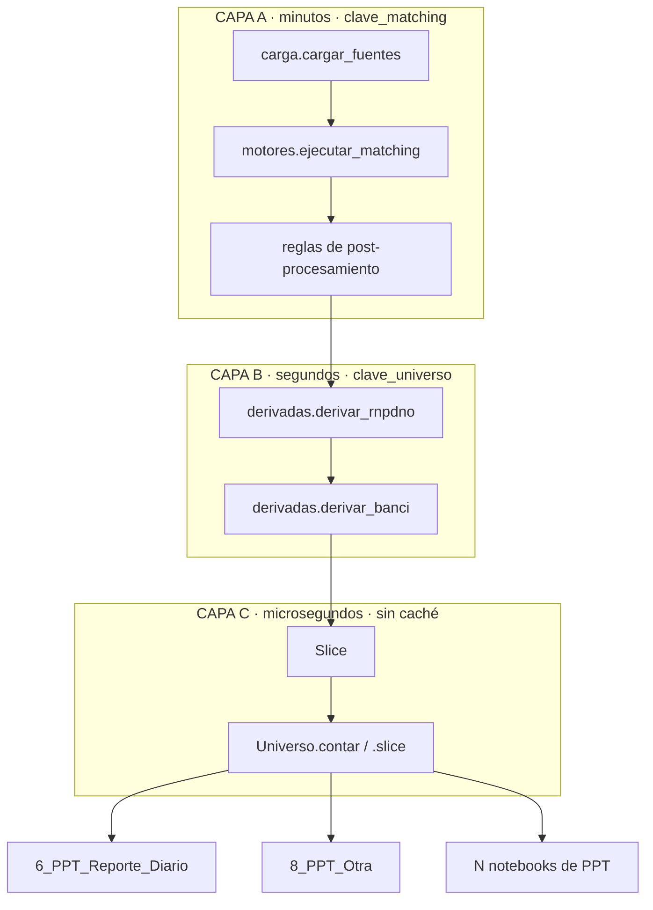

## Qué invalida el caché

Un caché sólo se reutiliza si todo lo que pudo influir en él sigue igual. `Universo.construir`
lo comprueba en dos pasos (`src/pipeline/huella.py`):

**1. La llave.** `clave_matching` y `clave_universo` resumen:

| Qué | Cómo se mide | Por qué así |
|---|---|---|
| El perfil | todos los campos de `Settings` de la capa, más el **rango** de `periodo_match` | un campo nuevo entra solo; el nombre del período no basta si cambian sus fechas |
| `config.py` | los valores **en memoria** tras importarlo y el código de sus funciones | varios valores dependen del entorno (`PIPELINE_MODO_INSUMOS`) o de un `glob`; un config.py editado pero no recargado sigue calculando con lo anterior |
| El código | el AST de los módulos raíz de la capa y de todo lo que importan del proyecto | comentar o mover código no invalida; cambiar lo que ejecuta, sí |
| Los insumos del perfil | tamaño y fecha de modificación | además de la revisión del paso 2 |

Cambiar cualquiera da otra llave: el caché anterior no se borra, simplemente deja de
encontrarse. Quedan fuera, a propósito, el nombre del perfil (`estatal` y `reporte_diario`
comparten caché), los períodos de rebanado, la entidad y las rutas de salida de
`config.py` (`PPT_DIARIO_FILE` lleva la fecha de hoy y lo invalidaría cada día).

**2. Los archivos leídos.** Al construir se anota cada archivo que se lee —Parquet del ETL,
catálogo INEGI, respuestas del Secretariado…— con su firma, y se guarda en `huella.json`
junto al caché. Al leerlo se revisan: si alguno cambió, el caché se descarta y se avisa
cuál. Así un insumo nuevo queda cubierto sin tener que declararlo.

Dos protecciones más al escribir:

- **No se guarda desde un kernel desactualizado.** Si un archivo del código de la capa se
  modificó después de arrancar el proceso, el kernel puede estar corriendo la versión
  anterior: el resultado se calcula, pero no se guarda, y se pide reiniciar el kernel.
- **Escritura atómica.** Cada nivel se escribe en una carpeta temporal que se renombra al
  final: una corrida interrumpida no deja un caché a medias con la llave buena.

`forzar=True` (o `forzar_matching=True`) recalcula aunque el caché valga, y
`limpiar_cache(cfg)` lo borra.

## La entidad es una dimensión, no un filtro

Antes, `config.ESTADO` filtraba RNPDNO y BANCI **antes** de los motores, así que cada PPT
estatal exigía su propia corrida de matching (32 corridas para 32 entidades). Además, un
caso de BANCI de una entidad no podía casar con un registro del RNPDNO capturado en otra.

Ahora el universo se construye **siempre nacional** y la clave de entidad viaja como
columna en los dos frames: `idestado_derivada_rnpdno` en `u.rn` (la del ETL, sin copiarla)
y `cve_entidad_derivada_banci` en `u.ba` (`DIMENSIONES` en `derivadas.py`). La entidad se
aplica al rebanar:

```python
Slice("rn", "01oct24-max", estatus="des", estado=17)   # Morelos
```

Consecuencias:

- Una sola corrida de motores alimenta las 32 entidades.
- El matching entre entidades ya es posible, así que los conteos estatales pueden ser
  **ligeramente mayores** que con el esquema anterior. Es un resultado más completo, no
  un error, pero conviene tenerlo presente al comparar contra cifras publicadas.

## Clasificación de carpeta de investigación

`config.MODALIDAD_CLASIFICACION_CARPETA` decide qué expediente cuenta como folio válido
(`cfval`, en `is_cfval_derivada_rnpdno`):

| Modalidad | Regex | RNPDNO con folio válido (corte 29-sep-2026) |
|---|---|---|
| 1 | `RNPDNO_REGEX_CARPETA`, uno para todo el país | 45,705 |
| 2 | `CATALOGO_REGEX_CI_POR_ENTIDAD`, uno por entidad | 103,079 |
| 3 | `CATALOGO_REGEX_CI_POR_ENTIDAD_2`, uno por entidad, más las siglas de Oaxaca | sin medir con ese corte |
| 4 | `CATALOGO_REGEX_CI_POR_ENTIDAD_3`, unión de la 2 y la 3, sin las siglas de Oaxaca | sin medir con ese corte |

La modalidad 3 es la traducción del código en R. En Oaxaca agrega una segunda capa,
porque su patrón acepta casi cualquier número-texto-año: de los folios que lo pasan se
extraen las siglas —lo que hay entre el consecutivo inicial y el año final,
`REGEX_SIGLAS_CI_OAXACA`— y deben existir en `config.CATALOGO_NOMENCLATURA_OAXACA`. Esa
capa sólo quita carpetas, nunca las agrega. Si el catálogo queda vacío, la modalidad 3 se
detiene con un error en vez de mandar todo Oaxaca a "Sin carpeta".

Encima de la modalidad, `config.MODALIDAD_MANUAL_CLASIFICACION_CARPETA = True` suma los
registros de una revisión manual aunque su folio no pase el regex o venga vacío, sea cual
sea `MODALIDAD_CLASIFICACION_CARPETA`. Se leen todos los archivos de
`input/carpetas_manuales/` (`config.CARPETAS_MANUALES_DIR`) y cuenta todo `fub_rnpdno` que
traigan, diga lo que diga su dictamen («Válido», «Se repite», «Vacío»). Esa capa sólo
agrega carpetas. Con `False` los archivos ni se leen. Para sumar una revisión basta con
dejarla en la carpeta: la firma de cada archivo entra en `clave_universo` y el caché se
recalcula solo. Con la primera revisión (`sin_carpeta_a_partir_de_julio.xlsx`, 187 FUBs,
uno con el expediente vacío) el folio válido pasa de 119,642 a 119,829 en el corte del
8-oct-2026.

Las revisiones van en **Parquet**: de él se lee sólo la columna `fub_rnpdno`, y el Excel
hay que leerlo entero. El Excel se sigue aceptando para que ninguna revisión vieja quede
fuera (`config.CARPETAS_MANUALES_EXTENSIONES`). Un archivo con otra extensión no se lee, y
el pipeline avisa con su nombre; a uno sin la columna `fub_rnpdno` lo detiene con error.
Un FUB que aparece en dos archivos cuenta una vez.

La implementación es única —`src.cleaning.clasificar_carpeta`— y la usa la CAPA B
(`derivadas.py`) sobre `expedientes_rnpdno`. El perfil hereda la modalidad de `config.py`;
sólo se sobrescribe en `perfiles/*.toml` si un reporte concreto necesita otra.

Antes el ETL y la carga también marcaban una indicadora de carpeta
(`indicadora_carpeta_derivada_rnpdno`, `indicadora_carpeta`) con su subfiltro
`ccarp`/`scarp`. Ningún indicador los usaba, así que se quitaron: el criterio de carpeta
sólo alimenta `cfval`.

Un detalle a tener presente:

- 29 de los 32 patrones del catálogo llevan `(?i)` después del ancla `^`, lo que el
  módulo `re` de Python 3.11+ rechaza. `clasificar_carpeta` iza esos flags al inicio
  (`normalizar_regex`), lo que da resultados idénticos y evita depender de que las
  columnas sean Arrow-backed —donde pandas despacha a RE2, que sí lo tolera—.

## El archivo de confrontas

`config.CONFRONTAS_FILE` es lo que aporta `indicadora_indicio_de_vida_derivada_pui` (el
indicio de vida en la PUI) al RNPDNO. Desde que existe el notebook 3, apunta a un Parquet de `output/`:

```python
CONFRONTAS_FILE = OUTPUT_DIR / "Resultado_3_Procesamiento_ETL_PUI.parquet"
```

Antes se entregaba a mano como Excel en `input/confrontas/`, y esa carpeta ya no forma parte
del pipeline. El lector (`src/pipeline/carga.py`) **sigue aceptando `.xlsx`**: elige según
la extensión, porque `read_parquet` no admite un callable en `columns` y para Parquet el
predicado de selección se aplica sobre los nombres del esquema. Un perfil puede así apuntar
a un archivo antiguo sin tocar código.

De ese archivo el pipeline toma **una sola columna**. El mapeo
`config.CONFRONTAS_COLUMN_MAPPING` acepta el nombre que exporta el notebook 3
(`indicadora_indicio_de_vida_derivada_pui`) y los de archivos anteriores
(`indicadora_registro`, `indicadora_indicio_de_vida`); `carga.py` la colapsa a binaria y la
deja en `indicadora_indicio_de_vida_derivada_pui`. Cómo se
construye esa columna y en qué se convierte después está en
[8. Indicios de vida](docs/8_indicios_de_vida.md).

## Configuración: `config.py` vs. perfiles

| | `config.py` | `perfiles/*.toml` |
|---|---|---|
| Contenido | rutas base, mapeos de columnas, catálogos de regex, `ENTIDADES`, `PERIODOS_TIEMPO`, `MODALIDAD_CLASIFICACION_CARPETA` | qué archivo fuente usar, orden de cascada, reglas activas, tolerancias, entidad |
| Cambia | casi nunca | por reporte |
| Cómo se lee | `import config` | `Settings.desde_perfil("reporte_diario")` |

`Settings` es un dataclass **congelado**: no hay `importlib.reload`, y dos configuraciones
pueden coexistir en el mismo kernel de Jupyter.

```python
cfg_a = Settings.desde_perfil("reporte_diario")
cfg_b = Settings.desde_perfil("estatal").con(estado=17)   # ambas vivas simultáneamente
```

## Variantes de lógica sin bifurcar notebooks

Cuando una PPT necesita un criterio distinto de "match confirmado" —no sólo otro parámetro—
se escribe una regla en `src/pipeline/reglas.py` y se nombra en el perfil:

```toml
reglas_post = ["excluir_revision_manual", "regla_r_desfase_dias"]
```

Quitar un nombre de esa lista desactiva la regla. Así se obtienen versiones del pipeline sin
duplicar el notebook 4 en `4_a` / `4_b` / `4_c`.

## Precalentar el caché fuera de Jupyter

```bash
python -m src.pipeline info    --perfil reporte_diario   # configuración y estado del caché
python -m src.pipeline build   --perfil reporte_diario   # construye el universo
python -m src.pipeline limpiar --perfil base --nivel universo
```

Útil para dejar el caché listo antes de abrir los notebooks, o desde una tarea programada.

---

# 7. Llaves de cruce entre BANCI y RNPDNO

Las metodologías de matching (ver [3. Metodología de Matching](docs/3_metodologia_de_matching.md))
viven dentro del pipeline: producen conteos e indicadores, pero el resultado no se puede
usar desde fuera. Quien tiene los archivos de origen —BANCI y RNPDNO tal como los entregan
el Secretariado y la Comisión Nacional— no tiene forma de saber qué carpeta corresponde a
qué reporte de búsqueda.

Esta capa cierra esa brecha: devuelve **los mismos archivos**, con una columna que aparea
las dos bases y unas columnas más que explican **cómo** se decidió cada apareo.

```text
src/pipeline/exportacion_llaves.py              el módulo
notebooks/7_Exportacion_Bases_Con_Llave.ipynb   la invocación
output/bases_con_llave/<perfil>/                la salida
```

La salida se separa **por perfil** porque los archivos llevan el mismo nombre que su
origen y contenido distinto según lo que se cruce:

| Perfil | Universo | Carpetas con cruce | Personas con cruce |
|---|---|---:|---:|
| `reporte_diario` | desaparecidos del sexenio | 7,253 | 7,171 |
| `cruce_total` | **todo contra todo** | **25,438** | **24,899** |

---

## 7.1. Qué se entrega

| Archivo | Qué es |
|---|---|
| `SUBIR_R_<corte>.xlsx` | el BANCI de origen, idéntico, **+14 columnas** en la hoja `Victimas` |
| `reporte_personas_completo_<corte>.parquet` (o `reporte_personas_<corte>.xlsx`) | el RNPDNO de origen, idéntico, **+11 columnas** al final |
| `mapa_cruce_<corte>.parquet` / `.csv` | la tabla puente: sólo los pares, sin el resto de las bases |
| `manifiesto_<corte>.json` | qué archivos se usaron, con qué reglas y qué salió |

**Cada base sale en el formato en que entró.** BANCI es un Excel de varias hojas y sale como
Excel. El RNPDNO puede entrar de dos formas (`config.formato_rnpdno`, por la extensión de
`config.RNPDNO_LOCAL_FILE`): si es el Parquet de tabla única sale como Parquet; si es el Excel
de tres hojas sale como Excel, con el bloque de columnas en cada hoja. En los dos casos las
columnas se aparean por FUB, no por posición.

**Idéntico quiere decir idéntico:** mismas filas y en el mismo orden, mismas columnas con el
mismo nombre, y el mismo nombre de archivo. En BANCI, además, las mismas hojas y en el mismo
orden (la `Hoja1` se copia tal cual, sin columnas nuevas). Lo único que cambia es el bloque
de columnas añadido al final.

Lo que **no** se conserva — **todo esto es de los Excel** (BANCI, y el RNPDNO cuando entra en
Excel). El RNPDNO en Parquet sale sin ninguna desviación: pandas conserva los dtypes tal cual
y `validar_export_parquet` lo comprueba columna por columna, dtype incluido.

| Qué | Por qué | Alcance en la corrida vigente |
|---|---|---|
| estilos, anchos de columna, tablas dinámicas | una reescritura no los mantiene | la `Hoja1` de BANCI queda con sus valores, sin el objeto dinámico |
| celdas con cadena vacía `''` → celda vacía | openpyxl no distingue una de otra | 149,586 celdas de BANCI (`COORD_X`, `COORD_Y`…). pandas lee las dos como `NaN` |
| decimales de 17 dígitos → 16 | openpyxl serializa con 16 significativos; **Excel guarda 15** | 219 celdas de BANCI. En coordenadas, 1e-10 metros |

Fue una decisión explícita: aquí importan los valores, no el formato. Las tres desviaciones
las **cuenta y reporta** `validar_export` en cada corrida; ninguna se silencia.

---

## 7.2. La llave es el FUB

`id_cruce` es el FUB del RNPDNO. En el RNPDNO es el propio FUB de la fila; en BANCI, el del
reporte con el que casó. Un `VLOOKUP` por esa columna entre los dos archivos basta.

**Por qué el FUB y no un identificador nuevo.** Es estable entre cortes, es legible y
cualquiera puede verificar un par a ojo. Inventar un identificador opaco es exactamente el
error que ya costó caro aquí: el `id_registro` sha1 que construía el Secretariado no se
podía reproducir desde el BANCI de origen, cruzar por él daba cero, y **561 confirmaciones
humanas nunca se aplicaban**. Una llave que no se puede regenerar desde los datos no
es una llave.

> ⚠️ **La relación es N:1.** Varias carpetas de BANCI pueden apuntar a la misma persona:
> en la corrida vigente son 79 FUB. Cruzar de RNPDNO hacia BANCI **multiplica filas** en
> esos casos. `n_registros_banci` dice cuántas esperar y `id_registro_banci_principal`
> apunta al registro representativo si se quiere un 1:1.
>
> Ese número era 4,663 antes de corregir la atribución del motor estándar: la
> multiplicidad era casi toda artefacto de que el mismo FUB se pegaba a carpetas que no le
> correspondían.

### `id_registro_banci`: por qué BANCI necesita identidad propia

BANCI **no tiene llave única**: 34,777 filas contra 31,744 valores distintos de `LLAVE`.
La diferencia son las carpetas colectivas —varias víctimas en un mismo expediente—, así que
cruzar por `LLAVE` duplica filas silenciosamente.

`id_registro_banci` = identificador de carpeta + ordinal de la víctima dentro de la carpeta,
en el orden del archivo:

```text
GUERRERO/12022510900117040725#01
└──────────── carpeta ────────┘ └┘ ordinal
```

Se puede regenerar desde el Excel de origen sin correr el pipeline. Ésa es la propiedad que
hace confiable a una llave, y la que le faltaba al sha1 del Secretariado.

---

## 7.3. Diccionario de columnas

### BANCI · hoja `Victimas`

| Columna | Valores | Qué dice |
|---|---|---|
| `id_registro_banci` | `ENTIDAD/carpeta#NN` | identidad de la fila |
| `fila_origen_banci` | entero | renglón físico en la hoja de origen (ancla de auditoría) |
| **`id_cruce`** | FUB · **vacío** | **la llave.** Vacío = esta carpeta no se apareó con nadie |
| `estatus_match` | `con_cruce` · `candidato_revision_manual` · `sin_cruce` | siempre tiene valor |
| `metodo_match` | `manual` · `estandar` · `refinado` | el motor que ganó la cascada |
| `submetodo_match` | `match_fub` · `match_curp` · `match_nombre` · `match_confirmado_sesnsp` · `definitivo` · `parcial (algun caracter distinto)` | el criterio exacto |
| `nivel_match` | `1` · `2` · `3` | el escalón del embudo del motor estándar (§3.2) |
| `metodos_concurrentes` | `"estandar, refinado"` | **todos** los motores que sostienen ese mismo FUB. Con `cascada_en_ejecucion = true` (§3.1) siempre nombra a uno solo: el motor que resolvió la fila sacó a los demás de la jugada |
| `fub_candidato_revision` | FUB | el que propuso el refinado y **no** se confirmó |
| `fubs_adicionales_manual` | FUB separados por `;` | otras personas validadas en la misma revisión |
| `score_match` | 0–100 | score del motor ganador |
| `evidencia_match` | texto | las variables que sostuvieron el match |
| `corte_match` | `AAAA-MM-DD` | corte de los datos |
| `version_match` | hash de 16 caracteres | `clave_matching`: identifica la corrida exacta |

### RNPDNO · tabla única (las tres hojas apiladas; `estatus` las distingue)

| Columna | Qué dice |
|---|---|
| **`id_cruce`** | el propio FUB si alguna carpeta de BANCI lo reclamó; vacío si no |
| `estatus_match` | `con_cruce` · `candidato_revision_manual` · vacío |
| `metodo_match`, `submetodo_match`, `nivel_match` | los del registro principal de BANCI |
| `metodos_concurrentes` | todos los métodos que alcanzaron este FUB, desde cualquier carpeta |
| `n_registros_banci` | cuántas filas de BANCI apuntan aquí (**el aviso de N:1**) |
| `id_registro_banci_principal` | el registro representativo: mayor prioridad en la cascada y, a igualdad, el primero del archivo |
| `carpeta_banci_principal` | su carpeta, sin el ordinal de víctima |
| `corte_match`, `version_match` | igual que en BANCI |

---

## 7.4. `revision manual`: sin cruce, pero no "nada"

El motor refinado propone candidatos que no alcanzan a ser match y que en
`normalizar_folios_v6.py` van a un Excel para que una persona los valide. La regla
`excluir_revision_manual` los retira de la oferta antes de la cascada (§3.5).

Antes se borraban sin dejar rastro, y quedaban **indistinguibles** de las filas donde ningún
motor encontró nada: se perdía justo la cola de trabajo que alguien tiene que revisar. Ahora
`_anular_motor` copia la oferta anulada a `tipo_match_<motor>_anulado` /
`id_match_<motor>_anulado` / `motivo_anulacion_<motor>` antes de borrarla. Esas columnas
**no participan en la cascada**: son evidencia, no oferta. Al caché de la capa A llegan las
dos primeras, como `tipo_match_<motor>_anulado_derivada_rnpdno_banci` /
`id_match_<motor>_anulado_derivada_rnpdno_banci`, que son las que lee la exportación; el
motivo no lo lee nadie y no se guarda.

En los archivos exportados eso se ve así:

| | `id_cruce` | `estatus_match` | `fub_candidato_revision` |
|---|---|---|---|
| match confirmado | el FUB | `con_cruce` | vacío |
| candidato sin validar | **vacío** | `candidato_revision_manual` | el FUB propuesto |
| nada | **vacío** | `sin_cruce` | vacío |

La llave nunca se ensucia: un candidato **no** es un cruce, y `id_cruce` sigue vacío. Para
trabajar la cola basta filtrar `estatus_match == "candidato_revision_manual"`.

---

## 7.5. El contrato de verificación

`validar_export` reabre los archivos escritos y **falla ruidosamente** si:

- cambian los nombres o el orden de las hojas (BANCI);
- cambia el número de filas;
- **alguna celda original no es idéntica** a la del archivo de origen (comparación completa,
  celda por celda, no muestreo). Las únicas tolerancias son las tres deformaciones de la
  tabla de §7.1, y están acotadas: la de decimales es exactamente el ancho del redondeo de
  openpyxl (1e-15 relativo), no un `isclose` genérico que pudiera tapar un error de
  conversión;
- aparecen columnas nuevas distintas de las declaradas, o en otro orden;
- algún `id_cruce` de BANCI no existe en el RNPDNO, o el conjunto de FUB apareados no
  coincide con `fubs_matcheados` de la CAPA A;
- algún FUB del mapa no aparece en el archivo del RNPDNO (señal de que la salida del notebook 1 y
  el archivo de origen son de cortes distintos).

No es paranoia. El valor de estos archivos depende por completo de que se puedan usar **en
lugar** de los originales; una diferencia silenciosa —una fecha convertida a texto, una fila
corrida— haría que todo lo que se cruce después estuviera mal sin que nadie se enterara.

---

## 7.6. Resultado de la corrida vigente

| BANCI (34,777 carpetas) | Registros |
|---|---:|
| `con_cruce` | 7,253 |
| `candidato_revision_manual` | 3,762 |
| `sin_cruce` | 23,762 |

| Método ganador | Registros | Subcriterios |
|---|---:|---|
| `estandar` | 6,121 | nivel 1 (FUB) 3,351 · nivel 2 (CURP) 1,410 · nivel 3 (nombre) 1,360 |
| `refinado` | 571 | `definitivo` 555 · `parcial` 16 |
| `manual` | 561 | `match_confirmado_sesnsp` 561 |

| RNPDNO (408,600 reportes) | Registros |
|---|---:|
| FUB con cruce | 7,171 |
| FUB marcados como candidato a revisión | 1,933 |
| FUB alcanzados por más de una carpeta | 79 |

Los 7,253 registros de BANCI apuntan a 7,167 personas distintas; los 4 FUB restantes hasta
7,171 vienen de `fubs_adicionales_manual` —personas validadas en una revisión que ninguna
fila puede llevar como `id_cruce`— y se reclaman sólo del lado del RNPDNO (§3.3).

> Cifras de la corrida del 7 de septiembre de 2026, ya con la atribución del motor estándar
> corregida. Cualquier exportación anterior a esa fecha tiene el `id_cruce`
> equivocado en las filas con `metodo_match = estandar` y debe regenerarse.

---

## 7.7. Cuándo hay que volver a exportar

La exportación **no calcula matches**: toma la CAPA A del universo que se construye en el
mismo notebook (`exportar_bases_con_llave(u)`), del caché si sigue valiendo. Hay que volver a
correr el notebook 7 cuando cambie cualquier cosa que mueva `clave_matching`: los archivos
de origen, las reglas del perfil, el orden de la cascada o las tolerancias. `version_match` viaja en cada fila exportada justamente para poder
distinguir de qué corrida salió una llave.

---

## 7.8. Bases para la revisión del Secretariado

[`src/pipeline/revision_sesnsp.py`](src/pipeline/revision_sesnsp.py) escribe las dos bases
que antes se armaban a mano con las salidas del script de R y de `normalizar_folios_v6.py`,
y que el Secretariado devolvía contestadas:

| Base | Función | Qué pares | Respuesta | Vuelve como |
|---|---|---|---|---|
| Candidatos a revisión manual | `exportar_candidatos_revision` | el mejor candidato que el refinado propone para cada registro sin match (score 1–99) | `VALIDA` | `revision_manual_score_SESNSP.xlsx` |
| Verificación de fecha de hechos | `exportar_revision_fecha_hechos` | matches que la fecha de hechos no confirma (abajo) | `VALIDO` | `matches_verif_fecha_hechos_SESNSP.xlsx` |

Salen en `output/revision_sesnsp/<perfil>/`, con el corte del RNPDNO en el nombre.

### El perfil `revision_secretariado` (notebook 8)

Los candidatos tienen que salir con la lógica del flujo que se usaba antes: primero el
script de R y, **sobre lo que éste dejaba sin match**, `normalizar_folios`, buscando en
**todo** el RNPDNO. Eso es el perfil `perfiles/revision_secretariado.toml`, que usa el
notebook 8:

- **Motores en cadena** (`cascada_en_ejecucion = true`): el refinado sólo propone
  candidatos para los registros que el estándar no emparejó.
- **Sin `regla_r_desfase_dias`**: en R un match del estándar con fecha que difiere, o con
  FUB localizado, sigue siendo match, así que ese registro no pasa al refinado.
- **Todo el RNPDNO** (`filtrar_rnpdno_clasificacion = false`, `fecha_sexenio = "1900-01-01"`):
  localizados y todos los años. BANCI, sólo no localizados.

Se comprobó contra `resultado_unificado_para_revision_30092026.xlsx`, armado con ese flujo:
con esta lógica coinciden 86 % de sus registros de BANCI; con la de `reporte_diario`
coincidían 132 pares. El FUB propuesto coincide menos, porque los dos flujos desempatan
sin regla explícita cuando dos candidatos tienen el mismo score: es una decisión pendiente.

> No es un perfil para indicadores: abre el universo y quita una regla, así que sus
> matches no son los de `reporte_diario`. Tiene su propia llave de caché.

### Qué pares van a verificación de fecha

| Motor | Qué pares entran | Regla de origen |
|---|---|---|
| estándar | `match_definitivo == "DIFIERE"`: más de 10 días entre las dos fechas de hechos | script de R: la columna con que se partía su base en definitivos y a revisar |
| refinado | los definitivos cuya fecha no cupo en ±10 días o que no la tienen (`SIN DATO`), en las filas que sostiene el refinado | `normalizar_folios_v6.py` → `matches_verif_fecha_hechos_v6.xlsx` |

`motor_origen` dice de cuál viene cada par. Si los dos motores proponen el mismo par sale
una sola vez, como `estandar, refinado`, con la trazabilidad del estándar. No se mandan
pares cuyo FUB no está en el universo RNPDNO del motor manual: un SI ahí no tendría
efecto, porque el motor manual descarta ese FUB.

### Lo que no se vuelve a mandar

Lo que el Secretariado ya contestó, con la regla de v6, en las dos bases: en la
verificación de fecha el SI y el NO cierran el caso; en la revisión por score el SI lo
cierra y el NO sólo bloquea ese par; un FUB ya emparejado no se vuelve a proponer. Lo que
quedó **sin respuesta** se vuelve a mandar.

### Formato e ida y vuelta

Una hoja `revision`, un par por renglón, con la columna de respuesta vacía y las columnas
de los archivos que el Secretariado ya devolvió, en los nombres que reconoce
`leer_revisiones_sesnsp`. Del lado de BANCI van también `id_registro_banci` y
`fila_origen_banci` (§7.2). La hoja `resumen` dice cuántos pares propuso cada motor y
cuántos se descontaron.

Al escribirla se vuelve a leer como si ya estuviera contestada y se comprueba que cada
renglón se liga con su registro de BANCI por contenido (entidad + carpeta + CURP / nombre /
fecha de nacimiento), que es lo que hará el motor manual. Si alguno se ligara con otro
registro, la exportación falla; los que no se pueden ligar (carpetas colectivas sin llave
que distinga a la víctima) se reportan.

> Las bases **no cambian ningún resultado**: sólo leen la capa A del universo. Las respuestas
> entran por el motor manual, que hoy lee un archivo de cada tipo
> (`config.REFINADO_RUTA_VERIF_FECHA_HECHOS`, `config.REFINADO_RUTA_REVISION_MANUAL`): los
> renglones contestados hay que agregarlos a esos archivos, no reemplazarlos, o se perderían
> las respuestas anteriores.

---

# 8. Indicios de vida: del ETL de PUI al indicador

Todo lo que en el proyecto se llama "indicio de vida" sale de aquí. Este capítulo sigue el
dato desde los archivos que llegan a `input/pui/` hasta los marcadores `{{...}}` que
imprime la plantilla.

## 8.0. Dos cosas distintas con el mismo nombre

Antes de nada, la confusión que hay que quitarse de encima: **en el repositorio conviven
dos "indicios de vida" que no son el mismo dato y no se calculan igual.**

| | `cind` / `sind` | `fmz` (lámina 12) |
|---|---|---|
| **Qué es** | bandera del universo: esta persona tiene registro administrativo posterior a su desaparición | cuántos indicios de un corte congelado ya derivaron en una localización |
| **De dónde sale** | `input/pui/` → notebook 3 → `Resultado_3_*.parquet` | `input/domicilios_y_numeros_contacto/…24062026.xlsx` |
| **¿Pasa por el pipeline?** | sí: CAPA A la integra, CAPA B la convierte en bandera | **no**: es una foto fija que se cruza aparte |
| **¿Se recalcula cada corrida?** | sí, con la PUI del día | no: el archivo está congelado al 24/06/2026 |
| **Quién lo calcula** | `carga.py` + `derivadas.py` | `src.directorio_indicios.indicios_formalizados` |
| **Dónde aparece** | `..._des_cisf_cind`, `..._des_sisf` | `reg_rn_24jun26-max_loc_fmz` y sus variantes |

Las secciones 8.1 a 8.5 cubren la primera; la 8.6, la segunda.

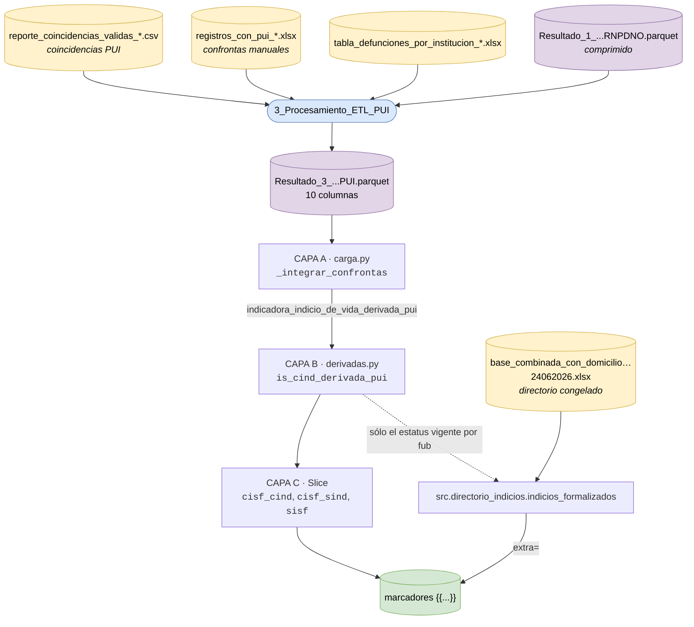

---

## 8.1. Los insumos del notebook 3

Los cuatro se declaran en `config.py` — **no hay autodetección**— y el cuaderno comprueba
los cuatro de golpe antes de leer nada, para no ir descubriendo faltantes de uno en uno.

| Archivo de entrada | Constante | Qué aporta | Filas (corte 14/09/2026) |
|---|---|---|---:|
| `input/pui/reporte_coincidencias_validas_2026-09-14.csv` | `PUI_COINCIDENCIAS_FILE` | coincidencias administrativas de la PUI: un renglón por evento detectado en otra institución | 175,433 |
| `input/pui/registros_con_pui_13032026.xlsx` | `PUI_REGISTROS_FILE` | confrontas **manuales** del RNPDNO, 5 columnas | 40,921 |
| `input/pui/tabla_defunciones_por_institucion_05052026.xlsx` | `PUI_DEFUNCIONES_FILE` | actas de defunción por institución | 3,639 |
| `output/Resultado_1_Procesamiento_ETL_RNPDNO.parquet` | `ETL_RNPDNO_OUTPUT_FILE` | del RNPDNO ya limpio: `fub`, CURP imputada, `clasificacion_des` y `fecha_hechos_modificada` | 408,958 |

Son los archivos de la corrida vigente; lo que manda es la constante, y cambiar de entrega
es apuntarla al archivo nuevo en `config.py`. La equivalencia con los nombres que usa el
script de R —`coincidencias_admin_con_inactivas`, `registros`, `defunciones_df` y
`comprimido`, que reaparecen más abajo— está en
[1. Fuentes de Información](docs/1_fuentes_de_informacion.md).

**Ésta es la única dependencia entre notebooks de ETL:** el 3 no puede correr sin el
Parquet del 1, porque necesita el RNPDNO para resolver clasificación, fecha de hechos y
CURP. Si falta, el cuaderno se detiene y lo dice.

> ⚠️ **No confundir** `registros_con_pui_DDMMYYYY.xlsx` (insumo, 5 columnas) con
> `registros_con_pui_activos_*.xlsx`, que son **salidas** antiguas del flujo en R.

### La CURP del comprimido es la imputada

```python
PUI_COMPRIMIDO_COLUMN_MAPPING = {
    'curp_victima': ['curp_vic_derivada_rnpdno'],   # la CURP IMPUTADA
    ...
}
```

`curp_victima` no existe con ese nombre en el Parquet del notebook 1: la equivalente es
`curp_vic_derivada_rnpdno`, que `src.cleaning.imputar_curps` rellenó desde los cruces.
**No sirve `curp_vic_rnpdno`**, la CURP original sin imputar: deja sin CURP a los registros
que sólo la tienen por imputación — justo los que el pipeline de R sí resuelve. Esta CURP
llega a la salida en las filas de defunciones (paso 9.2); con la columna equivocada, esas
filas salen con `curp_victima` vacía. El cruce por CURP + fecha del paso 6 no la usa: toma
la CURP de `registros`.

### La descarga del CSV no está automatizada

El ZIP llega a una carpeta de Drive bajo el patrón
`reporte_coincidencias_validas_YYYY-MM-DD.zip`. Hay que bajarlo, descomprimirlo y dejar el
`.csv` en `input/pui/`, y después **apuntar `config.PUI_COINCIDENCIAS_FILE` al archivo
nuevo**: copiarlo a la carpeta no cambia lo que lee el cuaderno.

La fecha del nombre es también la que etiqueta la corrida: `config.PUI_FECHA_CORTE = None`
hace que se derive del propio nombre del CSV (`2026-09-14` → `14092026`). Sólo es una
etiqueta; el archivo de salida tiene nombre fijo.

---

## 8.2. Qué hace el notebook 3, paso por paso

El cuaderno es la traducción a Python de `funcion_actualizar_confrontas_de_pui.R`, y sigue
el script línea por línea, **incluidos sus mensajes de diagnóstico y sus advertencias**.

### El flujo completo de un vistazo

Las cifras son las de la corrida del 14/09/2026. Las flechas punteadas marcan lo que el
`comprimido` sólo **presta** —una columna para resolver un cruce o un filtro—; no aporta
filas al resultado.

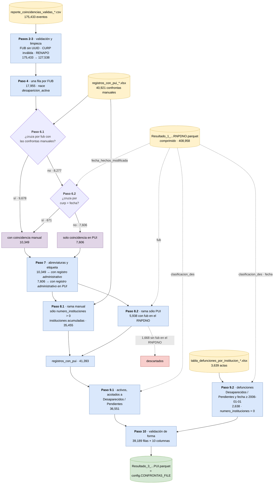

Tres cosas que el diagrama deja ver de un golpe y que son fáciles de perder leyendo el
código:

- **El archivo de confrontas manuales entra dos veces**: en el paso 6 como criterio de
  cruce y en el paso 8.1 como fuente de filas. Por eso la rama manual termina con 35,455
  registros y no con los 10,349 que casaron.
- **Las dos ramas se etiquetan distinto en el paso 7 y se vuelven a juntar en el 8**, ya sin
  esa distinción visible más que en `indicadora_coincidencia_manual`.
- **Las defunciones no pasan por ninguno de los cruces anteriores**: entran directas al
  final, con la misma etiqueta que los indicios de vida.

### Alcance deliberado

La función de R devuelve tres objetos; aquí se reproduce sólo uno:

| Salida de R | ¿Se reproduce? | Motivo |
|---|---|---|
| `registros_con_pui_activos` | ✅ sí | es `Resultado_3_*.parquet`, lo que consume `config.CONFRONTAS_FILE` |
| `comprimido_actualizado` | ❌ no | pide `sub_clasificacion` e `indicadora_indicio_de_vida_localizados`, que el notebook 1 todavía no genera |
| `registros_en_pui_no_activos` | ❌ no | sólo existe para alimentar al anterior |

Por eso se omiten los bloques *"Primera modificación en comprimido"* y *"Segunda
modificación: sub_clasificacion"* del script original.

### Paso 0 · equivalencias R → pandas

`dplyr` y `stringr` no se comportan como pandas con los nulos ni con el orden, así que el
cuaderno define los equivalentes exactos antes de tocar los datos:

| Helper | Réplica de | Por qué no vale el de pandas |
|---|---|---|
| `primero` | `dplyr::first()` | `GroupBy.first()` **salta los nulos**; `first()` de R no |
| `paste_unique` | `paste(unique(x), collapse=", ")` | conserva el orden de primera aparición |
| `paste_sorted_unique` | `paste(sort(unique(x)), …)` | — |
| `r_str_replace_all` | `stringr::str_replace_all()` con vector nombrado | aplica los patrones **en secuencia**, no en paralelo: la salida de uno es la entrada del siguiente |
| `conteos_en_orden_de_aparicion` | `table(x)` + reindex | — |
| `clean_names` | `janitor::clean_names()` | — |

### Paso 1 · carga del CSV

Todo se lee **como texto** (`dtype=str`) para no perder los ceros a la izquierda de
`institucion_id` (`"0044"` = RENAPO), que el cuaderno usa como filtro. `solo_mapeadas=False`
conserva las columnas extra: el mapeo fija el mínimo exigido, no el máximo.

### Paso 2 · validaciones de entrada

| Comprobación | Si falla |
|---|---|
| las 16 columnas de `PUI_COINCIDENCIAS_COLUMN_MAPPING` | **error**, ya en la lectura |
| `fase_busqueda ∈ {2, 3}` | **error**, con el conteo de los valores encontrados |
| `curp` vacías | advertencia, el proceso sigue |
| `is_valid` interpretable como lógico | advertencia |

`is_valid` llega como texto (`"True"` / `"False"`) y se convierte a booleano; es lo que más
adelante se renombra `desaparicion_activa`.

### Paso 3 · limpieza de las coincidencias

Cuatro operaciones, en este orden:

1. **FUB sin UUID.** La columna `fub` del CSV concatena el FUB del RNPDNO con el UUID de la
   coincidencia. Se recorta el bloque final de 32 hexadecimales y el guion sobrante:
   ```
   18DA6B13D-9A39-467E-B380-C5BE232F54A3-45D440DB-9731-42CC-9904-EF66E51E59E4
   → 18DA6B13D-9A39-467E-B380-C5BE232F54A3
   ```
   Sin esto **ningún cruce por FUB casaría**.
2. **CURP inválidas conocidas.** Se eliminan las listadas en `input/pui/curps_excluidas.txt`,
   una por renglón. Viven fuera de git porque son datos personales.
3. **RENAPO (`institucion_id == "0044"`).** Fuera las actas de nacimiento
   (`Tipo de Acto: Nacimiento`) y los eventos que contienen `|1`. El resto de RENAPO sí se
   conserva desde el 8 de junio de 2026. Es la limpieza que más filas descarta.
4. **Institución dentro del evento.** A `tipo_evento` se le adjunta la institución entre
   paréntesis, porque después los eventos se concatenan y hay que saber de quién es cada uno.

En el corte del 14/09/2026: **175,433 → 127,538 filas** (se descartan 47,895).

### Paso 4 · agregación por FUB

De un renglón por evento a **un renglón por persona**: 127,538 → **17,955 FUB**. Se
concatenan instituciones y eventos, se cuentan instituciones distintas y se toma el primer
valor del grupo para los campos de contexto (fechas, domicilio).

De aquí sale `desaparicion_activa` (15,938 activas / 2,017 inactivas), que decide qué
sobrevive al paso 9.

> ⚠️ `tramites_repetidos` parte `tipo_evento` por `", "`, y **los propios eventos contienen
> comas** (`"Fecha Registro: 1967-09-23, CURP: …, Tipo de Acto: Nacimiento"`), así que el
> corte no separa eventos completos sino fragmentos. Es el comportamiento del script de R y
> se conserva tal cual para no alterar la salida.

### Paso 6 · cruce con las confrontas manuales

Dos intentos, en cascada:

1. **Por `fub`.** 9,678 casan; 8,277 no.
2. **Por `curp_victima` + `fecha_hechos_modificada`**, sobre los que no casaron. Recupera a
   la misma persona registrada bajo un FUB distinto: 671 más.

Resultado: **10,349 con coincidencia manual** y **7,606 sólo en la PUI**.

### Paso 7 · aquí nace `indicadora_indicio_de_vida`

Se abrevian los nombres de institución y se unen las dos ramas. El valor se asigna así:

| Rama | `indicadora_coincidencia_manual` | `indicadora_indicio_de_vida` |
|---|---|---|
| PUI **y** confronta manual | `coincidencia en PUI y registro manual` | `con registro administrativo` |
| sólo PUI | `solo coincidencia en PUI` | `con registro administrativo en PUI` |

### Paso 8 · pegado con los registros manuales

- De `registros` se descartan las filas con `numero_instituciones == 0`: son defunciones que
  ya venían en ese archivo y se reincorporan en el paso 9 desde su propio insumo.
- Los FUB que están en ambas fuentes **acumulan**: se concatenan los nombres de institución
  y se suman los conteos.
- Los que sólo existen en la PUI se cruzan contra el `comprimido` y **se descartan los que
  no tienen FUB en el RNPDNO** (1,668 de 7,606). Un indicio de vida sobre alguien que no
  está en el registro no le sirve a nadie río abajo.

Total tras el pegado: 41,393 filas.

### Paso 9 · filtro de activos y anexo de defunciones

1. Se conservan las desapariciones **activas** y las de la rama manual (`desaparicion_activa`
   nula, porque no vienen de la PUI y no se sabe su estado).
2. Se acotan a `clasificacion_des ∈ {Desaparecidos, Pendientes}` según el comprimido →
   36,551 filas.
3. Se anexan las **defunciones**: mismo filtro de clasificación, más `fecha_hechos_modificada
   ≥ 2006-01-01` → 2,638 filas. Se les pone `numero_instituciones = 0`, se reescribe
   `defuncion_INE` → `defuncion de INE` y **se les asigna también
   `indicadora_indicio_de_vida = "con registro administrativo"`**.

Total: **39,189 filas**.

> ⚠️ **`cind` no significa literalmente "está vivo".** Las defunciones entran con la misma
> etiqueta que los indicios de vida — el propio cuaderno lo dice al imprimir *"tanto
> defunciones como indicios de vida"*—, así que la lectura correcta de la bandera es **"hay
> registro administrativo posterior a la desaparición"**. Son 2,638 de 39,189 en el corte
> vigente.

### Paso 10 · validación y guardado

Antes de escribir se comprueba: las diez columnas en orden, sin FUB nulos, sin duplicados
**dentro de una misma rama**, y `clasificacion_des` acotada.

El chequeo de duplicados distingue dos casos, porque no son lo mismo:

- **Solape PUI ↔ defunciones.** La misma persona puede tener un trámite en la PUI y un acta
  de defunción; las dos ramas se unen sin deduplicar y salen dos filas. El script de R hace
  exactamente lo mismo. Es esperado: se informa, no se marca como problema.
- **Duplicados dentro de una rama.** Eso sí es anómalo y apunta a FUB repetidos en algún
  insumo (`registros` trae 19 en el corte vigente, y el cuaderno lo advierte al cargarlo).

### Paso 11 *(opcional)* · comparación contra el archivo de R

Si `config.PUI_REFERENCIA_FILE` apunta a la salida del script de R del mismo corte, la
última celda contrasta ambas: FUB compartidos, sobrantes, faltantes y discrepancias columna
por columna. Es la **única entrada opcional** del cuaderno —una verificación, no un insumo—
y con `None` la celda no hace nada.

---

## 8.3. El contrato de salida: 10 columnas

`output/Resultado_3_Procesamiento_ETL_PUI.parquet`. El cuaderno trabaja con los nombres del
script de R (`config.PUI_OUTPUT_COLUMNS`) y los renombra **sólo al exportar**, con
`config.PUI_NOMBRES_EXPORTADOS`, para que el sufijo diga de dónde sale cada columna (ver la
convención en [5. Diccionario](docs/5_diccionario_de_variables.md#convención-de-sufijos)):

| Columna exportada | En el cuaderno | Origen | Descripción |
|---|---|---|---|
| `fub_derivada_pui` | `fub` | ambas | llave de persona |
| `curp_victima_derivada_rnpdno_pui` | `curp_victima` | PUI / comprimido | CURP (imputada cuando viene del comprimido) |
| `indicadora_indicio_de_vida_derivada_pui` | `indicadora_indicio_de_vida` | derivada, paso 7 | `con registro administrativo` · `con registro administrativo en PUI` |
| `institucion_indicadora_de_vida_derivada_pui` | `institucion_indicadora_de_vida` | PUI + manual | instituciones acumuladas, ya abreviadas |
| `numero_instituciones_derivada_pui` | `numero_instituciones` | PUI + manual | suma de ambas ramas; `0` en defunciones |
| `indicadora_coincidencia_manual_derivada_pui` | `indicadora_coincidencia_manual` | derivada, paso 7 | de qué rama vino; nulo en defunciones y en confrontas manuales sin PUI |
| `tipo_tramites_derivada_pui` | `tipo_tramites` | PUI | eventos concatenados, con abreviaturas |
| `tramites_repetidos_derivada_pui` | `tramites_repetidos` | PUI | conteo por evento (ver la advertencia del paso 4) |
| `fecha_evento_derivada_pui` | `fecha_evento` | PUI | primera fecha del grupo; acota el reporte semanal |
| `clasificacion_des_derivada_rnpdno` | `clasificacion_des` | comprimido | `Desaparecidos` · `Pendientes` |

Distribución en el corte del 14/09/2026:

```
indicadora_indicio_de_vida            indicadora_coincidencia_manual
  con registro administrativo    34,561  NaN (defunciones y manuales)  26,127
  con registro administrativo en PUI 4,628  coincidencia en PUI y manual  8,434
                                           solo coincidencia en PUI      4,628
clasificacion_des
  Desaparecidos  32,358
  Pendientes      6,831
```

Las cinco columnas de `registros` son las que fijan el ancho: cinco de ahí, cuatro que
aporta la PUI y `clasificacion_des`, que llega del comprimido. Si `registros` trajera además
su propia `clasificacion_des`, el cruce la duplicaría.

---

## 8.4. Cómo se integra: de `Resultado_3` a `indicadora_indicio_de_vida_derivada_pui`

Lo hace `_integrar_confrontas` en [`src/pipeline/carga.py`](src/pipeline/carga.py),
dentro de la **CAPA A**, justo después de cargar RNPDNO y BANCI:

```
✅ Confrontas integradas (39,189 FUBs con registro).
```

El mapeo que gobierna la lectura vive en `config.CONFRONTAS_COLUMN_MAPPING`:

```python
CONFRONTAS_COLUMN_MAPPING = {
    'fub': ['fub_derivada_pui', 'fub'],
    'indicadora_registro': ['indicadora_indicio_de_vida_derivada_pui',
                            'indicadora_registro', 'indicadora_indicio_de_vida'],
}
```

El primer alias de cada lista es el nombre que exporta el notebook 3; los demás permiten
seguir leyendo archivos anteriores. La columna llega al universo como
`indicadora_indicio_de_vida_derivada_pui`.

Los cuatro pasos de la integración:

1. **Lectura acotada.** Sólo el FUB y la indicadora, por sus alias. El lector acepta Parquet y
   Excel: `read_parquet` no admite un callable en `columns`, así que para Parquet el
   predicado se aplica sobre los nombres del esquema. Así un perfil puede seguir apuntando a
   un `.xlsx` antiguo.
2. **Deduplicación por `fub`** antes de cruzar, para que el merge no multiplique filas del
   RNPDNO. Es donde se resuelve el solape PUI ↔ defunciones del paso 10.
3. **Merge `left` sobre el RNPDNO** por `fub`. Los FUB sin coincidencia quedan nulos y se
   rellenan con `sin registro administrativo`.
4. **Homologación.** Todo a minúsculas, sin espacios, y
   `"con registro administrativo en pui"` → `"con registro administrativo"`.

> ⚠️ **En el paso 4 se pierde a propósito la distinción entre las dos ramas.** Un registro
> que sólo aparece en la PUI y otro confirmado también por confronta manual quedan
> indistinguibles en el universo: `indicadora_indicio_de_vida_derivada_pui` es **binaria**.
> Si alguna vez hace falta separarlos en un indicador, el dato sigue existiendo en
> `indicadora_coincidencia_manual_derivada_pui` dentro del Parquet, pero habría que traerlo
> en el merge.

> La dependencia que alimenta `fis` / `com` / `por` es la del RNPDNO (corregida por el cruce
> con BANCI), no la de la PUI.

---

## 8.5. De la columna a las banderas y a los marcadores

En la **CAPA B**, [`src/pipeline/derivadas.py`](src/pipeline/derivadas.py) convierte la
columna en banderas booleanas:

```python
ind = _serie_txt(rn, "indicadora_indicio_de_vida_derivada_pui").str.strip()
out["is_cind_derivada_pui"] = (ind != "sin registro administrativo").to_numpy()
```

`sind` no se guarda: es la negación exacta de `cind` y el rebanado la resuelve al filtrar.

Se evalúa sobre **todo el RNPDNO**, no sólo sobre los desaparecidos: la bandera existe para
las 408,958 filas y es el `Slice` quien decide después a qué subconjunto se aplica.

De ahí salen las dos derivadas que consumen las láminas de *información suficiente*:

```
sisf = ~ccurp & sind                 sin CURP válida NI registro administrativo (is_sisf_derivada_rnpdno_pui)
cisf = ~sisf = ccurp | cind          no se guarda: el rebanado niega is_sisf_*

cisf_cind = cind                     todo `cind` es, por definición, `cisf`
cisf_sind = ccurp & sind             sin indicios, pero identificable por CURP
cisf_cind + cisf_sind = cisf         y   cisf + sisf = total
```

`sisf` se llamaba `sdat` ("sin datos"); se renombró porque se confundía con los faltantes de
campo (`scurp`, `smuni`, `sfnac`). El nombre viejo todavía aparece en marcadores antiguos.

Marcadores que dependen de esta cadena, con los valores de la corrida del 14/09/2026:

| Marcador | Valor | % |
|---|---:|---:|
| `reg_rn_01ene06-max_des_sisf` | 44,413 | 34.4 % |
| `reg_rn_01ene06-max_des_cisf` | 84,751 | 65.6 % |
| `reg_rn_01ene06-max_des_cisf_cind` | 39,125 | 30.3 % |
| `reg_rn_01ene06-max_des_cisf_sind` | 45,626 | 35.3 % |

Los tres últimos se miden contra `reg_rn_01ene06-max_des` con **denominador explícito**, no
con la regla del padre: la lámina los presenta como un reparto del mismo total. Cada uno
tiene además su diferencia y sus deltas contra el corte de marzo (`_ddes` / `_dloc`), que se
describen en [`catalogo_abreviaturas.md`](catalogo_abreviaturas.md), secciones 9 bis y
9 ter.

### Qué invalida qué

Cambiar el CSV de la PUI y volver a correr el notebook 3 reescribe `Resultado_3_*.parquet`,
lo que cambia la `clave_matching` y **rehace la CAPA A completa** (minutos). Cambiar sólo el
período o el subfiltro de un `Slice` no invalida nada.

---

## 8.6. El otro camino: el directorio congelado de la lámina 12

La lámina 12 del reporte diario **no usa nada de lo anterior**. Su población sale de
`config.DIRECTORIO_INDICIOS_FILE`:

```
input/domicilios_y_numeros_contacto/
    base_combinada_con_domicilio_y_numeros_de_contacto_24062026.xlsx
```

Una foto fija de las personas con indicio de vida al **24/06/2026** —43,238 en el archivo
vigente—, con domicilio y teléfonos, entregada ya hecha desde fuera. Trae 37 columnas y sólo
se usan dos: `FUB` y `Estado de Desaparición`.

La pregunta que responde es otra: **de aquellos indicios, ¿a cuántos les siguió una
localización?** De ahí el token `fmz` = *formalizados*. Lo calcula
`src.directorio_indicios.indicios_formalizados` —un módulo aparte de `src/utils.py` que nada
del pipeline importa, así que editarlo no invalida el caché del matching—, y el RNPDNO sólo
aporta el **estatus vigente de cada FUB**:

| Clasificación en el RNPDNO | Cuenta como |
|---|---|
| `Localizados` | formalizado |
| `Desaparecidos` · `Pendientes` | todavía desaparecido |
| **no cruza con el RNPDNO** | todavía desaparecido |

El último criterio es deliberado: no hay evidencia de localización, y descartarlo inflaría el
porcentaje. Son 115 FUB en la corrida del 06/10/2026.

Antes de tabular se normaliza la entidad (`México` → `Estado de México`, nulo → `Sin
información`) y **el conteo nacional se toma antes de acotar por entidad**; después se
filtra a las 24 entidades de `config.DIRECTORIO_INDICIOS_ESTADOS`, las de la Búsqueda
Generalizada. Las nueve restantes quedan fuera a propósito.

La plantilla trae además una lámina gemela con **las 32 entidades federativas**: el mismo
tabulado, tomado antes de acotarlo a las 24, que sólo deja fuera lo que no es una entidad
("Nacido en el extranjero"). Las 32 salen del catálogo INEGI `config.ENTIDADES`, con los
mismos renombres que el directorio.

| Marcador | Corrida 06/10/2026 | Qué es |
|---|---:|---|
| `reg_rn_24jun26-max_loc_fmz` | 4,421 | formalizados en las 24 entidades |
| `pct_reg_rn_24jun26-max_loc_fmz` | 92.3 % | su parte del total del país |
| `reg_rn_24jun26-max_loc_fmz_v2` | 4,788 | los mismos formalizados, **sin acotar**: todo el país |
| `reg_rn_24jun26-max_loc_fmz_v3` | 367 | el complemento: los del resto del país |
| `gr_ent_rn_24jun26-max_loc_fmz` | 33,430 en 24 filas | desglose por entidad, apilado |
| `reg_rn_24jun26-max_loc_fmz_v4` | 4,787 | formalizados en las 32 entidades federativas |
| `gr_32ent_rn_24jun26-max_loc_fmz` | 43,118 en 32 filas | su desglose por entidad, apilado |

Las siete cifras salen de **una sola pasada** de `indicios_formalizados`, precisamente para
que no puedan discrepar entre sí, y entran al diccionario de la plantilla por `extra=` en
`Universo.indicadores`, igual que el cruce de MJ y RIPS de la última lámina.

Los nombres se arman con `config.DIRECTORIO_INDICIOS_CORTE` (`"24jun26"`): cambiar esa
constante y el archivo renombra los siete marcadores a la vez. La nomenclatura completa está
en [`catalogo_abreviaturas.md`](catalogo_abreviaturas.md) §9 quáter.

> El repositorio **no documenta quién produce ese archivo ni con qué criterio se marcó cada
> indicio**: se recibe ya hecho. No está garantizado que su población coincida con la de
> `cind`, y los dos números no son comparables sin verificarlo primero.

---

## 8.7. Antes de dar por buena una corrida

| Señal | Qué significa |
|---|---|
| `❌ Faltan N de los 4 insumos` | falta un archivo o `config.py` apunta a otro; si es el comprimido, corre antes el notebook 1 |
| `❌ A <insumo> le faltan N columna(s) exigida(s)` | la entrega cambió de nombres: actualiza el mapeo en `config.py` |
| `¡Atención! … fases de búsqueda no válidas` | el CSV trae fases distintas de 2 y 3; **detiene** el proceso |
| `` `registros` trae N FUB duplicados `` | esperado en pequeñas cantidades; multiplicará filas en los cruces por FUB |
| `ℹ️ N FUB aparecen tanto en la PUI como en defunciones` | esperado, es el comportamiento del script de R |
| `Hay N FUB duplicados dentro de una misma rama` | **anómalo**: revisa los insumos |
| `✅ Confrontas integradas (N FUBs con registro)` | debe coincidir con las filas del Parquet tras deduplicar por `fub` |

Y tres comprobaciones de sentido sobre la salida:

1. `indicadora_indicio_de_vida_derivada_pui` sólo debe tener los dos valores del paso 7.
2. `clasificacion_des_derivada_rnpdno` sólo `Desaparecidos` y `Pendientes`: cualquier otro valor significa
   que el filtro del paso 9 no se aplicó.
3. El conteo de `reg_rn_*_cisf_cind` nunca puede superar las filas del Parquet: es el mismo
   conjunto de FUB, restringido por período y estatus.

---

# 9. Los dos insumos diarios: descarga automática o ruta local

Dos insumos del pipeline —el RNPDNO del notebook 1 y la PUI del notebook 3— se resuelven al
principio de su cuaderno, y hay **dos modos** de resolverlos:

| Insumo | Notebook | En Drive | Qué queda en disco |
|---|---|---|---|
| RNPDNO | 1 | `reporte_personas_completo.parquet`, ~50 MB, nombre fijo | `input/rnpdno/reporte_personas_completo_DDMMAAAA.parquet` |
| PUI | 3 | `reporte_coincidencias_validas_YYYY-MM-DD.zip`, ~9 MB, uno por día | `input/pui/reporte_coincidencias_validas_YYYY-MM-DD.csv` |

**En modo `drive`, los dos tienen que ser del día.** Si el corte disponible no es el de hoy, el
notebook se detiene en vez de dejar que el reporte salga calculado sobre datos viejos.

Este documento es el trámite de una sola vez para habilitar las dos descargas, que comparten
credenciales, y la referencia del modo local. El código está en [src/drive.py](src/drive.py).

## Modo de insumos: `drive` o `local`

Lo decide `config.MODO_INSUMOS`, una sola línea en [config.py](config.py):

```python
MODO_INSUMOS = "drive"   # o "local"
```

| | `"drive"` (por omisión) | `"local"` |
|---|---|---|
| De dónde sale el insumo | de la carpeta de Google Drive | del archivo exacto que declara `config` |
| Credenciales | sí, OAuth (todo este documento) | **ninguna**: no se importa nada de Google |
| Regla del día | sí, se exige el corte de hoy | **no**: corre el archivo que le señales |
| Si no puede | **se detiene** | **se detiene** |

**Los dos modos son excluyentes y ninguno es el respaldo del otro.** En modo `drive`, si Drive
no responde el proceso se detiene; no se usa por lo bajo el Parquet que haya quedado en
`input/`, porque ese respaldo silencioso es justo lo que convierte una caída de red en un
reporte calculado sobre datos viejos. En modo `local` nunca se intenta descargar nada.

### Correr todo el pipeline sin descargar nada

1. En `config.py`, pon `MODO_INSUMOS = "local"`.
2. Apunta las dos rutas al archivo **exacto** que quieras correr (no se busca por patrón ni se
   toma "el más reciente"; si la ruta no existe, el cuaderno se detiene diciendo cuál falta):

```python
RNPDNO_LOCAL_FILE = RNPDNO_MANUAL_DIR / "reporte_personas_completo_18092026.parquet"
PUI_LOCAL_FILE    = PUI_DIR / "reporte_coincidencias_validas_2026-09-18.csv"
```

   `RNPDNO_LOCAL_FILE` también puede ser el Excel de tres hojas
   (`RNPDNO_MANUAL_DIR / "reporte_personas_01072026.xlsx"`): el notebook 1 reconoce el formato
   por la extensión.
3. Corre los notebooks como siempre. La celda de insumos imprime `📂 Modo local` y la ruta.

Sin tocar `config.py`, lo mismo con variables de entorno —útil para una corrida suelta o para
dejarlo fijo en `.secrets/drive.env`:

```bash
PIPELINE_MODO_INSUMOS=local .venv/bin/jupyter lab
PIPELINE_RNPDNO_ARCHIVO=/ruta/al/corte.parquet   # opcional, si no es la de config
PIPELINE_PUI_ARCHIVO=/ruta/al/corte.csv          # opcional
```

Las rutas relativas se resuelven contra la raíz del proyecto, no contra `notebooks/`.

Dos avisos del modo local:

- **El nombre del CSV de la PUI debe seguir trayendo la fecha** (`..._YYYY-MM-DD.csv`): de ahí
  sale la fecha de corte de la corrida (notebook 3). El Parquet del RNPDNO no la necesita en el
  nombre —su corte sale de `fecha_consulta`—, pero el cuaderno la imprime desde el nombre, así
  que conviene conservar el patrón `reporte_personas_completo_DDMMAAAA.parquet`.
- **Nadie revisa la antigüedad.** Es el punto del modo, y también su riesgo: el reporte saldrá
  con la fecha del archivo que hayas señalado.

### Un modo por fuente

Normalmente las dos fuentes van juntas. Se pueden separar —por ejemplo, bajar el RNPDNO pero
correr con un CSV de la PUI que te pasaron a mano— con `PIPELINE_RNPDNO_MODO` y
`PIPELINE_PUI_MODO`, que ganan sobre `MODO_INSUMOS`. `GDRIVE_RNPDNO_HABILITADO=0` y
`GDRIVE_PUI_HABILITADO=0`, la forma vieja de decir "no bajes nada", siguen funcionando y hoy
significan modo local para esa fuente.

Todo lo que sigue en este documento aplica al modo `drive`.

## Dónde viven las credenciales

Todo lo confidencial va en `.secrets/`, en la raíz del proyecto. Ese directorio tiene tres
candados y **ninguna credencial se versiona**:

| Candado | Qué hace |
|---|---|
| `.gitignore` de la raíz | ignora todo `.secrets/` |
| `.secrets/.gitignore` | lo vuelve a ignorar desde adentro, por si el de la raíz cambia |
| `.claude/settings.json` | `permissions.deny` impide que los asistentes de IA lean o editen esos archivos |

`config.py` sólo conoce las **rutas** de esos archivos. Nunca su contenido.

Archivos que acaban ahí:

```
.secrets/drive.env           ← id de la carpeta de Drive
.secrets/oauth_client.json   ← ID de cliente de escritorio, se baja de Google Cloud
.secrets/oauth_token.json    ← lo escribe el código tras tu primer consentimiento
```

## Por qué OAuth de usuario

Lo natural para automatizar sería una cuenta de servicio, porque corre sin nadie enfrente.
No se puede: la organización tiene activada la política
`iam.disableServiceAccountKeyCreation` y Google Cloud responde *"Se aplicó una política de
la organización que impide la creación de claves para cuentas de servicio en tu empresa"*.
Esa política no va a cambiar, así que OAuth de usuario es **el único camino** y el código no
contempla otro.

Sale ganando por otro lado: la descarga corre **con tu cuenta**, así que ve exactamente las
carpetas que tú ves y nadie tiene que compartir nada con un tercero. Das el consentimiento
una vez en el navegador y el token se refresca solo.

## Trámite

### 1. Proyecto de Google Cloud

En <https://console.cloud.google.com/>, crea un proyecto **dentro de tu organización** (no
"Sin organización": así el proyecto no cuelga de tu cuenta personal y sobrevive a cambios de
personal). Después, **APIs y servicios → Biblioteca → Google Drive API → Habilitar**.

Leer archivos con la Drive API entra en la cuota gratuita. No necesitas activar facturación.

### 2. Pantalla de consentimiento

**APIs y servicios → Pantalla de consentimiento de OAuth**. Elige tipo de usuario
**Interno**. Es importante: "Interno" sólo admite cuentas de tu organización, no requiere
verificación de Google y **el token no caduca a los 7 días**, que es lo que pasa cuando la
app queda como "Externa" en modo *Prueba*.

Llena nombre de la app y correo de contacto. No hace falta agregar permisos en esa pantalla.

### 3. ID de cliente

**APIs y servicios → Credenciales → Crear credenciales → ID de cliente de OAuth**, y en
tipo de aplicación elige **Aplicación de escritorio**. Descarga el JSON y muévelo:

```bash
mv ~/Descargas/client_secret_*.json .secrets/oauth_client.json
chmod 600 .secrets/oauth_client.json
```

### 4. Id de las carpetas de Drive del RNPDNO y de la PUI

Hacen falta las dos. Ninguno de los dos ids es secreto, pero las carpetas son internas y el
repo se comparte fuera de la organización, así que viven en `.secrets/drive.env` y no en
`config.py`.

Abre la carpeta que tiene el `reporte_personas_completo.parquet` y copia el id de la URL.
Haz lo mismo con la carpeta de los `.zip` diarios de la PUI.
Si la URL es

```
https://drive.google.com/drive/folders/1AbCdEfGhIjKlMnOpQrStUvWxYz?usp=sharing
```

el id es `1AbCdEfGhIjKlMnOpQrStUvWxYz`. También puedes pegar la URL completa: el código sabe
extraer el id. Crea el archivo de configuración:

```bash
cat > .secrets/drive.env <<'EOF'
# Carpeta de Drive con los reporte_personas_completo_DDMMAAAA.parquet.
# Acepta el id pelón o la URL completa.
GDRIVE_RNPDNO_FOLDER_ID=PEGA_AQUI_EL_ID

# Pon 0 para que esta fuente corra en modo local (lee config.RNPDNO_LOCAL_FILE y
# no toca Drive). Equivale a PIPELINE_RNPDNO_MODO=local.
GDRIVE_RNPDNO_HABILITADO=1

# Nombre exacto del archivo dentro de la carpeta. Sólo hace falta si cambia de nombre.
#GDRIVE_RNPDNO_ARCHIVO=reporte_personas_completo.parquet

# --- PUI (notebook 3) ---
# Carpeta de Drive con los .zip diarios de la PUI. Acepta el id pelón o la URL completa.
GDRIVE_PUI_FOLDER_ID=PEGA_AQUI_EL_ID_DE_LA_PUI

# Pon 0 para que la PUI corra en modo local. Ya vale 1 por omisión.
#GDRIVE_PUI_HABILITADO=1

# --- Modo de insumos ---
# Descomenta para correr TODO el pipeline sin descargar nada, leyendo los archivos
# que declaran config.RNPDNO_LOCAL_FILE y config.PUI_LOCAL_FILE.
#PIPELINE_MODO_INSUMOS=local
#PIPELINE_RNPDNO_ARCHIVO=input/rnpdno/reporte_personas_completo_18092026.parquet
#PIPELINE_PUI_ARCHIVO=input/pui/reporte_coincidencias_validas_2026-09-18.csv
EOF
chmod 600 .secrets/drive.env
```

### 5. Primer consentimiento

```bash
.venv/bin/python -c "from src import drive; print(drive.sincronizar_rnpdno())"
```

Se abre el navegador, inicias sesión con tu cuenta y autorizas el acceso de **sólo lectura**
a Drive. El resultado queda en `.secrets/oauth_token.json` y no se te vuelve a pedir. El
comando termina imprimiendo la ruta del Parquet en `input/rnpdno/`.

A partir de ahí el notebook 1 lo hace solo.

## El RNPDNO en cada corrida (notebook 1)

En Drive la carpeta tiene varios Parquet y el que sirve es el consolidado:

```
reporte_personas.xlsx
reporte_personas_actualizacion_pendiente.parquet
reporte_personas_completo.parquet          ← este
reporte_personas_desaparecidas.parquet
reporte_personas_localizadas.parquet
```

Ese nombre **no lleva fecha**: es fijo y se sobrescribe en cada entrega. Por eso se exige el
nombre exacto (`config.RNPDNO_DRIVE_ARCHIVO`) en vez de adivinar por patrón, y por eso la
fecha del corte hay que sacarla de otro lado. La secuencia es:

1. Busca ese archivo en la carpeta y lee su `modifiedTime`.
2. **Etapa 1 de la regla del día:** si no se subió hoy, se detiene ahí mismo, sin gastar la
   descarga.
3. Si ya está en `input/rnpdno/` el corte de esa fecha y coincide el tamaño, no lo baja.
4. Descarga a un archivo `.parcial`, para que una interrupción no deje en `input/rnpdno/` un
   Parquet truncado que el notebook tomaría por bueno.
5. **Etapa 2 de la regla del día:** lee `fecha_consulta` de lo descargado y confirma que sea
   de hoy. Si no, borra el `.parcial` y se detiene.
6. Renombra el `.parcial` a `reporte_personas_completo_DDMMAAAA.parquet`, con la fecha que
   salió de `fecha_consulta`.
7. Recarga `config` para que `config.RNPDNO_MANUAL_FILE_2` apunte al corte vigente. De ahí
   lo toman el resto del notebook y [src/pipeline/exportacion_llaves.py](src/pipeline/exportacion_llaves.py).

La copia local sí lleva la fecha en el nombre aunque la de Drive no: así `input/rnpdno/`
conserva el histórico de cortes y el nombre nunca miente sobre lo que hay adentro.

### La regla del día

Es la garantía de que el reporte nunca sale calculado sobre datos de otro día, y por eso se
verifica dos veces con fuentes distintas:

| Etapa | Fuente | Cuándo | Para qué |
|---|---|---|---|
| 1 | `modifiedTime` de Drive | antes de descargar | corta temprano y no gasta 50 MB en vano |
| 2 | `fecha_consulta` del Parquet | después de descargar | es el corte real, y manda sobre la etapa 1 |

`fecha_consulta` es la marca de tiempo con la que el RNPDNO generó la extracción, idéntica en
las 409,241 filas, y es la misma que el notebook usa para fechar el reporte. `modifiedTime`
sólo dice cuándo se subió el archivo, que es un buen filtro barato pero no es el corte.

La regla no tiene escapatoria por accidente:

- Si Drive sí respondió pero lo que tiene es de ayer, **se detiene**. El riesgo es el que
  importa: que todavía no exista el corte de hoy.
- Si Drive **no** responde, también se detiene. No se reusa el Parquet que haya en
  `input/rnpdno/`: eso sería convertir una falla de red en un reporte viejo sin que nadie lo
  pidiera.

Para reprocesar un corte anterior a propósito hay dos caminos, los dos explícitos: subir
`RNPDNO_DIAS_TOLERANCIA` en `config.py`, o correr en modo `local` apuntando a ese corte.
Las dos tolerancias (`RNPDNO_DIAS_TOLERANCIA` y `PUI_DIAS_TOLERANCIA`) se leen sólo de
`config.py`: si tu `.secrets/drive.env` todavía trae `GDRIVE_RNPDNO_DIAS_TOLERANCIA` o
`GDRIVE_PUI_DIAS_TOLERANCIA`, ya no hacen nada y puedes borrar esas líneas.

## La PUI en cada corrida (notebook 3)

Aquí es más simple, porque el nombre remoto **sí** trae la fecha. La carpeta guarda un zip por
día (`reporte_coincidencias_validas_YYYY-MM-DD.zip`, ~9 MB) que se sube puntualmente a las
08:00 hora local, y cada zip trae un único CSV con ese mismo nombre base.

1. Lista la carpeta y se queda con el zip de fecha más alta, ordenando por la fecha **parseada**
   y no por el texto. Con el formato ISO los dos órdenes coinciden, pero depender de esa
   coincidencia es frágil: basta que un día suban otro formato para que el orden alfabético
   entregue el archivo equivocado sin avisar.
2. **Regla del día:** si ese zip no es de hoy, se detiene sin descargar nada.
3. Si el CSV de ese corte ya está en `input/pui/`, no baja nada. No se compara el tamaño contra
   Drive —allá está comprimido y aquí no—; el nombre ya fija el corte, y el contenido de un
   corte cerrado no cambia.
4. Baja el zip a un directorio temporal, comprueba que traiga exactamente un `.csv` y que el
   nombre de adentro declare el mismo día que el zip, y lo descomprime a `input/pui/`. Lo que
   se conserva es el CSV; el zip se descarta.
5. Recarga `config` para que `config.PUI_COINCIDENCIAS_FILE` apunte al corte vigente.

La descompresión no usa `extractall`: se lee el miembro y se escribe en la ruta que decide el
código, así que un nombre interno con rutas (`../..`) no puede escribir fuera de `input/pui/`.

Los CSV pesan ~59 MB cada uno y **se van acumulando**: `input/pui/` crece un archivo por día.
No se borra nada solo, a propósito —son datos, no basura—, pero conviene podar los cortes
viejos de vez en cuando.

## Si algo falla

**"Falta el ID de cliente de OAuth"** — no está `.secrets/oauth_client.json`. Paso 3.

**"Falta GDRIVE_RNPDNO_FOLDER_ID"** — falta o está vacío `.secrets/drive.env`. Paso 4.

**"En la carpeta de Drive no está 'reporte_personas_completo.parquet'"** — el id apunta a
otra carpeta, o el archivo cambió de nombre. El mensaje lista lo que sí hay ahí. Si el nombre
cambió de forma permanente, ajusta `GDRIVE_RNPDNO_ARCHIVO` en `.secrets/drive.env`.

**Se vuelve a abrir el navegador cada semana** — la pantalla de consentimiento quedó como
"Externa" en modo *Prueba*, donde Google caduca el token a los 7 días. Cámbiala a
**Interno** (paso 2).

**"MODO LOCAL (RNPDNO): el archivo declarado no existe"** — corres en modo local y la ruta de
`config.RNPDNO_LOCAL_FILE` (o de `PUI_LOCAL_FILE`) no apunta a nada. El mensaje trae la ruta
completa. Coloca ahí el archivo, corrige la ruta, o vuelve al modo `drive` para que se baje.

**"El modo 'drive' NO cae al Parquet que haya en input/rnpdno/"** — Drive no respondió y el
pipeline se detuvo en vez de correr con lo que hubiera en disco. Si es un problema de red
pasajero, vuelve a intentar; si quieres correr ya mismo con un archivo que ya tienes, cámbiate
a modo `local` y declara la ruta.

**"PIPELINE_MODO_INSUMOS = 'x' no es un modo de insumos válido"** — sólo existen `drive` y
`local`. `config.py` se detiene al importarse para que el error no aparezca tres celdas después.

**"NO SE TIENE EL ARCHIVO DEL DÍA"** — el corte más nuevo que hay no es de hoy. El mensaje
dice de qué día es y cuántos días de atraso lleva. Lo normal es que el RNPDNO todavía no
haya subido el corte a Drive: súbelo y vuelve a correr. Si de verdad quieres reprocesar un
corte anterior, sube `RNPDNO_DIAS_TOLERANCIA` (o `PUI_DIAS_TOLERANCIA`, para la PUI) en
`config.py`.

**"No se puede saber de qué día es el archivo"** — el nombre del Parquet no cumple
`reporte_personas_completo_DDMMAAAA.parquet`, así que no hay forma de verificar el corte.
Renómbralo al patrón.

**"En la carpeta de Drive de la PUI no hay ningún reporte_coincidencias_validas_..."** —
cambió el nombre de los zips o el id de la carpeta. El mensaje lista los últimos nombres que sí
hay. Ajusta `GDRIVE_PUI_FOLDER_ID` o avisa para cambiar el patrón.

**"Se esperaba exactamente un .csv dentro de ..."** — el zip del día trae más de un archivo o
ninguno. Es un cambio de formato del lado de quien lo sube; el mensaje lista lo que venía.

**"El zip dice ser del X pero adentro trae ..."** — empaquetaron el día equivocado. El proceso
se detiene porque el nombre del zip estaría mintiendo sobre su contenido.

**Quieres forzar la descarga** aunque el archivo ya esté en disco:

```python
drive.sincronizar_rnpdno(forzar=True)   # RNPDNO
drive.sincronizar_pui(forzar=True)      # PUI
```

**Quieres revocar el acceso** que le diste: <https://myaccount.google.com/permissions>, y
borra `.secrets/oauth_token.json`.
