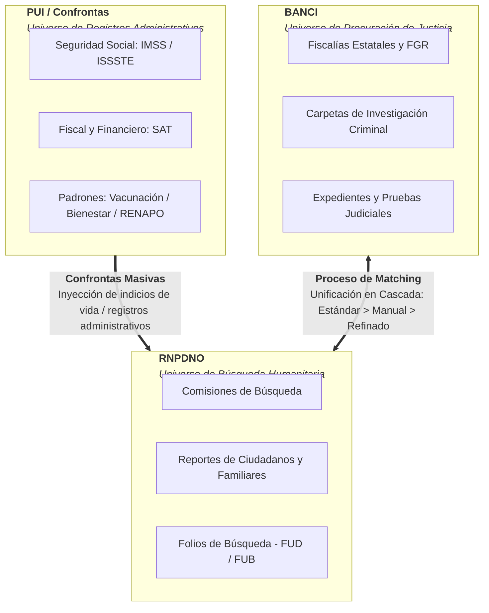
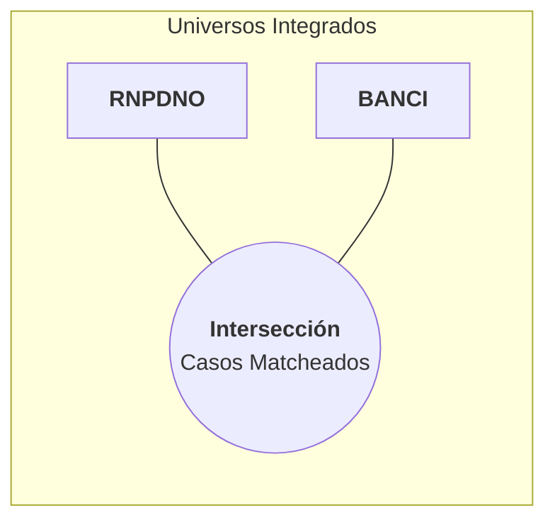
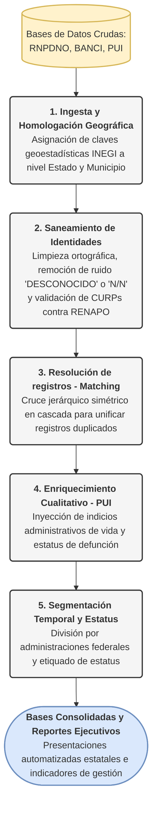
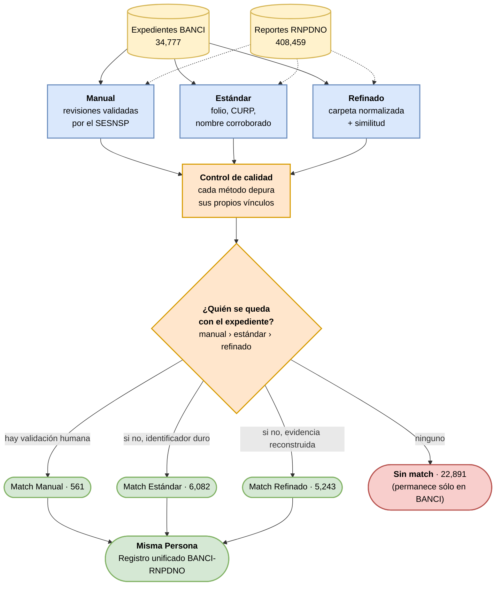
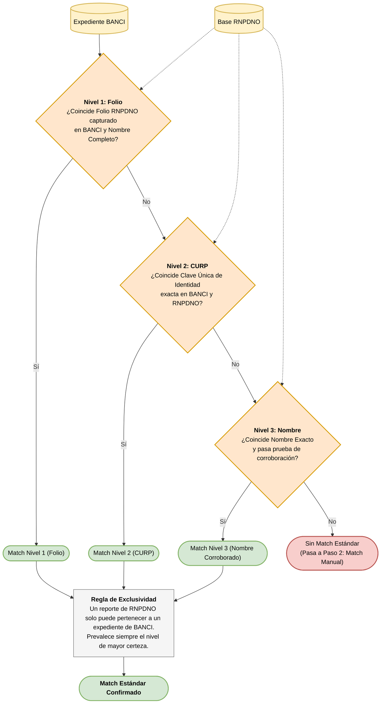
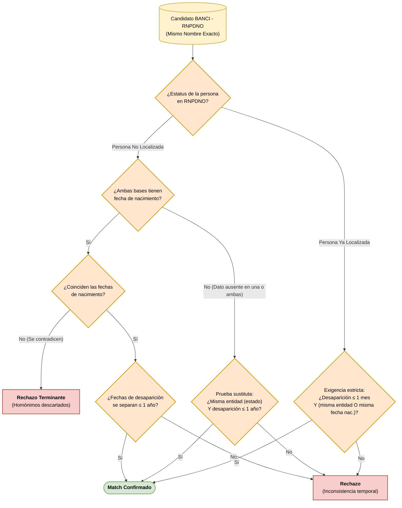

# Proyecto de Desaparecidos

Este repositorio contiene el pipeline de procesamiento, integración, análisis y visualización de información sobre personas desaparecidas, centralizando fuentes como RNPDNO, BANCI y PUI (Plataforma Única de Identidad).

## Objetivo del Proyecto

El objetivo principal de este proyecto es realizar la limpieza, cruce (matching) y conciliación de bases de datos de personas desaparecidas para la generación de indicadores analíticos y presentaciones automatizadas (diapositivas) a nivel estatal y nacional.

## Estructura Principal del Proyecto

```text
desaparecidos/
├── 1_funciones/       # Scripts de visualización (barras, líneas, treemaps)
├── docs/              # Documentación detallada del proyecto
├── input/             # Bases de datos y catálogos fuente (RNPDNO, BANCI, PUI, INEGI)
├── notebooks/         # Interfaz ejecutable: ETL y notebooks que arman cada PPT
├── output/            # Resultados y caché regenerable del pipeline
├── perfiles/          # Configuración como datos: un TOML por variante de reporte
└── src/               # Lógica del proyecto (pipeline, matching, limpieza, PPT)
```

## Configuración y Requisitos

Para ejecutar el pipeline, se recomienda utilizar un entorno virtual de Python.

1.  Instalar las dependencias del proyecto:
    ```bash
    pip install -r requirements.txt
    ```
2.  Ajustar rutas base y catálogos en `config.py` solo si cambia la infraestructura.
3.  Para configurar una corrida (archivo fuente, reglas, entidad, períodos), editar o crear
    un perfil en [`perfiles/`](perfiles/) — no `config.py`.

## Pipeline de Ejecución

**1. Fase ETL** — cada notebook deja un Parquet de nombre fijo en `output/`

| Notebook | Salida |
|---|---|
| `1_Procesamiento_ETL_RNPDNO.ipynb` | `Resultado_1_Procesamiento_ETL_RNPDNO.parquet` |
| `2_Procesamiento_ETL_BANCI.ipynb` | `Resultado_2_Procesamiento_ETL_BANCI.parquet` |
| `3_Procesamiento_ETL_PUI.ipynb` | `Resultado_3_Procesamiento_ETL_PUI.parquet` |

Los tres son independientes entre sí, con una excepción: **el 3 necesita el Parquet del 1**
(usa el RNPDNO para resolver clasificación, fecha de hechos y CURP).

El notebook 3 consolida las tres entregas de la PUI —coincidencias administrativas,
confrontas manuales y defunciones— en una marca por persona. Es el origen de las banderas
`cind` / `sind` y, con ellas, de los indicadores de *información suficiente*
(`sisf` / `cisf`). El recorrido completo, desde el archivo de entrada hasta el marcador de
la plantilla, está en [`docs/8_indicios_de_vida.md`](docs/8_indicios_de_vida.md).

**2. Fase de análisis y reportes**

*   `4_Generacion_Indicadores.ipynb`: construye el **universo** (RNPDNO + BANCI cruzados,
    con banderas derivadas) y lo deja cacheado.
*   `5_PPT_Reporte_Estatal.ipynb` y `6_PPT_Reporte_Diario.ipynb`: **consumen** ese universo.
    Cada uno declara su perfil de configuración y la lista de rebanadas que necesita.

Los notebooks de PPT no dependen entre sí y pueden ejecutarse en cualquier orden: el
primero que corra construye el universo, los siguientes lo leen del caché. Si entre uno y
otro cambia `config.py`, el perfil, el código o un insumo, el caché ya no vale y el
siguiente lo recalcula.

### Configuración por perfiles

La configuración variable no vive en `config.py` sino en `perfiles/*.toml`. `config.py`
conserva solo lo invariante (rutas base, mapeos de columnas, catálogos de regex, entidades).

```python
from src.settings import Settings
from src.pipeline import Universo
from src.slices import Slice

cfg = Settings.desde_perfil("reporte_diario")
u   = Universo.construir(cfg)          # acierto de caché si ya se construyó

u.contar(Slice("rn", "01oct24-max", estatus="des"))            # nacional
u.contar(Slice("rn", "01oct24-max", estatus="des", estado=17)) # Morelos
```

Dos perfiles pueden coexistir en el mismo kernel; ya no hace falta editar `config.py`
ni hacer `importlib.reload`.

### Las tres capas y el caché

| Capa | Qué hace | Costo | Se invalida con |
|---|---|---|---|
| A. Matching | carga de fuentes, 3 motores, reglas, cascada | minutos | perfil, `config.py`, código de los motores, insumos leídos |
| B. Derivadas | banderas `is_*`, dimensiones de rebanada | segundos | lo anterior + modalidad de carpeta + código de las derivadas |
| C. Rebanadas | máscaras por base/período/estatus/subfiltro/entidad | µs | nada |

Cambiar período, estatus, subfiltro o entidad **no vuelve a ejecutar el matching**.
La entidad dejó de ser un filtro previo a los motores y ahora es una dimensión de corte,
así que una sola corrida alimenta las 32 PPT estatales.

Para precalentar el caché fuera de Jupyter:

```bash
python -m src.pipeline info  --perfil reporte_diario
python -m src.pipeline build --perfil reporte_diario
```

Detalle completo en [`docs/6_arquitectura.md`](docs/6_arquitectura.md).

### El cruce BANCI ↔ RNPDNO en una tabla

Tres motores corren **siempre y sobre el universo completo**; la cascada decide después
quién se queda con cada expediente. `manual` va primero: cuando una revisión humana y el
algoritmo señalan a personas distintas, gana la revisión.

| Motor | Cómo decide | Gana |
|---|---|---:|
| **manual** | pares que el SESNSP validó uno por uno | 561 |
| **estandar** | embudo FUB → CURP → nombre corroborado | 6,082 |
| **refinado** | folio de carpeta normalizado + guardianes anti-homónimo | 5,243 |
| *sin match* | permanece sólo en BANCI | 22,891 |

Metodología completa en [`docs/3_metodologia_de_matching.md`](docs/3_metodologia_de_matching.md).

## Manual de Usuario y Documentación Detallada

Este repositorio cuenta con un **Manual de Usuario Conceptual** integrado para comprender las lógicas institucionales, los universos de datos y la metodología de unificación (matching) sin necesidad de revisar líneas de código.

*   [Manual de Usuario Conceptual: Lógicas de Procesamiento y Universos de Información](#manual-de-usuario-conceptual-lógicas-de-procesamiento-y-universos-de-información)

Para comprender a fondo la metodología técnica y la arquitectura del proyecto, consulta la documentación detallada en la carpeta [`docs/`](docs/):

1.  [Fuentes de Información y Catálogos](docs/1_fuentes_de_informacion.md)
2.  [Flujo y Pipeline de Datos](docs/2_flujo_y_pipeline.md)
3.  [Metodología de Matching](docs/3_metodologia_de_matching.md)
4.  [Generación de Reportes y Visualización](docs/4_generacion_de_reportes.md)
5.  [Diccionario de Variables](docs/5_diccionario_de_variables.md)
6.  [Arquitectura del Repositorio](docs/6_arquitectura.md)
7.  [Llaves de cruce entre BANCI y RNPDNO](docs/7_llaves_de_cruce.md)
8.  [Indicios de vida: del ETL de PUI al indicador](docs/8_indicios_de_vida.md)

La nomenclatura de los marcadores (`reg_rn_01oct24-max_des`…) vive aparte, en
[`catalogo_abreviaturas.md`](catalogo_abreviaturas.md).

---

# Manual de Usuario Conceptual: Lógicas de Procesamiento y Universos de Información

Este manual tiene como objetivo explicar de manera intuitiva y conceptual (independiente de cualquier lenguaje de programación como R o Python, de repositorios de código o bases de datos físicas) el funcionamiento analítico, los criterios de unificación y la interpretación cualitativa de los datos sobre personas desaparecidas en este proyecto.

---

## 1. Los Tres Universos de Información

Para comprender las métricas sobre desaparición en el país, es fundamental entender que la información proviene de tres fuentes principales con orígenes, objetivos y culturas institucionales totalmente distintas. Cada una representa una "faceta" diferente del mismo fenómeno.



### A. RNPDNO (Registro Nacional de Personas Desaparecidas y No Localizadas)
Base de datos de registros de personas desaparecidas y no localizadas del país. No cuenta con Folio Único de Búsqueda (FUB). 

*   **Origen:** Es gestionado por la Comisión Nacional de Búsqueda (CNB) y las comisiones locales. Se alimenta de reportes ciudadanos, llamadas telefónicas, denuncias anónimas, portales web y reportes institucionales.

### B. BANCI (Banco Nacional de Carpetas de Investigación de Personas Desaparecidas y No Localizadas)
Base de datos de carpetas de investigación iniciadas por delitos de **desaparición forzada** y **desaparición cometida por particulares**.

*   **Origen:** Es consolidado por el Secretariado Ejecutivo y proviene directamente de las Fiscalías Generales de las entidades federativas y de la Fiscalía General de la República (FGR).

### C. PUI (Plataforma Única de Identidad)
Es una plataforma por medio de la cual es posible consultar si una persona reportada como desaparecida en RNPDNO ha generado registros en instituciones públicas o privadas en una fecha posterior a la fecha de desaparición. Dicha información puede ser utilizada como **indicios de vida**.

*   **Origen:** No llega como un solo archivo, sino como tres entregas que el proceso consolida en una sola marca por persona:
    1.  **Coincidencias administrativas.** El listado automático de eventos detectados en otras instituciones (IMSS, ISSSTE, SAT, RENAPO, SEP, Bienestar, INM, PEMEX, SRE, entre otras). Viene por evento: una misma persona puede aparecer decenas de veces.
    2.  **Confrontas manuales.** Las coincidencias que además fueron revisadas y validadas por una persona. Sirven para distinguir el hallazgo automático del hallazgo corroborado.
    3.  **Defunciones por institución.** Actas de defunción localizadas para personas que siguen registradas como desaparecidas.
*   **Advertencia de lectura:** las tres entregas terminan bajo la misma etiqueta de "registro administrativo", **incluidas las defunciones**. La marca dice que *existe una huella administrativa posterior a la desaparición*, no que la persona esté necesariamente con vida.
*   **Periodicidad:** la descarga del archivo de coincidencias es **manual**; no hay un proceso automático que la traiga. Cada corte del reporte depende de que alguien la haya colocado en su carpeta.

---

## 2. Entidades de Conteo: ¿Qué estamos contando realmente?

Uno de los errores analíticos más comunes es confundir la cantidad de *personas* con la cantidad de *registros* o *carpetas*. Para interpretar correctamente la información cualitativa detrás de los números, debemos comprender la jerarquía de las entidades:

1.  **La Persona (RNPDNO):** Registros de persona desaparecida. Idealmente se identifica por una única CURP válida o, en su defecto, por la combinación exacta de Nombre(s), Primer Apellido, Segundo Apellido y Fecha de Nacimiento.

2.  **La Carpeta de Investigación (Expediente en BANCI):** Es el archivo judicial del caso.
    *   **Cardinalidad compleja:** Una sola carpeta de investigación puede involucrar a *múltiples personas desaparecidas* (por ejemplo, un evento donde desaparecen tres amigos juntos). Por otro lado, una sola persona desaparecida puede tener *múltiples carpetas de investigación* abiertas si desapareció en un estado y se denunció tanto a nivel local como federal, o en múltiples entidades federativas.

---

## 3. El Análisis de la Intersección (La Sintonía de los Universos)

Al cruzar simétricamente el universo de búsqueda (RNPDNO) contra el de procuración de justicia (BANCI), surgen cuatro sub-universos que nos revelan el estado real de la coordinación institucional y la atención de los casos:



### Se identifican cuatro bases de interés:
*   **Registros de RNPDNO que no están en BANCI**
*   **Registros de BANCI que no están en RNPDNO**
*   **Registros de RNPDNO que sí están en BANCI**
*   **Registros de BANCI que sí están en RNPDNO**

Debido a que el match se hace tanto a nivel **persona** como a nivel **carpeta de investigación**, los registros de RNPDNO que están en BANCI tienen diferente cardinalidad de los registros de BANCI que están en RNPDNO.

---

## 4. Las Categorías Cualitativas de Análisis.


### A. Con Delito vs. Sin Delito
*   No todas las personas desaparecidas son víctimas de un delito.
    *   **Sin Delito.** Casos de ausencias voluntarias (disputas familiares, decisiones personales), desorientación (personas de la tercera edad, condiciones de salud mental) o accidentes, donde la persona simplemente no es localizada pero no hay indicios criminales.
    *   **Con Delito.** Casos donde se acredita o sospecha fuertemente la comisión de un ilícito como privación ilegal de la libertad, secuestro, trata de personas, o desaparición forzada.
*   **Importancia:** Permite al analista separar los fenómenos de movilidad social/familiar de la crisis de violencia criminal.

### B. Con Indicios de Vida vs. Sin Indicios de Vida.
*   Esta clasificación surge directamente del universo **PUI** y de los datos de **confrontas**.
    *   **Con Indicios.** La persona tiene registros administrativos recientes (por ejemplo, movimientos del IMSS o transacciones del SAT posteriores a su fecha reportada de desaparición). Esto sugiere con un alto grado de probabilidad que la persona está viva y activa en algún lugar del país.
    *   **Sin Indicios.** Casos donde no existe absolutamente ninguna huella en las bases de datos gubernamentales o del sector privado desde la fecha del hecho.
*   **Importancia:** Los casos sin indicios representan el núcleo más crítico e histórico de la desaparición, mientras que los con indicios representan la oportunidad más clara para una localización, por ejemplo, mediante visitas de campo focalizadas.
*   **Dos matices que cambian la interpretación de la cifra:**
    *   La categoría agrupa el hallazgo automático y el corroborado a mano: una vez consolidada, el indicador no distingue entre ambos.
    *   Las **defunciones** entran en "con indicios". El nombre de la categoría es histórico; lo que realmente mide es la existencia de un registro administrativo posterior a la desaparición.

### B bis. "Indicios de vida" en el seguimiento de campo

Hay un segundo uso del término, que conviene no mezclar con el anterior. Para el seguimiento operativo se trabaja con un **directorio congelado** de las personas que tenían indicio de vida a una fecha determinada, acompañado de domicilio y números de contacto, que se entregó a las entidades participantes en la **Búsqueda Generalizada**.

Ese directorio no se actualiza: es una fotografía. Lo que sí se actualiza es el estatus de cada persona en el RNPDNO, y de ahí sale la pregunta de gestión que reporta la lámina correspondiente: **de aquellos indicios entregados, ¿a cuántos les siguió efectivamente una localización registrada?** A esos casos se les llama indicios **formalizados**.

Dos criterios de lectura:

*   Una persona del directorio que hoy **no aparece** en el RNPDNO se cuenta como todavía desaparecida: no hay evidencia de localización, y descartarla inflaría artificialmente el porcentaje de éxito.
*   El indicador se acota a las entidades que participan en la Búsqueda Generalizada, y se reporta junto al total nacional para poder compararlos.

### C. Registros Sin Datos.
*   **Concepto:** Son registros con niveles críticos de omisión de datos: no cuentan con una CURP válida y tampoco registran actividad administrativa alguna en el PUI o en confrontas.


### D. Desaparición Forzada vs. Desaparición Cometida por Particulares.
Información de delito proporcionada por BANCI.

*   **Desaparición Forzada.** Involucra la participación directa, indirecta o la aquiescencia de servidores públicos o agentes del Estado.
*   **Cometida por Particulares.** Llevada a cabo por individuos o grupos delictivos organizados sin la participación del Estado.
*   **Importancia:** Permite medir la responsabilidad del Estado.

---

## 5. Ventanas Temporales y su Sentido Político-Administrativo

El pipeline segmenta la información en periodos de tiempo muy específicos. Estas fechas no son arbitrarias; responden a hitos políticos, administrativos e institucionales de suma trascendencia:

1.  **Periodo Histórico Completo.**
    *   *Lógica:* Muestra la magnitud acumulada de la crisis de desaparición en México a lo largo de las décadas.

2.  **Periodo Histórico Reciente (a partir de enero de 2006).**
    *   *Lógica:* Muestra la magnitud acumulada de la crisis de desaparición en México a lo largo de las décadas.

3.  **Cierre de la Administración Anterior (menor a octubre de 2024).**
    *   *Lógica:* Marca el fin de la administración federal anterior. Ayuda a entender el panorama antes de la administración anterior. 

4.  **Gestión de la Nueva Administración Federal (mayor a octubre de 2024).**
    *   *Lógica:* Esta ventana temporal es de vital importancia analítica para:
        *   Medir la velocidad de generación de nuevos casos de desaparición bajo las políticas actuales.
        *   Evaluar el desempeño y efectividad de las nuevas estrategias de búsqueda y localización implementadas en la gestión actual.
        *   Rendir cuentas de manera transparente sobre los resultados propios, evitando mezclar los datos actuales con el acumulado histórico de administraciones previas.
5.  **Periodo a partir de la creación de BANCI (mayor a agosto de 2025):**
    *   *Lógica:* En julio de 2025 se publicó una reforma en el Diario Oficial de la Federación (DOF) por la que, al momento de la presentación de una denuncia, se iniciaría una carpeta de investigación y se le asignaría la carpeta correspondiente.

---

## 6. Proceso Conceptual de Tratamiento de la Información

Para transformar los datos crudos en inteligencia accionable, la información fluye a través de seis etapas lógicas consecutivas:



1.  **Ingesta y Homologación Geográfica:** Se leen las fuentes crudas y se asocian las entidades y municipios reportados con el catálogo nacional del INEGI, garantizando que no haya discrepancias por variaciones de nombres de municipios o estados.
2.  **Saneamiento de Identidades:** Se limpian los nombres (se eliminan acentos, abreviaturas espurias y espacios duplicados) y se remueve el "ruido" de registros mal capturados (ej. registros nombrados como "DESCONOCIDO", "N/N", "ALIA", etc.). Asimismo, se evalúa si las CURPs registradas cumplen con la validación de estructura de RENAPO.
3.  **Resolución de registros (Matching / Cruzamiento):** Es el corazón del procesamiento. Determina si el registro A y el registro B pertenecen a la misma persona física, unificando el universo de búsqueda y el judicial.
4.  **Enriquecimiento Cualitativo (PUI):** Se inyectan las marcas de "indicios de vida" o "registros administrativos" a los expedientes vigentes, lo que refina el entendimiento cualitativo del estatus de la persona. Esta etapa consolida por sí sola las tres entregas de la PUI —coincidencias automáticas, confrontas manuales y defunciones—, descarta las coincidencias que no corresponden a ningún expediente del RNPDNO y conserva únicamente los casos que siguen vigentes como desaparecidos o pendientes.
5.  **Segmentación Temporal y Clasificación:** Se aplican las etiquetas cualitativas descritas en la sección 4 y se segmentan las bases según las ventanas temporales de gestión gubernamental.
6.  **Generación de Entregables Ejecutivos:** Los números agregados se convierten en indicadores clave y se inyectan directamente en gráficos interactivos y presentaciones de PowerPoint (PPTX) personalizadas para cada uno de los 32 estados de la República, permitiendo que los tomadores de decisiones entiendan de un vistazo el panorama cualitativo de su región.

---

## 7. Lógica Detallada del Proceso de Matching (Cruce de Identidades)

El *matching* responde a una pregunta fundamental: **¿el expediente iniciado por una fiscalía en BANCI y el reporte registrado en la comisión de búsqueda en RNPDNO corresponden a la misma persona?** Cuando se confirma la identidad, ambos registros se unifican para evitar duplicidades en el conteo nacional y enriquecer la información disponible de cada caso.

El sistema contempla **tres métodos de matching** que se ejecutan de manera secuencial y complementaria mediante un **proceso de cascada por descarte**:

| Criterio | Fundamento | Naturaleza | Prioridad | Aporta hoy |
| :--- | :--- | :--- | :--- | ---: |
| **Manual** | Pares que una persona del SESNSP revisó y validó uno por uno. | Documental | **1ª (máxima)** | 561 |
| **Estándar** | Identificadores duros oficiales (Folio RNPDNO, CURP, nombre exacto corroborado). | Determinista y conservador | 2ª | 6,082 |
| **Refinado** | Números de carpeta normalizados, similitud de nombres y evidencia contextual. | Heurístico con guardianes | 3ª | 5,243 |

De 34,777 carpetas de BANCI, **11,886 encuentran a su persona** en el RNPDNO y 22,891
quedan sin vínculo.

---

### 7.1. Proceso de Cascada (Fallback Secuencial)

Conviene precisar algo que suele malentenderse: **los tres métodos se ejecutan siempre y
sobre el universo completo**. No se van pasando los sobrantes. Cada uno emite su veredicto
para cada expediente de BANCI, y sólo al final se decide quién se queda con él.

La cascada es, por tanto, un **orden de prioridad**, no un orden de ejecución:

1. **Prioridad 1 · Manual.** Si una persona revisó ese par y lo validó, ese vínculo manda.
2. **Prioridad 2 · Estándar.** Si no hay revisión humana, gobierna el identificador duro.
3. **Prioridad 3 · Refinado.** Si ninguno de los anteriores resolvió, entra la evidencia
   reconstruida a partir del número de carpeta.
4. **Sin match.** El expediente permanece sólo en el universo judicial de BANCI.

**¿Por qué el criterio humano va por delante del algoritmo?** Porque a veces señalan a
personas **distintas** —ocurre en 78 expedientes—, y en esos casos la revisión documental
es mejor evidencia. Cuando el estándar iba al frente, se perdían 54 validaciones humanas
sin dejar rastro: el algoritmo pisaba al revisor.

Antes de decidir el ganador, cada método pasa por un **control de calidad propio** (§7.4):
se anulan sus vínculos inválidos. Así, si el método preferente queda descalificado en un
caso concreto, **cede el turno** al siguiente en vez de dejar el expediente sin match.



---

### 7.2. Proceso de Matching Estándar (Tradicional)

El **criterio estándar** es la columna vertebral del cruce entre **BANCI** y **RNPDNO**. Su principio rector es **estrictamente conservador**: *es preferible no unificar dos registros con información dudosa antes que unir por error a dos personas distintas (falsos positivos)*.

Funciona a través de un **embudo jerárquico de tres niveles de certeza decreciente**. Todo expediente de BANCI que encuentra coincidencia en un nivel queda vinculado con su reporte correspondiente de RNPDNO y no continúa descendiendo en el embudo.



#### 7.2.1. Nivel 1: Vinculación por Folio de Búsqueda
Es el nivel de máxima certeza. Ocurre cuando el expediente de **BANCI** ya cuenta con el identificador del reporte de búsqueda de **RNPDNO** asignado previamente.
*   **Mecanismo:** Se verifica la igualdad exacta del folio de búsqueda en RNPDNO.
*   **Regla de seguridad:** Para evitar falsos positivos causados por errores tipográficos al capturar el folio en BANCI, se exige adicionalmente que el nombre de la persona coincida de manera exacta.

#### 7.2.2. Nivel 2: Vinculación por Clave Única de Identidad (CURP)
Aplica para aquellos expedientes de **BANCI** que no se vincularon por folio y que cuentan con una clave oficial de identidad con estructura válida.
*   **Mecanismo:** Se realiza una comparación de igualdad exacta de la CURP entre **BANCI** y **RNPDNO**.
*   **Regla de unicidad:** Se procesa de forma unívoca para evitar que duplicados internos en una misma fuente distorsionen las parejas generadas.

#### 7.2.3. Nivel 3: Vinculación por Nombre con Corroboración Contextual
Es el nivel más sensible del proceso, ya que **el nombre de pila y apellidos por sí solos no garantizan la identidad debido a la existencia de homónimos**. Por ello, el nombre abre posibles candidatos, pero el vínculo solo se confirma si se aprueba una prueba de corroboración:

1.  **Comparación Nominal Exacta:** Se identifican candidatos entre **BANCI** y **RNPDNO** con nombres y apellidos exactamente idénticos (no se permiten aproximaciones ni similitudes parciales en este criterio).
2.  **Prueba de Corroboración:**
    *   **Si ambas bases cuentan con fecha de nacimiento:** Si las fechas coinciden (con tolerancia de pocos días por captura), el match es aceptado siempre que las fechas de desaparición sean consistentes. **Si las fechas de nacimiento difieren, el candidato se rechaza de forma terminante**, evitando homónimos (dos personas pueden llamarse igual, pero no nacer en fechas distintas).
    *   **Si alguna base carece de fecha de nacimiento:** Se exige como prueba sustituta que los hechos hayan ocurrido en la misma entidad federativa y que las fechas de desaparición se encuentren dentro de un margen temporal admisible (hasta un año).
    *   **En registros de personas ya localizadas:** Las tolerancias temporales son mucho más estrictas (margen máximo de un mes) para evitar alterar los conteos de localización indebidamente.



#### 7.2.4. Reglas de Exclusividad y Trazabilidad
*   **Exclusividad (1 a 1):** Un reporte de **RNPDNO** no puede asignarse a más de un expediente judicial de **BANCI**. Si dos expedientes reclaman el mismo reporte, se preserva el vínculo originado en el nivel de mayor jerarquía (Folio > CURP > Nombre).
*   **Trazabilidad:** Cada coincidencia confirmada almacena metadatos explicativos: el nivel que originó el vínculo, las variables coincidentes y la diferencia en días entre las fechas reportadas, permitiendo auditorías puntuales de cada caso.

---

### 7.3. Proceso de Matching Manual (Validación Humana)

Este criterio **no busca nada**: transcribe decisiones que ya tomó una persona. Es el de
mayor prioridad porque un par revisado expediente por expediente es mejor evidencia que
cualquier coincidencia automática.

#### 7.3.1. De dónde salen esos vínculos

Del **Secretariado Ejecutivo (SESNSP)**, en dos revisiones documentales: una sobre las
fechas de los hechos y otra sobre los casos que el algoritmo dejó en zona dudosa. Cada
renglón es un dictamen de una persona sobre un par concreto.

**Sólo el veredicto afirmativo crea vínculo.** Un rechazo también cuenta, pero al revés:
significa que ese par **fue examinado y descartado**, así que el caso se cierra y se retira
de la búsqueda automática, sin asignar ninguna pareja. Es información valiosa: evita que el
sistema vuelva a proponer algo que una persona ya desechó.

#### 7.3.2. Una precisión: el folio pre-asignado NO cuenta

Algunos expedientes de BANCI ya traen escrito un folio del RNPDNO, asignado río arriba.
**Ese dato no se acepta como vínculo.** Aceptarlo daría por unificados dos registros sin
comparar un solo rasgo de identidad: ni nombre, ni CURP, ni fecha de nacimiento, ni carpeta.
Lo único comprobable es que el folio exista, y eso no es evidencia de que se trate de la
misma persona.

Además hacía daño: al ocupar el expediente, tapaba vínculos mejor sustentados, incluidos
pares que el propio SESNSP ya había confirmado a mano.

Desactivarlo no tira el dato. El folio **sigue siendo una pista** para el método refinado,
que lo usa para proponer candidatos; pero allí tiene que superar los controles de identidad
como cualquier otra hipótesis.

#### 7.3.3. Una carpeta, varias personas

Una carpeta de investigación puede tener **varias víctimas**, y una revisión puede haber
validado varios folios para ese mismo expediente. Como cada expediente sólo puede apuntar a
un folio, los demás se conservan aparte y se reclaman **desde el lado del RNPDNO**, donde
cada folio es una persona distinta con vínculo confirmado. De lo contrario se perderían
personas por una limitación del formato, no por falta de evidencia.

---

### 7.4. Proceso de Matching Refinado (Reconstrucción por Carpeta)

Parte de una observación práctica: **el número de carpeta de investigación identifica muy
bien, pero se escribe de mil formas distintas**. La misma carpeta aparece con guiones o
diagonales, con ceros de relleno, con el año delante o detrás, con el código de la oficina
intercalado. Un cruce exacto no encuentra nada; normalizando, aparecen coincidencias reales.

Es el método de mayor alcance —aporta 5,243 vínculos— y por eso es también el que más
controles lleva encima.

#### 7.4.1. Qué se le quita al folio antes de compararlo

Se descarta todo lo que **no distingue un caso de otro**: separadores, ceros a la izquierda,
el año y los **códigos de oficina** — números que aparecen en muchas carpetas distintas y
que por tanto identifican a la unidad administrativa, no al expediente. Lo que queda es el
consecutivo, que es lo que de verdad singulariza.

#### 7.4.2. Cómo se proponen candidatos

Comparar cada expediente contra los 408,459 reportes es inviable. El sistema agrupa por seis
señales y sólo compara dentro de cada grupo: folio de búsqueda, CURP completa, **los diez
primeros caracteres de la CURP** (que codifican nombre y fecha de nacimiento), consecutivo
de carpeta, primer apellido y fecha de nacimiento. Compartir cualquiera de ellas basta para
ser candidato.

Ser candidato **no es ser match**: sólo significa "merece que lo revisemos".

#### 7.4.3. Los guardianes anti-homónimo

Aquí está el corazón del método, y su diferencia con un simple parecido de texto: **que el
folio coincida no basta para afirmar que es la misma persona.**

*   **Guardián de identidad.** Si el nombre no es idéntico, o si las fechas de desaparición
    se separan más de un año, se exige un **ancla dura**: misma fecha de nacimiento, o los
    diez primeros caracteres de la CURP iguales. Sin esa ancla, no hay vínculo.
*   **Excepción por carpeta colectiva.** Cuando un expediente agrupa a varias víctimas, la
    fecha es genérica y no sirve como prueba; el guardián lo tiene en cuenta y no la exige.
*   **Guardián de "otra carpeta".** Para afirmar que dos expedientes distintos son la misma
    persona sin CURP completa ni folio, se pide más: si las entidades se contradicen, hacen
    falta a la vez fecha de nacimiento coincidente **y** nombre completo idéntico.

#### 7.4.4. Tres desenlaces posibles

| Resultado | Qué significa |
| :--- | :--- |
| **Definitivo** | El folio coincide y la identidad está anclada. Se acepta. |
| **Parcial** | El folio coincide salvo algún carácter, con nombre fuerte y ancla. Se acepta, marcado como tal. |
| **Revisión manual** | Hay indicios, pero **no** evidencia suficiente. **No se acepta.** |

> La categoría *revisión manual* es deliberada y merece subrayarse: son los casos que el
> sistema **no se atreve a resolver solo**. No cuentan como vínculo ni entran en ninguna
> cifra; quedan a la espera de que una persona los dictamine. Es la puerta por la que estos
> casos pueden convertirse mañana en matches manuales.

---

### 7.5. Control de Calidad y Reglas de Exclusión

Antes de decidir qué método se queda con cada expediente, **cada método depura sus propios
vínculos**. Dos controles operan hoy:

*   **Los candidatos a revisión no cuentan.** Lo descrito en 7.4.4: sin validación humana,
    fuera.
*   **Coherencia temporal y de estatus.** Se anula el vínculo si las fechas de desaparición
    se separan más de la tolerancia admitida, o si el folio del RNPDNO corresponde a una
    persona ya **localizada** (en cuyo caso no debería estar en el universo de búsqueda).

**Por qué el control va por método y no sobre el ganador.** Si se aplicara al final, sobre
el vínculo ya elegido, anularlo dejaría el expediente **sin match aunque otro método tuviera
uno válido esperando detrás**. Un vínculo anulado no debe matar el caso: debe ceder el turno.

#### Exclusividad y trazabilidad

*   **Del lado del RNPDNO se cuentan personas.** Una misma persona puede aparecer en varias
    carpetas, y distintos métodos pueden alcanzarla por vías distintas. En ese caso se
    registran **todos** los métodos que la sostienen, en vez de quedarse con el de la primera
    carpeta que aparezca en el archivo: ese desempate dependía del orden del fichero, no de
    un criterio, y movía la atribución de un corte a otro sin que nada hubiera cambiado.
*   **Trazabilidad.** Cada vínculo guarda por qué existe: el método que lo originó, las
    variables que coincidieron y la diferencia en días entre las fechas. Cualquier caso
    puede auditarse uno por uno.
