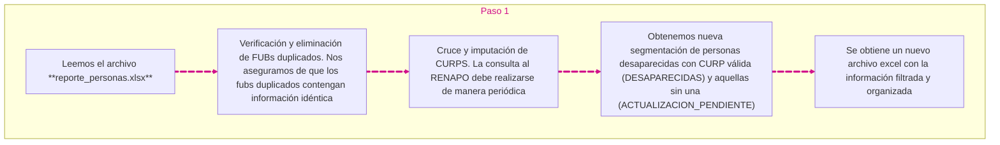
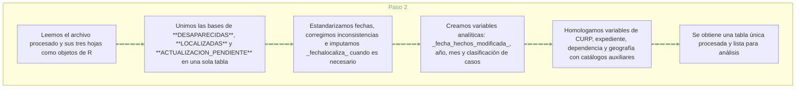
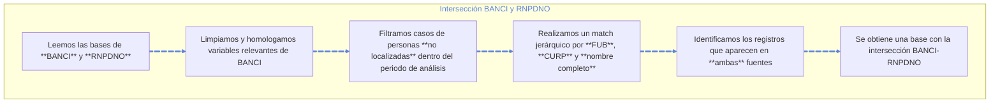
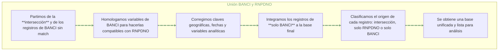

---
output:
  html_document: default
  pdf_document: default
---
# Documentación sobre el tema de Personas desaparecidas

En este repositorio se encuentran, de manera general, tres flujos. Cada uno asociado a una función en R que ejecuta cada proceso:

* [**1. Primer flujo. Descarga del RNPDNO y procesamiento de variables**](#1-primer-flujo-descarga-del-rnpdno-y-procesamiento-de-variables) (la función se encuentra en `RNPDNO/scripts/funcion_actualizar_rnpdno_y_procesar_variables.R`.
* [**2. Segundo flujo. Tratamiento BANCI y RNPDNO**](#2-segundo-flujo-tratamiento-banci-y-rnpdno) (la función se encuentra en `RNPDNO/scripts/funcion_tratamiento_banci_rnpdno.R`).
* [**3. Tercer flujo. Confrontas: añadidura de coincidencias administrativas manuales y con PUI**](#3-tercer-flujo-confrontas-añadidura-de-coincidencias-administrativas-manuales-y-con-pui) (la función se encuentra en `RNPDNO/scripts/funcion_actualizar_confrontas_de_pui.R`).

Adicionalmente, se incluye un [**0. Diccionario, preguntas frecuentes y pendientes**](#0-diccionario-preguntas-frecuentes-y-pendientes), en donde se podrá encontrar las definiciones conceptuales del tema de personas desaparecidas, preguntas frecuentes y temas pendientes por resolver.

## 0. Diccionario, preguntas frecuentes y pendientes

### Sobre personas desaparecidas

#### 1. ¿Cuál es la autoridad encargada del tema de personas desaparecidas?

Es importante tener en cuenta que los registros de las desapariciones o no localizaciones de personas se han registrado en distintas bases de información a lo largo del tiempo. En el presente, es la Comisión Nacional de Búsqueda el organismo encargado de recolectar estos datos y centralizarlos en una misma fuente de información (en el Registro Nacional de Personas Desaparecidas o simplemente RNPDNO). Las entidades encargadas de alimentar este centro de datos son tres: 

$\textbf{1.}$ las comisiones de búsqueda estatales, 

$\textbf{2.}$ las fiscalías locales y 

$\textbf{3.}$ la plataforma del RNPDNO (o simplemente "Portal").

Sin embargo, por dificultades administrativas, la información resguardada en el **RNPDNO** puede no siempre estar actualizada. Esto sucede principalmente debido a que las fiscalías locales no suben todos los casos de desapariciones al RNPDNO.

Por este motivo, al flujo de trabajo debemos añadir, cuando sea pertinente, la información que envía recurrentemente el Secretariado Ejecutivo del Sistema Nacional de Seguridad Pública (en adelante, el Secretariado). El Secretariado es la institución encargada de actualizar la Base Nacional de Carpetas de Investigación de Personas Desaparecidas (BANCI), con fecha de creación en agosto de 2025.

#### 2. ¿Cuáles son las fuentes de información del repositorio?

A continuación se enlistan las fuentes más importantes de información:

* **Base de información del RNPDNO que genera la CNB:** se puede encontrar una explicación más detallada [aquí.](https://docs.google.com/spreadsheets/d/1R0fRtUsEfOgbxpv1Ejw4o1d1KZ2swv3zLMHoO9kNsPo/edit?gid=0#gid=0) Encontrarás tres hojas del archivo excel `reporte_personas.xlsx`: ACTUALIZACION_PENDIENTE, LOCALIZADAS y DESAPARECIDAS.
* **BANCI:** La Base Nacional de Carpetas de Investigación de Personas Desaparecidas y No Localizadas, contiene los datos de las carpetas de investigación iniciadas por los delitos de desaparición forzada de personas y de desaparición cometida por particulares. A diferencia del RNPDNO no se cuenta con el Folio Único de Búsqueda (FUB) en esta base.
* **PUI:** La Plataforma Única de Búsqueda es una herramienta de búsqueda de personas desaparecidas. "En esta plataforma se permite consultar, a partir de la CURP, nombre o FUB si una persona reportada como desaparecida en el Registro Nacional de Personas Desaparecidas o No Localizadas (RNPDNO) ha generado registros en instituciones públicas o privadas con posterioridad a la fecha de su desaparición" (SEGOB, 2026). $\textrm{Referencia:}$ SEGOB, $\textit{Herramientas de búsqueda de personas desaparecidas. Diccionario de variables}$, 2026. [En esta dirección de Google Drive](https://drive.google.com/drive/folders/1BtlWEAcppSnA7zmyVaDcdXvVVatG32Wm?usp=sharing) se puede consultar el directorio de los tipos de trámites de las instituciones que han aportado información en la PUI.

#### 3. ¿Qué es una confronta?

Una confronta es un proceso de comparación de información que realizan las autoridades (por lo general, la Comisión Nacional de Búsqueda, las Fiscalías o el Centro Nacional de Identificación Humana) para determinar si una persona localizada, viva o fallecida, coincide con alguna persona reportada como desaparecida o no localizada en el Repositorio Nacional de Personas Desaparecidas y No Localizadas.

#### 4. ¿Cuáles son los delitos asociados a la desaparición de personas?

* $\textbf{Desaparición forzada de personas:}$ es definida a partir de tres elementos: 1) que se prive de la libertad a una o más personas, 2) que exista la intervención directa de personas servidoras públicas, ya sea con su apoyo, autorización o consentimiento y 3) que exista una abstención o negativa a reconocer la privación o a proporcionar información sobre la misma o la suerte, destino o paradero de la persona afectada. Este tipo de delito se encuentra tipificado en el capítulo tercero de la Ley General de Desaparición. En resumen, en la desaparición forzada hay una participación directa o indirecta del Estado.

* $\textbf{Desaparición cometida por particulares:}$ "la Convención Internacional establece que la única diferencia entre la desaparición cometida por particulares y la desaparición forzada es quién perpetra la conducta, es decir, si es cometida por una persona servidora pública o una particular" (SCJN, 2023). En este caso no hay intervención de personas servidoras públicas en el delito.

$\textrm{Referencia:}$ SCJN, $\textit{Apuntes sobre desaparición de personas}$, Unidad General de Conocimiento Científico y Derechos Humanos de la Suprema Corte de Justicia de la Nación, 2023. [En la siguiente liga](https://www.scjn.gob.mx/derechos-humanos/sites/default/files/Publicaciones/archivos/2024-02/apuntes-sobre-desaparicion.pdf) se puede consultar dicho documento.

## 1. Primer flujo. Descarga del RNPDNO y procesamiento de variables

### 1.1 Descarga del RNPDNO

El código que realiza la descarga y el procesamiento de variables del RNPDNO se encuentra en la dirección `RNPDNO/scripts/funcion_actualizar_rnpdno_y_procesar_variables.R`.

El primer paso es ubicar el archivo `reporte_personas.xlsx` de la carpeta $\texttt{cqr}$ [ubicado en esta liga.](https://drive.google.com/drive/folders/1Tgo8oWhoeilWr1J-EB6n22QK7rHUvgN0) Debes asegurarte de acceder a este con tu correo institucional de la Agencia. En el archivo `RNPDNO/docs/descripcion_de_variables_del_rnpdno.xlsx` se encuentran las definciones de las variables del RNPDNO.

Cada día, la Comisión Nacional de Búsqueda (CNB) actualiza el archivo `reporte_personas.xlsx`. Este contiene información sobre los datos históricos de las personas desaparecidas o no localizadas y de las personas que han sido localizadas. En específico, en cuanto a las personas todavía desaparecidas o no localizadas, la CNB divide a estas en dos conjuntos: aquellas de las que no se cuenta con información de CURP, ubicadas en la hoja del excel "ACTUALIZACIÓN_PENDIENTE" y aquellas personas de las que sí se tiene información de CURP, ubicadas en la hoja "DESAPARECIDAS". 

Sin embargo, la partición de información del RNPDNO puede venir equivocada; hay personas en "DESAPARECIDAS" que tienen CURP vacía o inválida y hay personas en "ACTUALIZACIÓN_PENDIENTE" que, a pesar de no contar con CURP, cuentan con información personal suficiente para buscar esta clave. Para que realmente tengamos en la hoja DESAPARECIDAS a las todas las personas con CURP válida (es decir, personas con información suficiente para rastrearlas en confrontas con otras instituciones) y en la hoja PENDIENTES a aquellas personas cuyas CURPS no podemos reconstruir, debemos modificar estos datos. 

Este paso se realiza en su totalidad en la función `automatizar_base_final_rnpdno()`, la cual automatiza la lectura, limpieza y reorganización inicial del archivo `reporte_personas.xlsx`. En particular, la función verifica la estructura de las hojas, elimina FUBs duplicados con información consistente, cruza la base con CURPs reconstruidas a partir de consultas previas a RENAPO, imputa CURPs válidas cuando es posible y vuelve a segmentar los registros en dos grupos: personas desaparecidas con CURP válida (`DESAPARECIDAS`) y personas cuya actualización sigue pendiente por no contar con una CURP válida (`ACTUALIZACION_PENDIENTE`). Como resultado, se genera un nuevo archivo `.xlsx` depurado y listo para su procesamiento analítico.

En el siguiente diagrama se muestra un resumen del flujo de datos en la descarga del RNPDNO:

### 1.2 Procesamiento de variables del RNPDNO

En un segundo momento, es decir en el Paso 2, la función `procesamiento_base_final(fecha_corte)` toma como insumo el archivo `base_final_reporte_personas_<fecha>.xlsx` generado en el paso anterior y construye una sola tabla analítica a partir de las tres hojas del RNPDNO: `DESAPARECIDAS`, `ACTUALIZACION_PENDIENTE` y `LOCALIZADAS`.

De manera general, el procesamiento de variables realiza las siguientes transformaciones:

#### **i. Unión de las tres bases**
Se leen las tres hojas del archivo y se agrega una variable llamada `clasificacion_des`, que permite identificar si cada registro corresponde a una persona:

* `Desaparecidos`
* `Pendientes`
* `Localizados`

Posteriormente, las tres tablas se unen en una sola base de trabajo.

#### **ii. Estandarización de fechas**
Se homologan a formato fecha las variables más importantes del RNPDNO, entre ellas:

* `fechahechos`
* `fechalocaliza`
* `fechanacimiento`
* `fechapercato`
* `fechacaptura`

Esto permite trabajar de manera consistente con el componente temporal de los registros.

#### **iii. Corrección de fechas inválidas**
La variable `fechalocaliza` se revisa para evitar inconsistencias. En particular, se anula (`NA`) cuando:

* la fecha de localización es anterior a la fecha de hechos, o
* la fecha de localización es posterior a la `fecha_corte` usada en la ejecución.

#### **iv. Creación de una fecha de hechos modificada**
Se construye la variable `fecha_hechos_modificada`, que sirve como referencia temporal principal para el análisis. Esta variable se genera con la siguiente prioridad:

1. `fechahechos`
2. `fechapercato`
3. `fechacaptura`

Es decir, cuando falta la fecha de hechos original, se utilizan fechas sustitutas para conservar una fecha de referencia del caso.

#### **v. Construcción de variables temporales**
A partir de las variables de fecha se generan nuevas variables analíticas, tales como:

* `anio_localizado`
* `anio_hechos`
* `anio_hechos_modificada`
* `mes_hechos_modificada`
* `anio_mes_hechos_modificada`

Asimismo, se crea la variable `fechalocaliza_imputada`. Si un registro está clasificado como `Localizados` pero no cuenta con `fechalocaliza`, esta se imputa usando `fecha_hechos_modificada`.

A partir de esta imputación también se generan:

* `anio_loc_imputada`
* `mes_loc_imputada`
* `anio_mes_loc_imputada`

Finalmente, si `fecha_hechos_modificada` resulta posterior a `fechalocaliza_imputada`, se corrige para evitar inconsistencias cronológicas.

#### **vi. Identificación de carpeta de investigación**
A partir del contenido de la variable `expediente`, se crea la variable `indicadora_carpeta`, que clasifica los casos en:

* `Con carpeta`
* `Sin carpeta`

Para ello se usan expresiones regulares que buscan patrones como `AP`, `CI` o `CDI`, asociados a carpetas o expedientes de investigación.

#### **vii. Reclasificación del tipo de expediente**
Con base en la variable anterior, se genera `expediente_reclasif`, que distingue entre:

* `carpeta de investigacion`
* `expediente genérico`

Esta variable permite separar los registros que cuentan con una carpeta formal de aquellos que solo tienen un expediente administrativo o genérico.

#### **viii. Homologación de la dependencia de origen**
La variable `dependencia_origen` se reclasifica en categorías más comparables mediante la nueva variable `dependencia_origen_reclasificado`. Entre las categorías resultantes se encuentran:

* `Fiscalía con carpeta de investigación`
* `Fiscalía con expediente genérico`
* `Fiscalía (otra)`
* `Comisión Nacional de búsqueda de personas`
* `Comisión local de búsqueda de personas`
* `Otra comisión`
* `Portal`

Esta homologación ayuda a distinguir el origen institucional del registro.

#### **ix. Validación de CURP**
Se crea la variable `indicadora_curp_valida`, que clasifica la `curp_victima` como:

* `valida`
* `invalida`

La validación se realiza con base en la estructura general de la CURP y en los códigos válidos de entidad federativa.

#### **x. Homologación geográfica con catálogos de INEGI**
Se estandarizan las claves geográficas del RNPDNO y se enlazan con catálogos de INEGI para obtener nombres de entidad y municipio.

Como parte de este proceso se construyen o renombran las siguientes variables:

* `estado_desaparicion`
* `entidad_nacimiento_nom`
* `cvegeo_desaparicion`
* `cve_estado_desaparicion`
* `cve_municipio_desaparicion`
* `municipio_desaparicion`

Esto permite contar con variables geográficas limpias y comparables para análisis territorial.

#### **xi. Integración de indicios de vida**
La base final se cruza por `fub` con una tabla histórica de registros administrativos e indicios de vida.

A partir de ello, la variable `indicadora_indicio_de_vida` se homologa para quedar resumida en dos grandes categorías:

* `con registro administrativo`
* `sin registro administrativo`

En esta homologación se agrupan también categorías previas como `defuncion` o `con registro administrativo en PUI`.

#### **xii. Cálculo de edad y grupo etario**
Finalmente, se calcula la variable `edad_al_momento_desaparicion` usando la diferencia entre `fecha_hechos_modificada` y `fechanacimiento`.

A partir de esta edad se genera la variable `grupo_etario`, con las siguientes categorías ordenadas:

* `Niñez (0-11)`
* `Adolescencia (12-17)`
* `Madurez (18-29)`
* `Adultez (30-59)`
* `Adulto o adulta mayor (60+)`

Estas variables son especialmente útiles para la construcción de gráficas, tablas descriptivas y análisis por perfil poblacional.

En el siguiente flujo se resume el segundo paso: 

## 2. Segundo flujo. Tratamiento BANCI y RNPDNO

El segundo flujo tiene como propósito preparar, homologar y articular la información proveniente de la **BANCI** y del **RNPDNO** para su análisis conjunto. La función `RNPDNO/scripts/funcion_tratamiento_banci_rnpdno.R` limpia la base de BANCI, estandariza variables clave y realiza un proceso de comparación con el RNPDNO para identificar qué registros aparecen en ambas fuentes y cuáles aparecen únicamente en la BANCI.

**¿Por qué es importante considerar la BANCI junto con el RNPDNO?** Como se menciona en la sección [0. Diccionario](#0-diccionario-preguntas-frecuentes-y-pendientes), la BANCI reúne la información de las carpetas de investigación de casos de desapariciones asociados a delitos de desaparición forzada de personas y de desaparición cometida por particulares, entonces mapear aquellos registros que están tanto en RNDPNO como en BANCI, como aquellos que solo están en BANCI, es obtener información sobre esas carpetas.

Como resultado, este flujo permite construir dos modalidades de salida: una **intersección**, que conserva los casos con correspondencia entre BANCI y RNPDNO, y una **unión**, que además incorpora los registros de BANCI que no se encuentran en el RNPDNO. Esto permite fortalecer la consistencia analítica de la base y mejorar el seguimiento institucional de los casos según se necesita una u otra base.

### 2.1 Intersección entre BANCI y RNPDNO

La modalidad de **intersección** identifica los registros de la BANCI que también se encuentran en el RNPDNO. Para ello, primero se limpia y filtra la información de BANCI, especialmente los casos de personas no localizadas dentro del periodo de análisis. Después, la función realiza un **match jerárquico** entre ambas fuentes, priorizando coincidencias por:

1. `FUB`
2. `CURP`
3. `nombre completo` + `alguna otra variable de información personal como entidad de nacimiento, fecha de desaparición, etc.`

Este procedimiento permite localizar de manera ordenada los casos compartidos entre ambas bases y aprovechar la información de BANCI para complementar variables del RNPDNO, particularmente aquellas relacionadas con carpetas de investigación y origen institucional del registro.

En el siguiente diagrama se resume el flujo de la intersección:

### 2.2 Unión entre BANCI y RNPDNO

La modalidad de **unión** parte de la intersección anterior, pero además incorpora los registros de BANCI que **no** tuvieron correspondencia en el RNPDNO. Para hacerlo posible, la función asigna a esos casos una estructura compatible con la base final del RNPDNO: genera identificadores internos, homologa variables geográficas, construye variables temporales y deriva variables analíticas como edad, grupo etario, clasificación del caso y origen del registro.

De esta forma, la unión permite contar con una base más amplia, donde se distinguen claramente tres tipos de registros: los que pertenecen a la intersección BANCI-RNPDNO, los que provienen solo del RNPDNO y los que provienen solo de la BANCI. Esto amplía la cobertura analítica y permite incorporar casos con carpeta de investigación que todavía no están reflejados en el RNPDNO.

En el siguiente diagrama se resume el flujo de la unión:

## 3. Tercer flujo. Confrontas: añadidura de coincidencias administrativas manuales y con PUI

### 3.1. Código de la función `funcion_actualizar_confrontas_de_pui.R`

La función `RNPDNO/scripts/funcion_actualizar_confrontas_de_pui.R` tiene como propósito **actualizar e integrar las coincidencias administrativas provenientes de la PUI** con los registros manuales ya existentes y con la base comprimida del **RNPDNO**. En términos generales, esta función permite **depurar, homologar y clasificar** los nuevos registros detectados en PUI, así como **ajustar variables clave del RNPDNO** para que reflejen correctamente estos indicios de vida y los casos de defunción.

De manera general, la función realiza las siguientes transformaciones:

#### **i. Validación inicial de insumos**
La función verifica que las cuatro bases necesarias estén disponibles:

* `registros`: son los registros de indicios de vida -sin contar defunciones- de las confrontas manuales.
* `defunciones_df`: contiene los registros de defunciones. Estos provienen exclusivamente de las confrontas manuales.
* `comprimido`: el RNPDNO transformado con el que se trabaja en todos los flujos.
* `coincidencias_admin_con_inactivas`: este archivo se actualiza periódicamente. Contiene las coincidencias administrativas -tanto de desapariciones activas como inactivas- de la PUI. Es importante notar que no está agrupado por FUB.

Si alguna falta, el proceso se detiene. Además, se revisa que el archivo de coincidencias administrativas contenga las columnas esperadas y que la variable `fase_busqueda` solo tenga valores válidos (`2` y `3`). 

#### **ii. Limpieza y homologación de coincidencias administrativas de PUI**
Posteriormente, la base de coincidencias de PUI se limpia y reorganiza. Entre otras cosas:

* se corrige la variable `fub`, eliminando el UUID agregado al final;
* se descartan CURPs inválidas identificadas explícitamente;
* se homologa la fecha de creación del reporte bajo el nombre `created_at`;
* se excluyen los registros provenientes de **RENAPO** (`institucion_id == "0044"`);
* y se concatena la institución al nombre del `tipo_evento`.

Esto permite contar con una base más uniforme para el análisis posterior. 

#### **iii. Agrupación de coincidencias por FUB**
Después, las coincidencias se agrupan por `fub` para construir una versión resumida de la información. En esta etapa se generan variables como:

* `no_apariciones`
* `instituciones`
* `tipo_evento`
* `no_instituciones`
* `fases_busqueda`
* `desaparicion_activa`

Asimismo, se identifican trámites repetidos y se conservan únicamente los tipos de trámite únicos por registro. Esto permite pasar de una base de eventos a una base de coincidencias consolidadas por persona. 

#### **iv. Cruce con confrontas manuales**
Una vez agrupada la información de PUI, la función contrasta estas coincidencias con los registros manuales ya existentes. Primero se realiza el cruce por `fub`; después, para los casos sin match, se construye una llave auxiliar con:

* `CURP`
* `fecha_desaparicion`

Con ello se distinguen dos tipos de casos:

* aquellos que ya tenían coincidencia manual, y
* aquellos que aparecen **solo en PUI**.

Esta comparación evita duplicidades y permite identificar qué registros realmente amplían la cobertura previa de las confrontas administrativas. 

#### **v. Homologación institucional y construcción de la base combinada**
Posteriormente, se limpian los nombres de instituciones para dejar abreviaturas comparables (por ejemplo, `CONSAR`, `SAT`, `SRE`, `IMSS-PUI`, `IMSS-Bienestar`). Luego se integran en una sola base los casos:

* con coincidencia en **PUI y registro manual**, y
* con **solo coincidencia en PUI**.

A partir de esto se crean variables clave como:

* `indicadora_coincidencia_manual`
* `indicadora_indicio_de_vida`
* `institucion_indicadora_de_vida`
* `tipo_tramites`
* `tramites_repetidos`
* `fecha_evento`

De esta manera se obtiene una tabla unificada de coincidencias administrativas lista para incorporarse al flujo general del repositorio. 

#### **vi. Integración de registros manuales con coincidencias de PUI**
Enseguida, la función actualiza la base `registros` para incorporar la información de PUI en aquellos casos donde ya existía un registro manual. En estos casos se:

* concatenan las instituciones indicadoras de vida, y
* se actualiza el conteo de instituciones (`numero_instituciones`).

Además, se integran los registros que solo tienen coincidencia en PUI, siempre y cuando su `fub` exista también en el RNPDNO. Los registros sin `fub` en RNPDNO se identifican y se descartan. 

#### **vii. Actualización de variables en la base comprimida del RNPDNO**
La función también modifica directamente la base `comprimido` del RNPDNO en dos puntos importantes.

Por un lado, si un caso aparece **solo en PUI**, tiene desaparición **inactiva** y en el RNPDNO está clasificado como `Localizados`, entonces la variable `indicadora_indicio_de_vida_localizados` (la cual indica si un caso de localización tuvo coincidencia administrativa) se actualiza a:

* `con registro administrativo`

Por otro lado, si un caso aparece **solo en PUI**, tiene desaparición **activa** y en el RNPDNO está clasificado como `Desaparecidos` o `Pendientes`, entonces la variable `sub_clasificacion` se actualiza a:

* `Desaparecido con registro administrativo`

Estas modificaciones permiten que el RNPDNO comprimido refleje de forma más precisa la evidencia administrativa detectada en PUI. 

#### **viii. Integración de defunciones**
Adicionalmente, la función cruza `defunciones_df` con el RNPDNO comprimido y conserva únicamente los casos clasificados como `Desaparecidos` o `Pendientes` cuya `fecha_hechos_modificada` sea posterior al **1 de enero de 2006**. Después:

* se reclasifica `indicadora_indicio_de_vida` como `con registro administrativo`,
* se ajusta el nombre de la institución,
* y se incorpora esta información a la base final de registros administrativos.

Esto permite integrar en un mismo producto tanto los indicios de vida de PUI como los registros vinculados con defunciones. 

#### **ix. Construcción del resultado final**
Finalmente, la función genera una base llamada `registros_con_pui_activos`, que reúne los registros administrativos relevantes para el análisis y el reporte semanal. Si así se indica, esta base también puede guardarse en disco como archivo `.rds`.

Como salida, la función devuelve una lista con dos objetos:

* `comprimido_actualizado`
* `registros_con_pui_activos`

En conjunto, estos productos permiten **actualizar simultáneamente la base de confrontas administrativas y la versión comprimida del RNPDNO**, incorporando la información más reciente proveniente de la PUI. 

### 3.2. Confrontas manuales

En la presente sección se podrá encontrar la documentación de las confrontas manuales, las cuales se dividen en cuatro periodos: primera, segunda, tercera y cuarta confronta. Vale la pena resaltar que el trabajo de estos datos ha pasado por diferentes áreas y equipos dentro de la ATDT. La primera confronta fue liderada por Fidel, la segunda pasó a ser responsabilidad de Mario y la tercera fue gestionada por Mariano y su equipo. Luego, Marco manipuló esta última confronta y Alejandra Nuñez fue designada responsable del tema (hasta la fecha de este script).

De manera general, la información que se puede encontrar en cada confronta es la siguiente:

* **Pre-confronta:** solo es usada para analizar defunciones (según información del RENAPO).
* **Primera confronta:** este documento contiene información de la primera confronta con varias instituciones; a saber, Renapo, Consar, SAT, RND, RNIP, de Bienestar, Vivesalud, REPUVE, SRE, registros de vacunas y de becas e IMSS (archivo `tabla_informacion_contacto_2.xlsx`).
* **Segunda confronta:** este documento contiene información de la primera confronta con varias instituciones; a saber, la Secretaría de Infraestructura, Telecomunicaciones y Transportes (SICT), IMSS, SAT, ISSSSTE, Secretaría de Bienestar, Instituto Mexicano de Migración (INAMI), la SRE, etc (archivo `segunda_confronta_depurada.xlsx`).
* **Tercera confronta:** este documento contiene información de la confronta con el INE, con instituciones bancarias, adicionalmente, se tiene el registro si la persona desaparecida fue llamada en una confronta anterior (archivo `base_contactos_confrontas_segunda_version_14102025.xlsx`).
* **Cuarta confronta:** este alberga la información del Voto INE 2024 ([**3.2.1. Confronta Voto INE 2024**](#3-2-1-confronta-voto-ine-2024)).

Adicionalmente también se han recuperado información de datos de contacto mediante el cruce de información con telefonías móviles ([**3.2.2. Confronta con telefonías móviles**](#3-2-2-confronta-con-telefonías-móviles)).

### 3.2.1. Confronta Voto INE 2024

$\textbf{Fecha de confronta:}$ Esta información la envió el INE el día 14 de octubre de 2025.

En este archivo encontramos tres indicadores de vida: 

a. Voto INE 2024: el archivo contiene los registros de personas desaparecidas que tienen marca de voto. Este se considera un indicio de vida si y solo sí el hecho de desaparición de la persona es $\textbf{anterior}$ al 01 de enero de 2024 (la información que envió el INE no permite distinguir la fecha en la que se realizó el voto electoral de la persona.)

b. Trámite en el INE: se incluye información sobre si la persona realizó un trámite en el instituto (ej. cambio de domicilio, corrección de datos personales, inscripción al INE, etc.). Indicio válido solo si la fecha de desaparición es estrictamente anterior a la fecha del trámite en el INE.

c. Baja del INE por suspensión o pérdida de nacionalidad. Si el motivo de este trámite de baja responde a una suspensión, es posible que la persona desaparecida haya enfrentado un proceso judicial. Asimismo si la baja se debió a la pérdida de nacionalidad, esto puede indicar que la persona pudo haber salido del país. La justificación de esto puede encontrarse [aquí](https://repositoriodocumental.ine.mx/xmlui/bitstream/handle/123456789/133571/CGex202204-27-ap-8.pdf).

### 3.2.2. Confronta con telefonías móviles

El objetivo de esta confronta fue conseguir líneas telefónicas de las personas desaparecidas. Telcel envió la información el 27 de octubre de 2025, por otra parte, Movistar (o el grupo Pegaso) entregó los resultados correspondientes el 30 de octubre del mismo año. Es importante notar que las confrontas $\textbf{no}$ incluyen la fecha de dada de alta de las líneas telefónicas de las personas.

