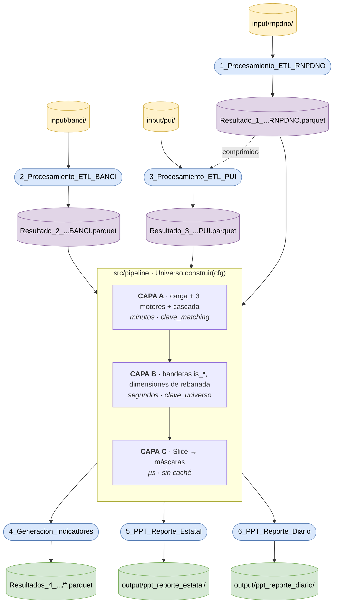

# 2. Flujo y Pipeline de Datos

El proyecto es híbrido: los módulos de `src/` implementan la lógica y los notebooks la
**orquestan y declaran qué se quiere**. Un notebook no implementa pipeline; pide rebanadas.

## Diagrama general



## Los notebooks

| Notebook | Qué hace | Salida |
|---|---|---|
| **1_Procesamiento_ETL_RNPDNO** | limpia el RNPDNO, deriva fechas, CURP (con imputación), nombre y clasificación. Exporta exactamente `config.RNPDNO_OUTPUT_COLUMNS` | `Resultado_1_*.parquet` |
| **2_Procesamiento_ETL_BANCI** | limpia BANCI, repara nombres, deriva folios y municipio. Exporta exactamente `config.BANCI_OUTPUT_COLUMNS` | `Resultado_2_*.parquet` |
| **3_Procesamiento_ETL_PUI** | cruza coincidencias de la PUI con confrontas manuales y defunciones; produce `indicadora_indicio_de_vida_derivada_pui` ([8. Indicios de vida](8_indicios_de_vida.md)). Exporta con `config.PUI_NOMBRES_EXPORTADOS` | `Resultado_3_*.parquet` |
| **4_Generacion_Indicadores** | construye y cachea el universo; materializa rebanadas a Parquet | `Resultados_4_.../` |
| **5_PPT_Reporte_Estatal** | 32 presentaciones estatales desde una sola corrida | `output/ppt_reporte_estatal/` |
| **6_PPT_Reporte_Diario** | reporte diario nacional | `output/ppt_reporte_diario/` |
| **7_Exportacion_Bases_Con_Llave** | devuelve BANCI y RNPDNO idénticos a su origen, con la llave de cruce y la procedencia de cada match; arma la base de revisión de fecha de hechos para el Secretariado | `output/bases_con_llave/<perfil>/`, `output/revision_sesnsp/<perfil>/` |
| **8_Revision_Secretariado** | con el perfil `revision_secretariado` (flujo R → normalizar_folios), arma los candidatos a revisión manual y la verificación de fecha para el Secretariado | `output/revision_sesnsp/revision_secretariado/` |

Los notebooks 1, 2 y 3 son independientes entre sí, salvo que **el 3 necesita el Parquet
del 1** (usa el RNPDNO como `comprimido` para resolver clasificación, fecha de hechos y
CURP). Los notebooks 4, 5, 6 y 7 comparten la capa A: la primera corrida paga el matching y
las siguientes leen el caché, mientras siga valiendo (ver [6. Arquitectura](6_arquitectura.md#qué-invalida-el-caché)).

> El Parquet del 3 no es una fuente más que se cruce con las otras dos: entra por
> `config.CONFRONTAS_FILE` y su única aportación al universo es la columna
> `indicadora_indicio_de_vida_derivada_pui`, que la CAPA B convierte en la bandera `is_cind_derivada_pui` (su negación, `sind`, la resuelve el rebanado). El
> recorrido completo está en [8. Indicios de vida](8_indicios_de_vida.md).

> El **7 no vuelve a correr los motores para exportar**: toma la capa A del universo que
> construye (del caché, si sigue valiendo) con `exportar_bases_con_llave(u)` y la vuelca a
> los archivos de origen. Con el mismo perfil y los mismos insumos, la llave exportada y los indicadores
> salen del mismo cruce; la columna `version_match` de cada fila lleva la `clave_matching`
> para poder comprobarlo desde el propio Excel.

## Las tres capas

El pipeline está partido según **cuánto cuesta cada paso y de qué configuración depende**.
Esa separación define las llaves de caché:

| Capa | Qué hace | Costo | Llave | La invalida |
|---|---|---|---|---|
| **A · Matching** | carga fuentes, 3 motores, reglas, cascada | minutos | `clave_matching` | cualquier campo del perfil de la capa A (con el rango de `periodo_match`), `config.py`, el código de los motores, cualquier insumo leído |
| **B · Derivadas** | banderas `is_*`, dimensiones de rebanada, curación | segundos | `clave_universo` | lo anterior + modalidad de carpeta + código de las derivadas |
| **C · Rebanadas** | máscaras por base/período/estatus/subfiltro/entidad | µs | — | nada |

**Cambiar período, estatus, subfiltro o entidad no invalida ningún caché.** Por eso los
notebooks 5 y 6, con configuraciones distintas, comparten una sola corrida de motores.

## Cómo se pide un indicador

Un notebook declara rebanadas y pide sus conteos. No calcula nada por su cuenta:

```python
cfg = Settings.desde_perfil("reporte_diario")
u   = Universo.construir(cfg)

CONTEOS = [
    Slice("rn", "01oct24-max", estatus="des"),
    Slice("rn-no-ba", "01ago25-max", estatus="des", subfiltro="sfval_sfvac"),
]
vars_ppt = u.indicadores(CONTEOS, porcentajes=PORCENTAJES)
```

Cada `Slice` genera su nombre canónico (`reg_rn-no-ba_01ago25-max_des_sfval_sfvac`), que es
el marcador `{{...}}` de la plantilla PPTX. La nomenclatura completa está en
[`catalogo_abreviaturas.md`](../catalogo_abreviaturas.md).

## Relación con el código fuente

| Módulo | Papel |
|---|---|
| `src/settings.py` | `Settings`: configuración inmutable y llaves de caché |
| `src/slices.py` | `Slice`: rebanadas declarativas, nombre canónico ↔ objeto |
| `src/pipeline/carga.py` | CAPA A · lee los tres Parquet e integra confrontas |
| `src/pipeline/motores.py` | CAPA A · orquesta los tres motores, consolida y deja sólo las columnas que se leen después |
| `src/pipeline/reglas.py` | reglas de invalidación registradas por nombre |
| `src/pipeline/derivadas.py` | CAPA B · banderas `is_*` y columnas derivadas |
| `src/pipeline/universo.py` | orquestador y caché de dos niveles |
| `src/pipeline/huella.py` | qué decide si un caché sigue valiendo: config, código e insumos leídos |
| `src/matching_r.py` | motor **estándar** |
| `src/matching_engine.py` | motor **manual**, cascada y auditoría |
| `src/motor_refinado.py` | motor **refinado** |
| `src/cleaning.py` | limpieza de cadenas, fechas, CURP y clasificación de carpeta |
| `src/validacion.py` | insumos: exige archivo, hoja y columnas |
| `src/validacion_banci.py` | BANCI: revisa el contenido de la entrega y la compara con la anterior |
| `src/ppt_engine.py` | sustitución de textos e imágenes en PPTX |
| `src/utils.py` | I/O, agregaciones, deltas contra el corte de marzo y el cruce externo de MJ y RIPS (`cruzar_mj_rips`) |
| `src/directorio_indicios.py` | indicios de vida ya formalizados (`indicios_formalizados`); fuera de la huella del caché, así que editarlo no repite el matching |
| `1_funciones/` | graficación (barras, líneas, treemap, heatmap) |

## Fuera de Jupyter

```bash
python -m src.pipeline info    --perfil reporte_diario   # configuración y estado del caché
python -m src.pipeline build   --perfil reporte_diario   # construye el universo
python -m src.pipeline limpiar --perfil base --nivel universo
```

Útil para dejar el caché caliente antes de abrir los notebooks.
