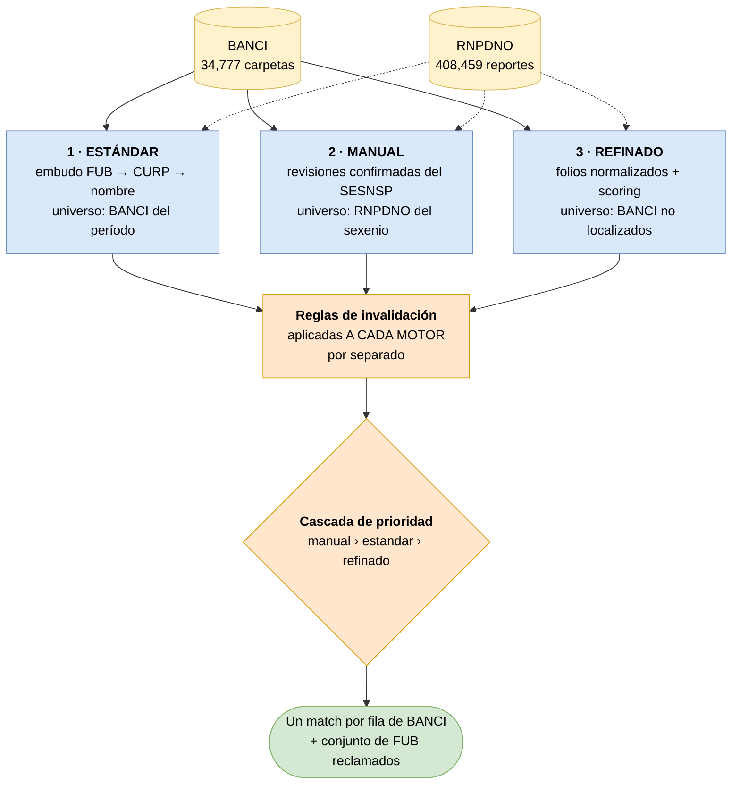
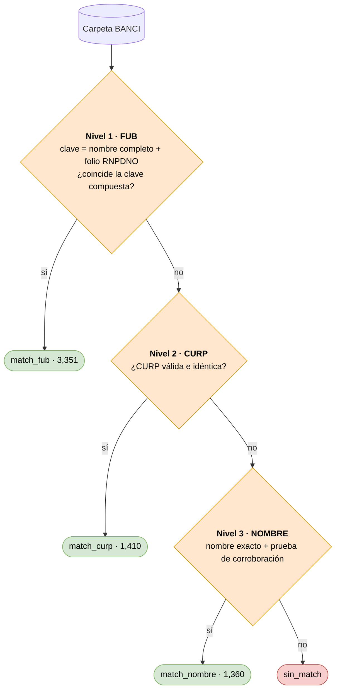
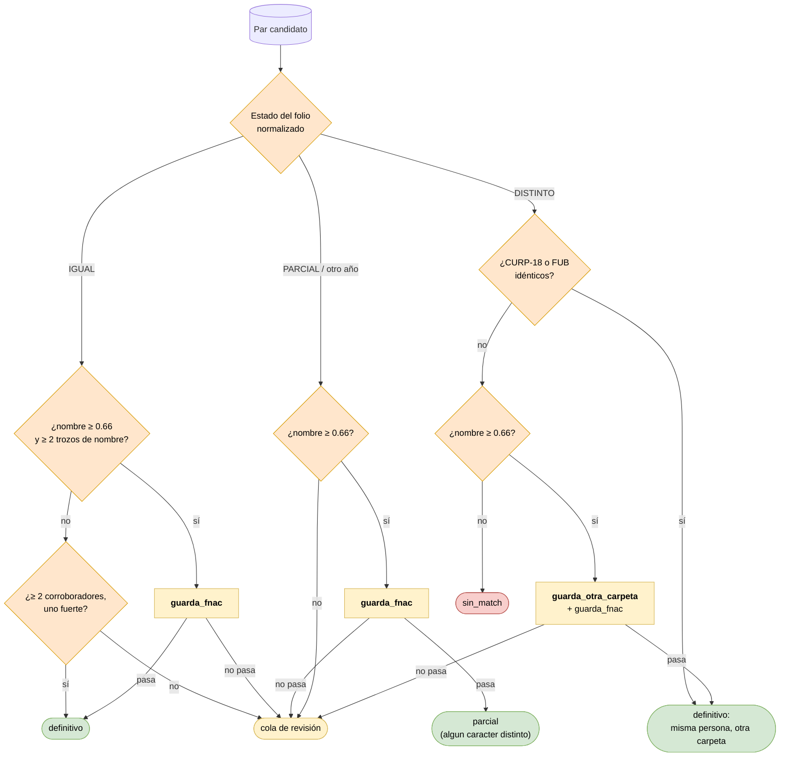

# 3. Metodología de Matching

El matching responde a una sola pregunta: **¿la carpeta de investigación abierta por una
fiscalía (BANCI) y el reporte de búsqueda levantado en una comisión (RNPDNO) son de la
misma persona?**

Importa porque las dos bases se alimentan por vías independientes. Sin cruce, la misma
persona se cuenta dos veces; con un cruce mal calibrado, dos personas distintas se
fusionan en una. El sistema está construido para equivocarse hacia el primer lado: **es
preferible dejar dos registros sin unir que unir a dos personas distintas.**

Todo el código vive en la CAPA A del pipeline y se cachea con `cfg.clave_matching`
(ver [6. Arquitectura](6_arquitectura.md)).

| Archivo | Papel |
|---|---|
| `src/pipeline/motores.py` | orquesta los tres motores, prepara los universos, consolida |
| `src/matching_r.py` | motor **estándar** (réplica del script R original) |
| `src/matching_engine.py` | motor **manual** + cascada + auditoría comparativa |
| `src/motor_refinado.py` | motor **refinado** (réplica de `normalizar_folios_v6.py`) |
| `src/pipeline/reglas.py` | reglas de invalidación aplicadas motor por motor |

---

## 3.1. Panorama: tres motores y una cascada

Por defecto los tres motores se ejecutan **sobre el universo completo**, cada uno por su
cuenta. No se pasan los sobrantes entre sí. Cada uno emite su veredicto para cada fila de
BANCI, y sólo al final se decide quién gana. (El perfil puede encadenarlos; ver más abajo.)



**Por qué corren los tres y no en cadena.** Si el estándar se llevara sus filas antes de
que el manual opinara, una confirmación humana nunca podría corregirlo. Corriéndolos en
paralelo, cuando dos motores señalan a **personas distintas** la cascada puede preferir al
de mayor autoridad. En la corrida actual eso pasa en 78 filas.

### La cadena, cuando el paralelo no cabe

Correr el refinado sobre el universo completo es caro, y con el RNPDNO entero (408,600
registros, ver §3.7) deja de ser viable. Para eso existe la perilla del perfil:

```toml
cascada_en_ejecucion = true   # default: false
```

En `true` los motores corren **en el orden de la prioridad** —`manual` → `estandar` →
`refinado`— y cada uno recibe sólo las filas que el anterior no resolvió. El refinado deja
de mirar las ya resueltas.

Dos condiciones lo hacen seguro:

1. **El orden de ejecución es el de prioridad, nunca al revés.** Con el estándar al frente
   una fila confirmada a mano saldría del flujo antes de que el motor manual opinara: el
   algoritmo pisaría al revisor, que es justo lo que la cascada existe para impedir. El
   manual va primero y no cuesta nada: no busca, transcribe.
2. **Las reglas de invalidación se aplican a cada motor antes de pasar el remanente.** Un
   match anulado devuelve la fila a la cadena en vez de matarla.

Lo que se pierde es la **corroboración cruzada**: si el estándar resuelve una fila, el
refinado ya no la ve y nunca se sabrá si coincidían. La columna `metodos_concurrentes` de
las bases exportadas (§7.3) queda con un solo motor, y la auditoría comparativa deja de
medir discrepancias. Por eso el default es `false` y el reporte diario no lo activa.

### El orden de prioridad

```toml
orden_prioridad_cascada = ["manual", "estandar", "refinado"]
```

> ⚠️ **`manual` va primero**, no el estándar. Son pares que una persona del SESNSP revisó
> y validó uno por uno; cuando el algoritmo y el revisor discrepan, gana el revisor. Con
> `estandar` al frente se perdían 54 validaciones humanas sin dejar rastro.

Es prioridad, **no** orden de ejecución: los motores ya corrieron todos. La cascada sólo
elige, para cada fila, el primer motor de la lista que tenga un match válido.

### Resultado de la corrida vigente

| Motor | Filas de BANCI que gana | Subcriterios |
|---|---:|---|
| **estandar** | 6,121 | `match_fub` 3,351 · `match_curp` 1,410 · `match_nombre` 1,360 |
| **refinado** | 571 | `definitivo` 555 · `parcial (algun caracter distinto)` 16 |
| **manual** | 561 | `match_confirmado_sesnsp` 561 |
| *sin match* | 27,524 | — |
| **Total** | **34,777** | |

Los dos motores algorítmicos **coinciden mucho más de lo que parecía**: en 5,290 filas el
estándar y el refinado señalan al MISMO FUB. Por eso el refinado gana pocas por su cuenta:
su aportación propia son los 571 casos que sólo el folio normalizado resuelve.

> Estos números cambiaron el 7 de septiembre de 2026 al corregir un defecto de
> **atribución** del motor estándar: sus matches se pegaban a la fila equivocada de
> BANCI. Los pares siempre fueron correctos; lo que estaba mal era de qué carpeta
> colgaban. Antes de la corrección el estándar aparentaba ganar 6,077 filas y el refinado
> 5,240, porque la desalineación los hacía parecer complementarios cuando en realidad
> coincidían.

---

## 3.2. Motor ESTÁNDAR — embudo de identificadores duros

`src/matching_r.py` · réplica del script R `funcion_tratamiento_banci_rnpdno_*.R`

Es el criterio de referencia: **determinista, sin similitud difusa**. Un embudo de tres
niveles de certeza decreciente. Quien casa en un nivel sale del embudo y no baja al
siguiente.

Antes de empezar, BANCI se **deduplica**: por CURP y por nombre + fecha de inicio, quedándose
con el registro más reciente. Es lo que hace el R original y evita que un duplicado interno
reclame dos veces el mismo reporte.



### Nivel 1 · FUB (folio de búsqueda)

BANCI a veces ya trae el folio del RNPDNO capturado en `folio_rnpdno`. No basta con que
coincida: **la llave de cruce es `normalizar(nombre_completo + " " + folio)`**. El nombre
va pegado al folio precisamente para que un error de captura en el folio no arrastre a un
reporte ajeno.

- Contra **no localizados**: coincidencia directa de la clave, sin condición de fecha.
- Contra **localizados**: la clave *más* tolerancia de fecha de hechos ≤ 30 días.

### Nivel 2 · CURP

Sólo entran registros de BANCI cuya CURP pasa la validación estructural
(`src.cleaning.es_curp_valida_vectorizado`), que el ETL calcula una sola vez en
`curp_valida_derivada_banci`. La comparación es de igualdad exacta sobre los 18
caracteres, después de limpiar las dos CURP de la misma forma: sin espacios y en mayúsculas
(`src.cleaning.limpiar_curp`).

Ambos lados se deduplican antes de cruzar: BANCI por `curp_limpia` quedándose con la fecha
de inicio más reciente, y el RNPDNO por CURP quedándose con la fecha de hechos más
reciente. Sin eso, una CURP repetida generaría un producto cartesiano de parejas.

### Nivel 3 · Nombre + corroboración

El más delicado, porque **el nombre no identifica**: los homónimos son frecuentes. Aquí el
nombre sólo **abre candidatos** (comparación exacta tras normalizar acentos y espacios —
no hay similitud parcial en este motor). El vínculo se confirma con una prueba aparte,
implementada como un `case_when` de casos **excluyentes**, no como un OR:

**Para personas no localizadas** (`_validar_match_nombre_r`, tipo `desaparecidos`):

| Caso | Condición | Veredicto |
|---|---|---|
| 1 | Ambas bases tienen fecha de nacimiento y difieren **≤ 5 días** | acepta si la fecha de hechos difiere ≤ **365 días** |
| 2 | Ambas tienen fecha de nacimiento y difieren **> 5 días** | **rechazo terminante** |
| 3 | A alguna le falta la fecha de nacimiento | acepta si **coincide la entidad** y la fecha de hechos difiere ≤ 365 días |

> El caso 2 es la guarda anti-homónimo del motor: dos personas pueden llamarse igual, pero
> no nacer en fechas distintas. Cuando el dato existe y contradice, **no** se pasa al caso 3
> a buscar una prueba más blanda.

**Para personas ya localizadas** las tolerancias se estrechan: fecha de hechos ≤ **30 días**
Y (fecha de nacimiento ≤ 5 días **O** misma entidad). Es más estricto porque un falso
positivo aquí mueve los conteos de localización.

La tolerancia de fecha se etiqueta además en categorías legibles
(`categorizar_tolerancia_fecha`): `Exacta`, `1-5 días`, `6-10 días`, `11-30 días (1 mes)`,
`2-5 meses`, `6-12 meses`, `Más de 1 año`.

### Trazabilidad

Cada match del estándar lleva el porqué: `variables_match`, `verif_nombre`, `verif_curp`,
`verif_fecha_nac`, `verif_entidad`, `verif_sexo`, `tolerancia_fecha_desaparicion`,
`diferencia_dias_desaparicion`, `fecha_hechos_status`, `evaluacion_match` y `score`. En el
frame de los motores llevan el sufijo `_estandar`; al caché sólo llegan `score` y
`variables_match` del ganador ([5. Diccionario](5_diccionario_de_variables.md#caché-de-matching-cachematchingclavebanciparquet)).

`fecha_hechos_status` es `COINCIDE (N DIAS)` si la fecha de hechos de las dos bases difiere
10 días o menos, `DIFIERE (N DIAS)` si difiere más, y **nulo** si falta alguna de las dos
fechas y no hay diferencia que medir (el script de R escribía ahí `NA (NA DIAS)`). Es una
etiqueta descriptiva: la regla que anula por fecha (`regla_r_desfase_dias`, §3.5) usa el
número `diferencia_dias_desaparicion`.

---

## 3.3. Motor MANUAL — lo que una persona ya validó

`motor_match_manual` en `src/matching_engine.py`

No busca nada: **transcribe decisiones humanas**. Tiene tres fuentes posibles y sólo una
está activa por defecto.

| Fuente | Estado | Qué aporta |
|---|---|---|
| 1. FUB pre-asignado en BANCI | 🔴 **apagada** | el `folio_rnpdno` que BANCI ya trae |
| 2. DataFrame explícito (`df_manual`) | ⚪ opcional | pares de una fuente a medida |
| 3. Revisiones confirmadas del SESNSP | 🟢 **activa** | 561 pares validados uno por uno |

### Por qué la fuente 1 está apagada

```toml
manual_usar_fub_preasignado = false
```

Aceptar ese FUB marcaría el registro como match **sin comparar un solo atributo de
identidad** — ni nombre, ni CURP, ni fecha de nacimiento, ni carpeta. Lo único verificable
es que el folio exista en el RNPDNO, y eso no es evidencia. Peor aún: tapaba matches mejor
sustentados, incluidos pares que el SESNSP ya había confirmado a mano.

Apagada, esos registros quedan libres. El FUB **no se pierde como señal**: el motor
refinado lo sigue usando para generar candidatos y puede sostener un definitivo con él,
pero allí tiene que pasar por los guardianes anti-homónimo. Se reactiva sin tocar código
poniendo la clave del perfil en `true`.

### La fuente activa: revisiones del SESNSP

Dos archivos **opcionales** en `input/input_reporte_diario/`:

```
matches_verif_fecha_hechos_SESNSP.xlsx   ← revisiones de fecha de hechos
revision_manual_score_SESNSP.xlsx        ← revisiones manuales por score
```

Si no existen, el motor no falla: simplemente no aporta matches.

**Sólo el veredicto `SI` crea match.** Un `NO` significa que el par fue revisado y
rechazado: cierra el caso —el registro sale del universo del refinado— pero no asigna
ningún vínculo. Es el mismo criterio de `normalizar_folios_v6.py`.

#### Relación muchos a muchos

Una fila de BANCI sólo puede llevar un FUB ganador (`fub_derivada_rnpdno_banci`), pero una
revisión puede haber validado **varios FUB** para ese mismo registro (la misma carpeta con
varias víctimas). Los FUB sobrantes viajan en la columna
`fubs_confirmados_manual_derivada_rnpdno_banci` y se reclaman del lado del
RNPDNO, donde cada FUB es una persona distinta con match confirmado. Dejarlos fuera perdía
personas por una limitación del formato, no por falta de evidencia.

Un FUB confirmado se descarta si **no existe en el universo RNPDNO vigente** (apunta a un
localizado o a un caso pre-sexenio). Se descarta *ese FUB*, no el registro: así el refinado
puede buscarle su match real.

---

## 3.4. Motor REFINADO — folios normalizados y scoring

`src/motor_refinado.py` · réplica de `normalizar_folios_v6.py`

Los otros dos motores buscan a la **persona**: por CURP, por nombre, por FUB. El refinado
busca por el **expediente**. Parte del número de carpeta, lo limpia hasta dejar el número
que de verdad identifica el caso y, cuando dos registros comparten ese número, pregunta
*"¿y además son la misma persona?"* antes de aceptar nada.

Por eso existe: hay casos donde el RNPDNO y BANCI **no comparten ni CURP ni el nombre bien
escrito**, pero sí hablan de la misma carpeta. Lo que pasa es que la escriben distinto:

```
BANCI   →  "FED/MICH/URU/0001234/2019"
RNPDNO  →  "1234/2019"
```

Un `==` entre esas dos cadenas da `False`. El refinado existe para que dé `True`.

Su universo es más estrecho: sólo **BANCI no localizados** (`filtrar_banci_no_localizados`)
contra **RNPDNO del sexenio**. Un localizado puede casar con un desaparecido por folio y
generar matches espurios, y además ya no necesita búsqueda.

> **El caso que se sigue en todo el capítulo.** Sin CURP y con el nombre escrito distinto,
> ni el estándar ni el manual lo agarran; es exactamente el hueco que el refinado cubre.
>
> | | BANCI | RNPDNO |
> |---|---|---|
> | Carpeta | `FED/MICH/URU/0001234/2019` | `1234/2019` |
> | Nombre | `MARIA GPE DE LA CRUZ VAZQUEZ` | `MA GUADALUPE CRUZ VASQUEZ` |
> | CURP | *(vacía)* | *(vacía)* |
> | Fecha nac. | 1988-03-04 | 1988-03-04 |
> | Fecha hechos | 2019-05-02 | 2019-05-05 |

### Etapa 1 · Limpiar: sacar el consecutivo del folio

El folio se parte en trozos —por `- / _ . espacio` y en cada cambio letra↔dígito— y cada
trozo se clasifica:

```
"FED/MICH/URU/0001234/2019"
      ↓
   FED, MICH, URU  →  letras        → claves de oficina, no sirven de llave
   2019            →  año           → se guarda aparte (importante en la etapa 3)
   0001234         →  el más largo  → CONSECUTIVO → sin ceros → "1234"

"1234/2019"  →  consecutivo "1234", año "2019", sin claves
```

**Las dos bases llegan al mismo `1234`.** Eso es todo lo que hace la normalización: tirar
lo que no identifica el caso —formato, ceros, prefijos institucionales, el año— y quedarse
con el número. Si empatan en longitud gana el último, porque el folio suele terminar en
consecutivo antes del año.

A esa regla se le añaden dos correcciones, porque sola falla:

| Problema | Cómo se resuelve |
|---|---|
| Hay números que no son del caso sino de la oficina (`0044-101-**3003**-2025`) | un trozo numérico que aparece en ≥ `UMBRAL_TOKEN_CODIGO_OFICINA = 20` folios **distintos** (o en ≥ 0.05 % de la base) no puede ser un consecutivo: se descarta. Nunca se vacía un folio — si todos sus candidatos son códigos de oficina, se conservan |
| BANCI a veces trae consecutivos de 1 o 2 dígitos, inútiles como llave | si el consecutivo de la carpeta tiene ≤ 2 dígitos se usa en su lugar la columna `ID_CI` (`_consecutivo_banci`). Sin esto, el 34.6 % de los BANCI no localizados se queda sin consecutivo comparable |

El año se reconoce con `ANIO_MIN/MAX = 1990/2035`: una ventana estrecha a propósito, para
que un consecutivo de cuatro dígitos (`0345`, `4501`) no se confunda con un año. El margen
hacia adelante absorbe los errores de captura.

En la misma pasada se normalizan las demás columnas: entidad a nombre canónico, sexo, CURP
limpia, municipio sin acentos y FUB en mayúsculas.

### Etapa 2 · Proponer: no se compara todo contra todo

34,777 filas de BANCI × 400 mil del RNPDNO son 14 mil millones de comparaciones: inviable.
El RNPDNO se indexa por **seis llaves** y una fila de BANCI sólo se compara contra quien
comparta **al menos una**:

| Llave | Qué agrupa |
|---|---|
| `idx_fub_b` | FUB idéntico |
| `idx_curp_b` | CURP completa (18) |
| `idx_curp10_b` | primeros 10 de la CURP (nombre + fecha de nacimiento, sin entidad ni homoclave) |
| `idx_cons_b` | **el consecutivo de la etapa 1** |
| `idx_ape_b` | primer apellido (bloques de más de `MAX_BLOQUE_NOMBRE = 3000` se saltan) |
| `idx_fnac_b` | fecha de nacimiento |

En el caso de ejemplo, el consecutivo `1234` está en `idx_cons_b`, así que la fila del
RNPDNO entra a la lista de candidatos.

> Esto es *blocking*: no busca el match, busca **a quién vale la pena mirar**. Propone de
> más a propósito, porque las etapas siguientes filtran. El índice de apellido se salta los
> bloques enormes: "HERNÁNDEZ" propondría medio país y no descartaría nada.

### Etapa 3 · Clasificar el par: dos preguntas y una rejilla

Para cada par candidato se hacen **dos evaluaciones independientes**.

#### Pregunta A · ¿qué tan parecidos son los folios?

Cuatro respuestas posibles (`_folio_limpio_status`):

| Estado | Cuándo |
|---|---|
| `igual` | mismo consecutivo, mismo año (o falta el año en algún lado), sin choque de claves |
| `parcial` | mismo consecutivo y año, pero las claves de oficina no coinciden |
| `anio_distinto` | mismo consecutivo, **año distinto** |
| `no` | consecutivo distinto, o no hay consecutivo comparable |

`anio_distinto` merece detenerse: **los consecutivos se reinician cada año**, así que la
carpeta 1234/2019 y la 1234/2024 no tienen nada que ver. El script original midió que el
**55 % de los pares con "mismo consecutivo" eran de años distintos**; por eso el año es un
filtro duro y no un detalle de presentación.

En el ejemplo: mismo `1234`, mismo `2019`, y el RNPDNO no trae claves con las que chocar →
**`igual`**.

#### Pregunta B · ¿qué tan parecidos son los nombres?

No se comparan las cadenas enteras. Se parten en palabras, se expanden abreviaturas y se
quitan partículas:

```
"MARIA GPE DE LA CRUZ VAZQUEZ"  →  MARIA · GUADALUPE · CRUZ · VAZQUEZ
"MA GUADALUPE CRUZ VASQUEZ"     →  MARIA · GUADALUPE · CRUZ · VASQUEZ
                                     ✓        ✓         ✓      ✓ (0.93)
```

La similitud es **la proporción de palabras del nombre más corto que encuentran pareja** en
el otro, con tolerancia ortográfica de 0.85 (`VASQUEZ`/`VAZQUEZ` sí, `CASTAN`/`CASTAÑO`
no). Tolera el orden distinto y que una base traiga un apellido de más. Aquí casan 4 de 4 →
**similitud 1.00**.

El umbral que decide es **0.66**: por encima, el nombre por sí solo es evidencia suficiente
para proponer. Y siempre con un mínimo de **2 palabras**: coincidir sólo en "JOSÉ" no es
coincidir.

#### La rejilla

Cruzando las dos respuestas sale la decisión:

| Folio ↓ \ Nombre → | **fuerte** (≥ 0.66 y ≥ 2 palabras) | **débil** |
|---|---|---|
| `igual` | candidato a **definitivo** *(pasa por guardián)* | definitivo **sólo** con ≥ 2 corroboradores, uno fuerte (fecha nac. o CURP-10) |
| `parcial` / `anio_distinto` | candidato a **parcial** *(pasa por guardián)* | nada |
| `no` | CURP-18 o FUB idénticos → **definitivo** "misma persona, otra carpeta"; si no, guardián reforzado | nada |

Dos lecturas que conviene fijar: en la esquina inferior derecha **folio distinto + nombre
débil no produce nada** —el motor no inventa—, y la fila de arriba a la derecha es la
salida de emergencia para cuando el nombre viene mal capturado pero el folio coincide.

El mismo recorrido, completo:



### Etapa 4 · Los guardianes anti-homónimo

Si hay una sola idea que llevarse de este motor, es ésta:

> **Un folio idéntico NO basta para afirmar que son la misma persona.**

Porque una carpeta puede cubrir a varias víctimas, porque los folios se capturan mal y
porque los homónimos existen. Antes de aceptar un definitivo, el par pasa por un guardián.

**`_guarda_fnac`** — el guardián normal. Su lógica es *"si algo no encaja del todo,
exígeme un ancla dura"*:

```
¿El nombre es idéntico al 100 %?            ─┐
¿Difieren las fechas de hechos ≤ 360 días?  ─┴→ las dos SÍ → pasa
                                                alguna NO  → exige fecha de nacimiento
                                                             igual, o CURP-10 igual
```

Ese umbral de 360 días es `DIAS_FHECHOS_EXIGE_FNAC`. En el ejemplo: nombre 1.00 y fechas a
3 días → pasa directo (y aunque no fuera así, las
fechas de nacimiento coinciden). Un caso donde el guardián sí muerde: dos
`JUAN PEREZ RAMIREZ` con el mismo consecutivo pero hechos separados 1,100 días. El nombre
es idéntico, la fecha no encaja → se exige fecha de nacimiento o CURP-10, y sin ellas no
hay definitivo: se va a la cola de revisión.

**La excepción de las carpetas colectivas.** Cuando una misma carpeta cubre a varias
personas distintas, su fecha de hechos es genérica y no es confiable, así que el guardián
se **relaja**: no tiene sentido exigirle coherencia a un dato que se sabe genérico. A
cambio se **cierra** la ruta de los corroboradores, porque en una carpeta colectiva
coincidir en "entidad + sexo" no dice nada: todas las víctimas del expediente coinciden en
eso.

**`_guarda_otra_carpeta`** — el guardián reforzado, sólo para el caso más delicado:
afirmar "es la misma persona, en otra carpeta" **sin** CURP completa ni FUB.

- Entidades que se contradicen → hace falta fecha de nacimiento o CURP-10 **y** nombre
  completo idéntico (≥ 3 palabras, mismas de los dos lados).
- Hay fechas de nacimiento en ambos lados y **difieren** → rechazo inmediato.
- No hay fechas de nacimiento → nombre completo idéntico **más** un apoyo: municipio,
  entidad o fecha de hechos a ≤ 10 días.

### Etapa 5 · Elegir un ganador por fila de BANCI

Una fila puede haber producido varios candidatos aceptados. Se escoge uno:

```
definitivo  >  parcial  >  revisión manual  >  sin match
```

y entre definitivos empatados gana el de mejor fecha de hechos:
`COINCIDE (≤ 10 días)` > `SIN DATO` > `DIFIERE`.

El caso de ejemplo termina como **`definitivo`**, con el motivo escrito en texto en
`variables_match_refinado`:

```
nombre 1.00 + folio limpio identico (formato/ceros ignorados); fuente: carpeta;
+fecha de hechos (+-10 dias)
```

#### La cola de revisión: aquí —y sólo aquí— entra el score

> ⚠️ **El score no decide los matches.** Todo definitivo o parcial sale con
> `score_refinado = 100` fijo. Los pesos de abajo sirven únicamente para **ordenar la cola
> de lo dudoso**, y ese score se topa en 99 justamente para que nunca se confunda con un
> match aceptado.

Antes de puntuar hay un colador: un candidato ni siquiera entra a la cola si no tiene un
folio específico (`igual`/`parcial` con consecutivo de ≥ 4 dígitos), o un nombre fuerte, o
un nombre razonable más algo no genérico, o dos señales de las cuales una sea dura. Sin ese
filtro la cola se llenaría de pares que sólo coinciden en sexo y entidad.

| Peso | Valor | Señal |
|---|---:|---|
| `W_FOLIO_LIMPIO` | 45 | folio normalizado idéntico |
| `W_FOLIO_PARCIAL` | 25 | folio parcialmente coincidente |
| `W_CURP10` | 25 | primeros 10 de la CURP |
| `W_NOMBRE` | 25 | similitud de nombre (se multiplica por la similitud) |
| `W_FNAC` | 15 | fecha de nacimiento |
| `W_PUENTE` | 15 | carpeta compartida con otro par ya resuelto |
| `W_MUNICIPIO` | 8 | municipio |
| *(sin constante)* | 8 | mismo consecutivo con año distinto |
| `W_ENTIDAD` | 3 | entidad — sólo desempate |
| `W_SEXO` | 2 | sexo — sólo desempate |
| — | **−5** | coincide **sólo un apellido**: se penaliza, no se premia |

El **puente** (`W_PUENTE`) es cómo el motor atrapa los casos colectivos: si la carpeta A de
BANCI ya casó definitivamente con la carpeta B del RNPDNO, las **otras** víctimas de la
carpeta B entran a la cola de A con bono.

#### Umbrales

```python
UMBRAL_NOMBRE_100  = 0.90   # sólo etiqueta verif_nombre como "COINCIDE"
UMBRAL_NOMBRE_SOLO = 0.66   # el nombre por sí solo basta para proponer
UMBRAL_NOMBRE_MIN  = 0.50   # piso para que el nombre sume en el score
UMBRAL_NOMBRE_EXACTO = 0.999
UMBRAL_MUNICIPIO   = 0.80   # fuzzy sobre NOMBRES de municipio, no claves
MIN_TOKENS_NOMBRE  = 2
CORROBORADORES_MIN_CARPETA = 2
```

> `municipio_derivada_rnpdno` se deriva al cargar, traduciendo la clave del RNPDNO a
> **nombre** con el catálogo INEGI. El motor compara nombres con fuzzy match; comparar
> claves daba intersección cero y el municipio nunca sumaba.

### Salidas del refinado

Una fila por cada fila de BANCI, con cuatro resultados posibles:

| `tipo_match_refinado` | Significado |
|---|---|
| `definitivo` | pasa folio/identidad y los guardianes |
| `parcial (algun caracter distinto)` | folio casi igual + nombre fuerte + guardián |
| `revision manual` | candidato plausible **sin** evidencia suficiente |
| `sin_match` | nada |

**`revision manual` no es un match.** La regla `excluir_revision_manual` lo retira de la
oferta del motor antes de la cascada. En `normalizar_folios_v6.py` esos casos van a un
Excel para que una persona los valide; aquí simplemente no cuentan.

Sólo después entra la cascada, donde el refinado compite con los otros dos. La mayoría de
sus matches señalan al mismo FUB que ya encontró el estándar; su aportación propia son los
casos que **sólo** el folio normalizado resuelve (ver §3.1).

### El motor en un vistazo

```
       folio crudo, escrito distinto en cada base
                   │
   [1] LIMPIAR ────┤  tirar formato, ceros, prefijos, código de oficina, año
                   │  → queda el CONSECUTIVO
                   ▼
   [2] PROPONER ───┤  6 índices: quién comparte consecutivo, CURP, CURP-10,
                   │  FUB, apellido o fecha de nacimiento
                   ▼
   [3] CLASIFICAR ─┤  folio: igual / parcial / otro año / no
                   │  nombre: ¿≥ 0.66 y ≥ 2 palabras?
                   ▼
   [4] GUARDIANES ─┤  "folio igual NO basta": ancla dura si algo no encaja
                   │  (fecha de nacimiento o CURP-10)
                   ▼
   [5] ELEGIR ─────┤  definitivo > parcial > revisión > nada
                   │  (el score sólo ordena la revisión)
                   ▼
          una fila de resultado por registro de BANCI
```

Cada guardián, cada umbral y cada "→ nada" de la rejilla son la misma frase del inicio de
este capítulo aplicada: **es preferible dejar dos registros sin unir que unir a dos
personas distintas.**

---

## 3.5. Reglas de invalidación

Se aplican **a cada motor por separado y ANTES de consolidar**. El orden lo fija el perfil:

```toml
reglas_post = ["excluir_revision_manual", "regla_r_desfase_dias", "actualizar_rn_con_banci"]
```

| Regla | Capa | Qué hace |
|---|---|---|
| `excluir_revision_manual` | A · motor | anula los candidatos `revision manual` |
| `regla_r_desfase_dias` | A · motor | anula matches con desfase > `tolerancia_desfase_dias` (10 días) o cuyo FUB está `Localizados` en RNPDNO |
| `actualizar_rn_con_banci` | B · RNPDNO | un FUB reclamado por BANCI pasa a "Con carpeta" y dependencia de fiscalía |

> **Por qué por motor y no sobre el ganador.** Antes se aplicaban después de consolidar. Si
> el estándar ganaba y la regla lo invalidaba, la fila quedaba en `sin_match` **aunque el
> manual o el refinado tuvieran un match válido esperando detrás**. Un match anulado no
> debe matar la fila: debe ceder el turno. Depurando la oferta de cada motor antes de
> elegir, la prioridad hace lo que promete.

Añadir una regla es escribir una función con `@regla_motor` y nombrarla en el perfil.
Quitar su nombre de la lista la desactiva. Así se obtienen variantes del pipeline sin
bifurcar el notebook.

---

## 3.6. Consolidación

`combinar_matches_cascada` recorre los motores en orden de prioridad y asigna a cada fila
el primero con match válido. Al salir de la capa A (`motores._salida`) el resultado queda
con el sufijo de las dos bases de las que sale: `fub_derivada_rnpdno_banci` (el FUB
ganador), `tipo_match_derivada_rnpdno_banci` (los motores que lo sostienen),
`metodo_origen_derivada_rnpdno_banci` (el que ganó la fila),
`subcriterio_match_derivada_rnpdno_banci`, `score_derivada_rnpdno_banci` y
`variables_match_derivada_rnpdno_banci`. El detalle de cada motor y las copias
`*_consolidado` de la cascada no salen de la capa: nadie los lee
([5. Diccionario](5_diccionario_de_variables.md#caché-de-matching-cachematchingclavebanciparquet)).

Después se pasa **del lado de BANCI al lado del RNPDNO**, que es donde se cuentan personas:

- Un mismo FUB puede ser alcanzado por motores distintos **a través de filas distintas de
  BANCI** (la misma persona en varias carpetas). Se listan **todos** los métodos que lo
  sostienen, en el orden de la cascada, en vez de quedarse con el de la primera fila: ese
  desempate dependía del orden del archivo, no de una regla, y movía la atribución entre
  cortes sin que nada más cambiara.
- Se suman los FUB extra de `fubs_confirmados_manual_derivada_rnpdno_banci` (§3.3).

El resultado es `ResultadoMatching`: el BANCI consolidado, el conjunto `fubs_matcheados`,
el mapa FUB → métodos y la auditoría comparativa entre motores.

Ese conjunto de FUB es lo que alimenta las bases derivadas
`rn-si-ba` / `rn-no-ba` / `ba-si-rn` / `ba-no-rn` (ver
[catálogo de abreviaturas](../catalogo_abreviaturas.md)).

---

## 3.7. Los universos que ve cada motor

No todos miran lo mismo, y es deliberado:

| Motor | Universo BANCI | Universo RNPDNO |
|---|---|---|
| estándar | sólo no localizados | completo, separando localizados de no localizados |
| manual | completo | del sexenio y no localizado (`_universo_rnpdno`) |
| refinado | sólo no localizados | del sexenio y no localizado |

### Las perillas que abren el universo

Ninguno de esos recortes está fijo en el código: los cinco salen del perfil, y apagarlos
todos da el **cruce total** (perfil `cruce_total`). El perfil `revision_secretariado`
(notebook 8) apaga los mismos salvo el de BANCI localizados: es la lógica con que se armaba
la lista de candidatos para el Secretariado ([7. Llaves de cruce §7.8](7_llaves_de_cruce.md#78-bases-para-la-revisión-del-secretariado)).

| Qué recorta | Perilla | Dónde se aplica |
|---|---|---|
| BANCI localizados | `filtrar_banci_no_localizados` | filtro interno del motor estándar **y** universo del refinado |
| RNPDNO localizados | `filtrar_rnpdno_clasificacion` | motores manual y refinado |
| RNPDNO pre-sexenio | `fecha_sexenio` | motores manual y refinado |
| Matches con desfase o FUB localizado | `reglas_post` (`regla_r_desfase_dias`) | después de cada motor |
| Fechas de BANCI en el estándar | `periodo_match` | ver la advertencia de abajo |

> ⚠️ **`periodo_match` hoy no llega al motor.** `motores.py` se lo pasa a
> `motor_match_estandar`, pero éste no lo reenvía a `ejecutar_confronta`, así que el motor
> estándar **nunca acota BANCI por fecha**. Es un cabo suelto anterior a la refactorización
> y se dejó como está a propósito: reenviarlo ahora *añadiría* un filtro que hoy no existe y
> movería los conteos del reporte diario. Corregirlo es una decisión aparte, no un descuido.

`_universo_rnpdno` filtra por clasificación **y por prefijo sin acentos**:

```python
CLASIF_UNIVERSO = ("DESAPARECID", "PENDIENTE", "NO LOCALIZAD")
```

> Va `"NO LOCALIZAD"` y **nunca** `"LOCALIZAD"` a secas: son opuestos y uno contiene al
> otro. El prefijo salva la ambigüedad, porque `"NO LOCALIZADA"` no empieza con
> `"LOCALIZAD"`. Si aparece una clasificación nueva que debería entrar, el pipeline la
> **avisa por pantalla** en vez de excluirla en silencio.

Las fechas nulas **se incluyen**: no se puede descartar que caigan en el rango. Hoy no hay
ninguna, y mantenerlas evita que un corte futuro encoja el universo sin avisar.

---

## 3.8. La entidad no filtra: es una dimensión

El universo se construye **siempre nacional**. Antes, `config.ESTADO` filtraba antes de los
motores: cada PPT estatal exigía su propia corrida (32 para 32 entidades) y un caso de
BANCI de una entidad no podía casar con un reporte capturado en otra.

Hoy la clave de entidad viaja como columna (`idestado_derivada_rnpdno`,
`cve_entidad_derivada_banci`) y la entidad se aplica al rebanar:

```python
Slice("rn", "01oct24-max", estatus="des", estado=17)   # Morelos
```

Una sola corrida alimenta las 32 entidades, y el matching entre entidades ya es posible.
Consecuencia a tener presente: los conteos estatales pueden salir **ligeramente mayores**
que con el esquema anterior. Es un resultado más completo, no un error.

`_verificar_universo_nacional` aborta la corrida si `config.ESTADO` quedó activo, porque si
no los Parquet del ETL vendrían filtrados y el universo sería parcial en silencio.

---

## 3.9. Rendimiento del motor refinado

El refinado era el techo del sistema: con el universo acotado del reporte diario
(20,251 registros del RNPDNO) tardaba minutos, pero con el RNPDNO completo
(408,600) el costo crecía como **n^1.7** —duplicar el universo triplicaba el
tiempo— y un cruce total proyectaba **más de 100 horas**.

### Dónde se iba el tiempo

| Medición | RNPDNO | Tiempo (300 filas de BANCI) |
|---|---:|---:|
| antes | 25,000 | 30.4 s |
| antes | 50,000 | 83.4 s |
| antes | 100,000 | 259.2 s |
| antes | 200,000 | 1,041.5 s |

`cProfile` señaló dos culpables, ninguno de ellos el que parecía:

**1 · Accesos escalares a columnas Arrow (≈40% del tiempo).** `_g` y `_conteos`
leían celda por celda con `df.at[i, col]` / `df[col].iat[i]`. Las columnas del
RNPDNO vienen respaldadas por Arrow, donde un acceso escalar cuesta ~40 µs en vez
de ~50 ns: con 408 mil registros por diez columnas eran millones de accesos.
Ahora cada columna se materializa a lista **una vez** y se indexa por posición.

**2 · Un cálculo cuadrático en `_conteos` (≈53%).** Por cada registro se
reconstruían los conjuntos "carpetas de esta persona" y "personas de esta
carpeta", que dependen sólo del GRUPO, y luego se restaba un elemento con
`len(S - {x})`, que recorre todo el conjunto. El costo era la suma de |grupo|².

Lo que hacía explotar esa suma: **los registros del RNPDNO sin expediente caen
todos bajo la misma llave**. `str(nan).strip().upper()` produce la cadena
`"NAN"`, que no es vacía, así que 44,747 de cada 100,000 registros quedaban
agrupados como si compartieran carpeta: 2,000 millones de operaciones.

La corrección de rendimiento memoiza el conjunto por grupo y sustituye la resta
por una prueba de pertenencia (`|S| - 1` si el elemento está). El resultado es
idéntico; sólo deja de repetirse el mismo cálculo.

> ⚠️ **La llave `"NAN"` sigue siendo un defecto de fondo, no sólo de velocidad.**
> Al agrupar como una sola carpeta a todos los registros sin expediente, esos
> registros quedan marcados como *carpeta colectiva*, y `_guarda_fnac` desactiva
> el guardián anti-homónimo para las carpetas colectivas (§3.4). Es el mismo
> problema que ya se documentó del lado de BANCI con `NTRA_CI = '0'`, aquí a
> mayor escala. Corregirlo cambia matches, así que está pendiente de decisión.

### Resultado

| RNPDNO | Antes | Después | Mejora |
|---|---:|---:|---:|
| 25,000 | 30.4 s | 8.1 s | 3.8× |
| 50,000 | 83.4 s | 11.4 s | 7.3× |
| 100,000 | 259.2 s | 15.5 s | 16.7× |
| 200,000 | 1,041.5 s | 18.6 s | **55.9×** |

El crecimiento pasó de n^1.7 a prácticamente lineal. **El cruce total —todo BANCI
contra todo el RNPDNO— corre hoy en 13.4 minutos.**

Las tres optimizaciones (materializar columnas, memoizar `_conteos`, y memoizar
`similitud_nombres` con poda por cota exacta del ratio de difflib) se verificaron
con una corrida completa del perfil `reporte_diario`: los once conteos por motor y
subcriterio son iguales y **ninguna de las 34,777 filas cambió de FUB**.

---

## 3.10. Cómo se verifica, y qué se sabe que falla

### La batería de verificación

Los conteos no delatan un matching roto: el defecto de atribución corregido el 7 de
septiembre de 2026 convivió con
totales perfectamente plausibles. Lo que lo destapó fue preguntarle a los datos si **el
criterio declarado se cumple de verdad**. Ésa es la forma de auditar este sistema:

| Grupo | Qué se comprueba |
|---|---|
| Integridad | BANCI conserva filas y orden del ETL · toda fila con match tiene FUB y al revés · todo FUB asignado existe en el RNPDNO · `fubs_matcheados` cuadra con las filas |
| Motor estándar | nivel 1: el FUB asignado es el capturado en BANCI **y** el nombre coincide · nivel 2: **CURP idéntica de 18 caracteres** · nivel 3: nombre normalizado idéntico, sin fechas de nacimiento contradictorias, con entidad coincidente cuando falta la fecha |
| Motor manual | los pares marcados como revisión confirmada del SESNSP |
| Atribución | el nombre de la carpeta se parece al de la persona del FUB asignado, por motor |
| Reglas | ningún match sobreviviente con desfase mayor a la tolerancia, ni apuntando a un FUB Localizado, ni con un candidato `revision manual` |
| Cascada | ningún motor de menor prioridad le ganó a uno de mayor |

En la corrida del 7 de septiembre de 2026 pasan **18 de 18**. La prueba más sensible es la
del nivel 2: `match_curp` exige igualdad exacta de CURP, así que cualquier desalineación la
tumba de inmediato —pasó de 0 % a 100 % al corregir esa atribución—.

> Dos verificaciones fallaron en el primer intento por estar **mal planteadas**, no por el
> código: una comparaba la clave numérica de entidad del RNPDNO contra el nombre que usa
> BANCI (`15` contra `"ESTADO DE MEXICO"`), y otra exigía parecido de nombre al motor
> refinado, que precisamente existe para casar cuando el nombre no coincide. Vale la pena
> saberlo: al auditar, la primera sospecha debe ser la prueba.

### Limitaciones conocidas

**1 · Carpetas colectivas sin guardián.** `_guarda_fnac` empieza con
`if colectiva: return True, ""`: una carpeta colectiva **desactiva por completo** el
guardián anti-homónimo. La excepción existe porque en esas carpetas la fecha es genérica,
pero quita la protección justo donde más se necesita —cuando varios miembros de una familia
comparten expediente, los apellidos coinciden y el umbral de 0.66 pasa—.

De los 571 matches del refinado, **23 no tienen ni nombre parecido ni ancla dura** (fecha de
nacimiento, CURP-10, CURP-18 o FUB iguales):

| | |
|---|---:|
| Apellidos idénticos y nombre de pila distinto (firma de hermano) | 15 |
| De ésos, además con **sexo distinto** entre las dos bases | 6 |
| Variantes del mismo nombre (apellidos invertidos, segundo nombre) — legítimos | 8 |

Ejemplos: `ESTRELLA ROSALES PANZO` ↔ `MARCOS ROSALES PANZO`;
`EDUARDO LOMELI RIVERA` ↔ `MARIA SILVIA LOMELI RIVERA`.

Contradice el criterio declarado del sistema (*mejor dejar dos registros sin unir que unir a
dos personas distintas*). Dos guardas lo corregirían: que **el sexo no pueda contradecir**
—el motor ya lo calcula y hoy sólo lo usa como desempate de 2 puntos en el score— y que, con
apellidos idénticos y nombre de pila distinto, se exija ancla dura. Impacto: 23 de 7,253
matches (0.32 %). **Pendiente de decisión**, porque cambia la metodología heredada de
`normalizar_folios_v6.py`.

**2 · La llave `"NAN"` del RNPDNO.** Los registros sin expediente caen todos bajo la misma
llave de carpeta y quedan marcados como colectivos, lo que dispara la limitación anterior a
gran escala. Ver §3.9.

**3 · `periodo_match` no llega al motor estándar.** Ver §3.7.
