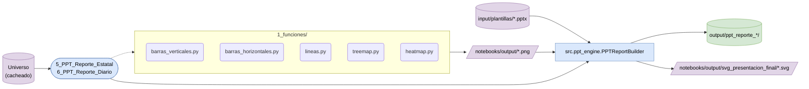

# 4. Generación de Reportes y Visualización

Dos notebooks producen presentaciones: `5_PPT_Reporte_Estatal.ipynb` (32 entidades) y
`6_PPT_Reporte_Diario.ipynb` (nacional). Ambos siguen el mismo patrón: **declarar qué se
quiere, pedirlo al universo, armar la PPT**.



## Nombre de los archivos

El reporte diario lleva **la fecha de emisión** en el nombre, así que cada corrida deja su
propio archivo y no pisa la del día anterior:

```
output/ppt_reporte_diario/Reporte de personas desaparecidas - 07.09.2026.pptx
```

El patrón y el formato de fecha están en `config.PPT_DIARIO_NOMBRE` y
`config.PPT_DIARIO_FECHA_FORMATO`; `config.ppt_diario_file(fecha=None)` compone la ruta.

> El notebook llama a esa función al ejecutarse en lugar de usar la constante
> `PPT_DIARIO_FILE`, que se congela con la fecha en que se importó `config`: un kernel
> abierto de un día para otro seguiría escribiendo con la fecha de ayer.

Es la fecha en que se **emite** el reporte, no la del corte de los datos. Esa última viaja
dentro de la presentación, en los marcadores `fha_rn_*`.

Las estatales llevan clave y nombre de entidad —`Reporte_Estatal_17_Morelos.pptx`—, con la
nacional como `00` para que ordene primero.

## El contrato: marcadores `{{...}}`

La plantilla PPTX lleva marcadores de texto con el **nombre canónico** del indicador:

```
{{reg_rn-no-ba_01oct24-max_des_sfval_sfvac}}     → 5,782
{{pct_reg_rn_01oct24-max_loc_cvid}}              → 68.4%
{{fha_rn_dia_mes_anio}}                          → 4 de septiembre de 2026
{{gr_mes_rn-no-ba_01oct24-max_des_cfval}}        → imagen
```

El notebook declara los `Slice` correspondientes y `PPTReportBuilder` los sustituye. Añadir
un indicador es añadir una línea a `CONTEOS`: **cuesta microsegundos**, porque la rebanada
es una máscara booleana sobre el universo ya construido.

`render()` devuelve el reporte de qué marcadores se encontraron y cuáles no, que es la
herramienta para diagnosticar una plantilla.

### Cuando un marcador no se sustituye

Casi siempre es la plantilla, no el cálculo. Dos fallos habituales:

- **El marcador está partido.** PowerPoint puede dejar `{{reg_r` en un párrafo y el resto
  en otro (basta un Enter accidental). El motor busca `{{...}}` dentro de un mismo párrafo,
  así que ve dos trozos sueltos y no lo reconoce.
- **Errata en el nombre.** `..._dessfval_cfvac` en vez de `..._des_sfval_cfvac`. El nombre
  tiene que ser exactamente el que genera `Slice.nombre`.

Para auditar una plantilla, comparar los marcadores que pide contra las claves que produce
el notebook:

```python
rep = builder.render(SALIDA)
no_hallados = [k for k, v in rep["text_report"].items() if v == 0]
```

## Gráficas

**Una gráfica, un bloque**, en la sección de gráficas del cuaderno y con todos sus
parámetros escritos en la llamada:

```python
nombre = "gr_mes_rn-no-ba_01oct24-max_des_cfval"
tabla = serie_mensual(
    Slice("rn-no-ba", "01oct24-max", estatus="des", subfiltro="cfval"))
ancho_cm, alto_cm = dimensiones_placeholder(PLANTILLA, nombre)
barras_verticales(
    tabla, nombre=nombre, mostrar=False,
    ancho=ancho_cm, alto=alto_cm,
    colores=["#9b2347ff"],
    tam_valor_ejex=7,
    ...
)
registrar(nombre, tabla)
```

No hay diccionarios de estilo compartidos entre láminas parecidas: en la práctica ninguna
se deja ajustar con los parámetros de la de al lado —el tamaño del texto depende de cuántas
barras entren, la posición de la cápsula de qué tan largas sean—, y un estilo común obligaba
a tocar todas para mover una. Lo único compartido es la preparación de los datos
(`serie_mensual`, `tabulado_dependencia`), que no es estilo.

Para agregar una gráfica se copia el bloque más parecido, se le cambia la rebanada y el
nombre, y se ajustan sus parámetros. `registrar` apunta el nombre en `GRAFICAS_GENERADAS`,
que es la lista que el armado de la presentación inserta en la plantilla.

Al terminar el armado, el notebook copia a `notebooks/output/svg_presentacion_final/`
únicamente los SVG de gráficas cuyos marcadores de imagen sí se sustituyeron en la
presentación, con nombres `Diap_XX_fecha.svg` (por ejemplo, `Diap_09_11.11.2026.svg`).
El número corresponde a la posición real de la diapositiva y la fecha es la de emisión
del archivo PPTX. Esta salida queda separada de los archivos intermedios que guardan las
funciones de gráficas; el PowerPoint sigue insertando los PNG.

Cada gráfica sustituye al **cuadro de texto** que lleva su marcador, heredando su posición
y sus medidas (`dimensiones_placeholder`). Así la plantilla manda sobre la maquetación y el
código sólo aporta el contenido.

> ⚠️ `exportar_grafica` (en `1_funciones/funciones.py`) tiene `"output/<nombre>"` codificado
> y relativo al directorio de trabajo, así que los PNG caen en `notebooks/output/` sin
> importar lo que declare el notebook. `RUTA_GRAFICAS` apunta a esa ruta real.

## Marcadores derivados

Además de los conteos directos, las plantillas usan seis familias calculadas aparte:

| Familia | Qué es | Dónde se calcula |
|---|---|---|
| `pct_X` | `X` entre su denominador (por defecto `Slice.padre`) | `Universo.indicadores(porcentajes=…)` |
| `pct_X_v1` / `_v2` / `_v3` | porcentajes de un reparto, con las décimas ajustadas para que el grupo sume exactamente 100% | `particiones.porcentajes_particion` |
| `X-Y` | resta contra un corte congelado (25/03/2026 o 01/07/2026) | `utils.diferencias_vs_corte` |
| `X_ddes` / `X_dloc` / `X_dfub` | altas y bajas cruzando los `fub` de ambas fotos; con `_v2`, contra el corte de julio | `utils.deltas_vs_corte` |
| `reg_rn_24jun26-max_loc_fmz` y sus `_v2` / `_v3` / `_v4` | indicios de vida del directorio actualizado que ya derivaron en una localización | `directorio_indicios.indicios_formalizados` |
| `reg_mr_min-max*` | estatus vigente de las personas con detención penitenciaria | `utils.cruzar_mj_rips` |

Las cuatro últimas necesitan un archivo que **no pasa por el pipeline**:

- los cortes de marzo y julio, que llegan como Excel ya rebanado en `input/datos_marzo/` e
  `input/datos_julio/` (`config.CORTES_REFERENCIA`);
- el directorio de indicios fechado al 18/11/2026 (`config.DIRECTORIO_INDICIOS_FILE`), que conserva los marcadores `24jun26` requeridos por la plantilla;
- el archivo de MJ y RIPS (`config.MJ_RIPS_FILE`).

Los dos últimos tampoco son rebanadas del universo —su población no sale del RNPDNO ni de
BANCI—, así que **no hay `Slice` del que colgarse**: se calculan aparte y sus conteos se
inyectan con `extra=` en `Universo.indicadores`, ya con el nombre de su marcador:

```python
tabulado_fmz, tabulado_fmz_32, fmz = indicios_formalizados(u.rn)

vars_ppt = u.indicadores(
    CONTEOS, porcentajes=PORCENTAJES,
    extra={MARCADOR_FMZ:     fmz["total"],
           MARCADOR_FMZ_PCT: fmz["pct"],
           ...},
)
```

Como no hay `Slice`, tampoco aplica la regla del padre para sus porcentajes: el denominador
se escribe a mano (`src.utils.MJ_RIPS_DENOMINADOR`) o lo devuelve la propia función
(`fmz["nacional"]`). El detalle de la nomenclatura está en
[`catalogo_abreviaturas.md`](../catalogo_abreviaturas.md), secciones 9 bis a 9 quinquies, y
el de los indicios en [8. Indicios de vida](8_indicios_de_vida.md).

### Las bajas como base (`_dloc`)

Un `_dloc` tampoco se puede exportar con `PARA_EXPORTAR`: sus registros son, por definición,
los que ya **no** están en la rebanada de hoy, y viven en el Excel del corte. El notebook 6
los declara en `BAJAS_A_EXPORTAR` y su sección 3.2 los escribe con
`src.cortes_referencia.bajas_vs_corte` en `cfg.resultados_dir` como
`<indicador>_dloc.parquet` (p. ej. `reg_rn_01ene06-max_des_sisf_dloc.parquet`). Los
declarados en `BAJAS_VS_JULIO_A_EXPORTAR` son lo mismo contra el corte de julio y salen con
el `_v2` de su marcador (`reg_rn_01ene06-max_des_sisf_dloc_v2.parquet`):

- las columnas del Excel del corte, tal como llegan, con el sufijo de su fecha (`_25mar26`
  o `_01jul26`; el de julio ya traía el de su fuente: `fub_rnpdno_01jul26`);
- del universo de hoy, `expedientes_rnpdno` y las columnas que deciden pertenecer a la
  rebanada (estatus, fecha, banderas del subfiltro), cruzadas por `fub`, vacías si el `fub`
  ya no está en el RNPDNO.

La función se detiene si los `fub` distintos no son exactamente el `_dloc` que calcula
`deltas_vs_corte`, e imprime por qué salió cada registro (hoy localizado, ya no
cumple el subfiltro, fecha fuera del período o ya no está en el RNPDNO). Vive fuera de
`src/utils.py` porque ese archivo entra en la huella del caché y editarlo obliga a repetir
el matching.

### La diferencia como base (`<actual>-<corte>`)

Un marcador de diferencia resta dos totales, y esa resta es `_ddes − _dloc`, así que su base
son las dos corrientes juntas. El notebook 6 las declara en `DIFERENCIAS_A_EXPORTAR` y la
misma sección 3.2 las escribe con `src.cortes_referencia.movimientos_vs_corte` como
`<indicador>-<corte>.parquet`, con el nombre del marcador (p. ej.
`reg_rn_01ene06-max_des_sisf-reg_rn_25mar26_des_sisf.parquet`). Una fila por registro, y la
columna `movimiento_derivada_rnpdno_25mar26` dice a qué corriente pertenece:

| Valor | Qué es | Columnas |
|---|---|---|
| `alta` | está en la rebanada de hoy y no en el corte (`_ddes`) | las del universo de hoy |
| `baja` | está en el corte y no en la rebanada de hoy (`_dloc`) | las mismas de su base `_dloc` |

Las altas menos las bajas dan el valor del marcador, y la función se detiene si no cuadra
(pasaría si alguna fila de hoy no trajera `fub` o lo trajera repetido). El `fub` queda en
`fub_rnpdno` en las altas y en `fub_25mar26` en las bajas: cada uno con el sufijo de su
fuente. En la corrida del 06/10/2026: 612 altas − 6,628 bajas = −6,016.

### Bases con la fecha del día (`PARA_EXPORTAR_CON_FECHA`)

Las rebanadas de `PARA_EXPORTAR` se escriben como `<indicador>.parquet` y se pisan en cada
corrida. Las que se entregan fuera necesitan una copia por día, y en Excel para quien las
revisa. El notebook 6 las declara en `PARA_EXPORTAR_CON_FECHA` y las escribe con
`src.exportacion_fechada.exportar_con_fecha` en `cfg.resultados_dir`, con la fecha de
**emisión** (`ddmmaaaa`) al final del nombre, igual que el reporte diario:

```
reg_rn-no-ba_01jul26-max_des_sfval_08102026.parquet
reg_rn-no-ba_01jul26-max_des_sfval_08102026.xlsx
```

Hoy es una sola: los desaparecidos sin match en BANCI y sin carpeta válida desde el
01/07/2026, la base de la revisión manual de carpetas. Lo que esa revisión dé por válido
vuelve por `input/carpetas_manuales/` (ver [6. Arquitectura](6_arquitectura.md)) y sale de
la base siguiente. La revisión vuelve en Parquet, el formato de esa carpeta. Ojo: de los
archivos de esa carpeta cuenta **todo** `fub_rnpdno`, diga lo que diga el dictamen, así que
al regresarla hay que dejar sólo las filas válidas.
