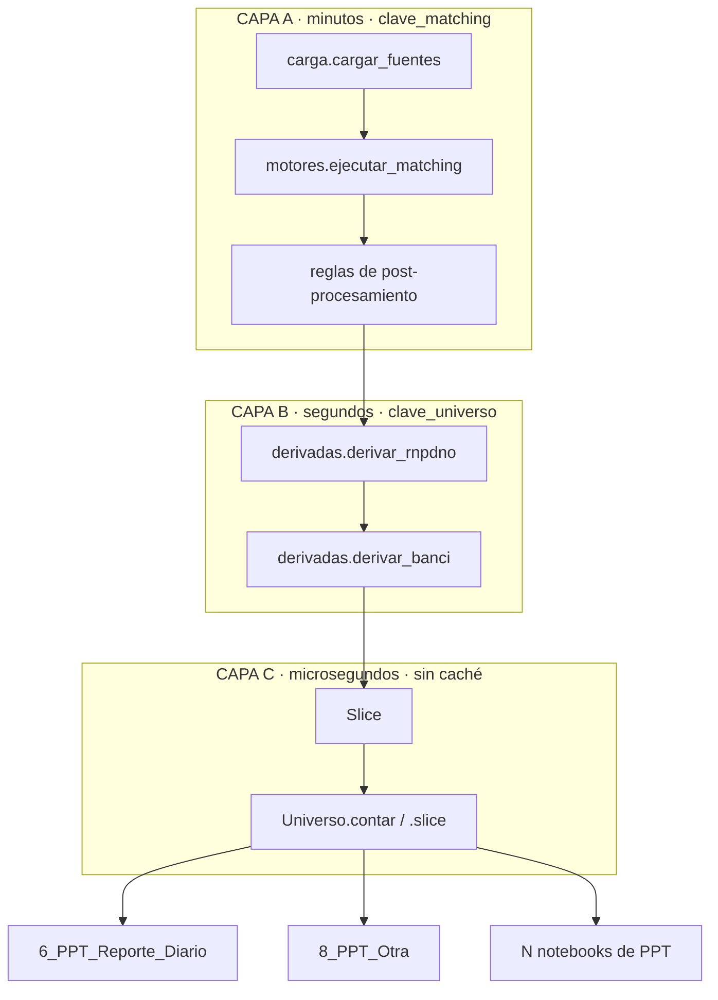

# 6. Arquitectura del Repositorio

## Estructura de carpetas

```text
desaparecidos/
├── config.py                 # (Core) SÓLO lo invariante: rutas base, mapeos de columnas,
│                             # catálogos de regex, ENTIDADES. No se edita para reconfigurar
│                             # una corrida.
├── perfiles/                 # Configuración como DATOS. Un TOML por variante de reporte.
│   ├── base.toml             # valores por defecto; los demás heredan con `extends`
│   ├── reporte_diario.toml
│   ├── estatal.toml
│   ├── cruce_total.toml     # todo BANCI contra todo el RNPDNO, sin filtros de universo
│   └── revision_secretariado.toml  # candidatos para el Secretariado (flujo R → normalizar_folios)
│
├── notebooks/                # Interfaz ejecutable. Consumen el pipeline, no lo implementan.
│   ├── 1_Procesamiento_ETL_RNPDNO.ipynb  # → Resultado_1_*.parquet
│   ├── 2_Procesamiento_ETL_BANCI.ipynb   # → Resultado_2_*.parquet
│   ├── 3_Procesamiento_ETL_PUI.ipynb     # → Resultado_3_*.parquet (= CONFRONTAS_FILE)
│   ├── 4_Generacion_Indicadores.ipynb    # construye y cachea el universo
│   ├── 5_PPT_Reporte_Estatal.ipynb       # 32 entidades desde una sola corrida
│   ├── 6_PPT_Reporte_Diario.ipynb        # declara rebanadas y arma la PPT
│   ├── 7_Exportacion_Bases_Con_Llave.ipynb  # bases de origen + llave de cruce
│   └── 8_Revision_Secretariado.ipynb     # candidatos y verificación de fecha para el Secretariado
│
├── src/
│   ├── settings.py           # Settings: configuración inmutable + llaves de caché
│   ├── slices.py             # Slice: rebanadas declarativas tipadas
│   ├── pipeline/
│   │   ├── carga.py          # CAPA A · carga de fuentes (RNPDNO, BANCI, confrontas)
│   │   ├── motores.py        # CAPA A · 3 motores + cascada; recorta lo que sale
│   │   ├── reglas.py         # reglas de post-procesamiento registradas por nombre
│   │   ├── derivadas.py      # CAPA B · banderas is_*, dimensiones de rebanada, curación
│   │   ├── universo.py       # orquestador + caché de dos niveles
│   │   ├── huella.py         # qué decide si un caché sigue valiendo
│   │   ├── exportacion_llaves.py  # CAPA C · bases de origen + id_cruce, con validación
│   │   ├── revision_sesnsp.py     # CAPA C · bases de revisión manual del Secretariado
│   │   └── __main__.py       # CLI: python -m src.pipeline build --perfil X
│   ├── cleaning.py           # ETL: limpieza de cadenas, fechas y CURP; criterio de carpeta
│   ├── matching.py           # normalización y preparación compartida por los motores
│   ├── matching_r.py         # motor ESTÁNDAR (embudo FUB → CURP → nombre, lógica R)
│   ├── matching_engine.py    # motor MANUAL + cascada + auditoría comparativa
│   ├── motor_refinado.py     # motor REFINADO de folios normalizados (lógica v6)
│   ├── ppt_engine.py         # sustitución de variables e imágenes en PPTX
│   ├── utils.py              # I/O y helpers
│   ├── validacion.py         # insumos: archivo, hoja y columnas exigidas
│   └── validacion_banci.py   # BANCI: contenido y comparación con la entrega anterior
│
├── 1_funciones/              # Módulo de graficación
├── input/                    # Archivos inmutables (no se sobreescriben)
└── output/
    ├── Resultado_1_Procesamiento_ETL_RNPDNO.parquet
    ├── Resultado_2_Procesamiento_ETL_BANCI.parquet
    ├── Resultado_3_Procesamiento_ETL_PUI.parquet   # lo lee config.CONFRONTAS_FILE
    ├── cache/                # Caché del pipeline (regenerable, se puede borrar)
    │   ├── matching/<clave>/ # nivel 1: el cruce (sólo las columnas que se leen después)
    │   └── universo/<clave>/ # nivel 2: rn.parquet + ba.parquet con banderas
    ├── bases_con_llave/<perfil>/  # salida del notebook 7: BANCI y RNPDNO + id_cruce
    ├── revision_sesnsp/<perfil>/  # salida de los notebooks 7 y 8: bases para el Secretariado
    ├── ppt_reporte_estatal/  # salida del notebook 5
    ├── ppt_reporte_diario/   # salida del notebook 6
    └── Resultados_4_Generacion_Indicadores/   # rebanadas materializadas a petición
```

## Las tres capas

El pipeline está partido según **cuánto cuesta cada paso y de qué configuración depende**.
Esa separación no es estética: define las llaves de caché.

| Capa | Qué hace | Costo | Llave | Invalidada por |
|---|---|---|---|---|
| **A. Matching** | carga fuentes, 3 motores, reglas, cascada | minutos | `cfg.clave_matching` | cualquier campo del perfil de la capa A (con el rango de `periodo_match`), `config.py`, el código de los motores, cualquier insumo leído |
| **B. Derivadas** | banderas `is_*`, dimensiones de rebanada, curación de columnas | segundos | `cfg.clave_universo` | lo anterior + modalidad de carpeta + código de las derivadas |
| **C. Rebanadas** | máscaras por base / período / estatus / subfiltro / entidad | µs | — | nada: se recalculan siempre |

Cambiar un período, un estatus, un subfiltro o una entidad **no invalida ningún caché**.
Ese es el motivo de que varios notebooks de PPT con configuraciones distintas compartan
una sola corrida de motores.



## Qué invalida el caché

Un caché sólo se reutiliza si todo lo que pudo influir en él sigue igual. `Universo.construir`
lo comprueba en dos pasos (`src/pipeline/huella.py`):

**1. La llave.** `clave_matching` y `clave_universo` resumen:

| Qué | Cómo se mide | Por qué así |
|---|---|---|
| El perfil | todos los campos de `Settings` de la capa, más el **rango** de `periodo_match` | un campo nuevo entra solo; el nombre del período no basta si cambian sus fechas |
| `config.py` | los valores **en memoria** tras importarlo y el código de sus funciones | varios valores dependen del entorno (`PIPELINE_MODO_INSUMOS`) o de un `glob`; un config.py editado pero no recargado sigue calculando con lo anterior |
| El código | el AST de los módulos raíz de la capa y de todo lo que importan del proyecto | comentar o mover código no invalida; cambiar lo que ejecuta, sí |
| Los insumos del perfil | tamaño y fecha de modificación | además de la revisión del paso 2 |

Cambiar cualquiera da otra llave: el caché anterior no se borra, simplemente deja de
encontrarse. Quedan fuera, a propósito, el nombre del perfil (`estatal` y `reporte_diario`
comparten caché), los períodos de rebanado, la entidad y las rutas de salida de
`config.py` (`PPT_DIARIO_FILE` lleva la fecha de hoy y lo invalidaría cada día).

**2. Los archivos leídos.** Al construir se anota cada archivo que se lee —Parquet del ETL,
catálogo INEGI, respuestas del Secretariado…— con su firma, y se guarda en `huella.json`
junto al caché. Al leerlo se revisan: si alguno cambió, el caché se descarta y se avisa
cuál. Así un insumo nuevo queda cubierto sin tener que declararlo.

Dos protecciones más al escribir:

- **No se guarda desde un kernel desactualizado.** Si un archivo del código de la capa se
  modificó después de arrancar el proceso, el kernel puede estar corriendo la versión
  anterior: el resultado se calcula, pero no se guarda, y se pide reiniciar el kernel.
- **Escritura atómica.** Cada nivel se escribe en una carpeta temporal que se renombra al
  final: una corrida interrumpida no deja un caché a medias con la llave buena.

`forzar=True` (o `forzar_matching=True`) recalcula aunque el caché valga, y
`limpiar_cache(cfg)` lo borra.

## La entidad es una dimensión, no un filtro

Antes, `config.ESTADO` filtraba RNPDNO y BANCI **antes** de los motores, así que cada PPT
estatal exigía su propia corrida de matching (32 corridas para 32 entidades). Además, un
caso de BANCI de una entidad no podía casar con un registro del RNPDNO capturado en otra.

Ahora el universo se construye **siempre nacional** y la clave de entidad viaja como
columna en los dos frames: `idestado_derivada_rnpdno` en `u.rn` (la del ETL, sin copiarla)
y `cve_entidad_derivada_banci` en `u.ba` (`DIMENSIONES` en `derivadas.py`). La entidad se
aplica al rebanar:

```python
Slice("rn", "01oct24-max", estatus="des", estado=17)   # Morelos
```

Consecuencias:

- Una sola corrida de motores alimenta las 32 entidades.
- El matching entre entidades ya es posible, así que los conteos estatales pueden ser
  **ligeramente mayores** que con el esquema anterior. Es un resultado más completo, no
  un error, pero conviene tenerlo presente al comparar contra cifras publicadas.

## Clasificación de carpeta de investigación

`config.MODALIDAD_CLASIFICACION_CARPETA` decide qué expediente cuenta como folio válido
(`cfval`, en `is_cfval_derivada_rnpdno`):

| Modalidad | Regex | RNPDNO con folio válido (corte 29-sep-2026) |
|---|---|---|
| 1 | `RNPDNO_REGEX_CARPETA`, uno para todo el país | 45,705 |
| 2 | `CATALOGO_REGEX_CI_POR_ENTIDAD`, uno por entidad | 103,079 |
| 3 | `CATALOGO_REGEX_CI_POR_ENTIDAD_2`, uno por entidad, más las siglas de Oaxaca | sin medir con ese corte |
| 4 | `CATALOGO_REGEX_CI_POR_ENTIDAD_3`, unión de la 2 y la 3, sin las siglas de Oaxaca | sin medir con ese corte |

La modalidad 3 es la traducción del código en R. En Oaxaca agrega una segunda capa,
porque su patrón acepta casi cualquier número-texto-año: de los folios que lo pasan se
extraen las siglas —lo que hay entre el consecutivo inicial y el año final,
`REGEX_SIGLAS_CI_OAXACA`— y deben existir en `config.CATALOGO_NOMENCLATURA_OAXACA`. Esa
capa sólo quita carpetas, nunca las agrega. Si el catálogo queda vacío, la modalidad 3 se
detiene con un error en vez de mandar todo Oaxaca a "Sin carpeta".

Encima de la modalidad, `config.MODALIDAD_MANUAL_CLASIFICACION_CARPETA = True` suma los
registros de una revisión manual aunque su folio no pase el regex o venga vacío, sea cual
sea `MODALIDAD_CLASIFICACION_CARPETA`. Se leen todos los archivos de
`input/carpetas_manuales/` (`config.CARPETAS_MANUALES_DIR`) y cuenta todo `fub_rnpdno` que
traigan, diga lo que diga su dictamen («Válido», «Se repite», «Vacío»). Esa capa sólo
agrega carpetas. Con `False` los archivos ni se leen. Para sumar una revisión basta con
dejarla en la carpeta: la firma de cada archivo entra en `clave_universo` y el caché se
recalcula solo. Con la primera revisión (`sin_carpeta_a_partir_de_julio.xlsx`, 187 FUBs,
uno con el expediente vacío) el folio válido pasa de 119,642 a 119,829 en el corte del
8-oct-2026.

Las revisiones van en **Parquet**: de él se lee sólo la columna `fub_rnpdno`, y el Excel
hay que leerlo entero. El Excel se sigue aceptando para que ninguna revisión vieja quede
fuera (`config.CARPETAS_MANUALES_EXTENSIONES`). Un archivo con otra extensión no se lee, y
el pipeline avisa con su nombre; a uno sin la columna `fub_rnpdno` lo detiene con error.
Un FUB que aparece en dos archivos cuenta una vez.

La implementación es única —`src.cleaning.clasificar_carpeta`— y la usa la CAPA B
(`derivadas.py`) sobre `expedientes_rnpdno`. El perfil hereda la modalidad de `config.py`;
sólo se sobrescribe en `perfiles/*.toml` si un reporte concreto necesita otra.

Antes el ETL y la carga también marcaban una indicadora de carpeta
(`indicadora_carpeta_derivada_rnpdno`, `indicadora_carpeta`) con su subfiltro
`ccarp`/`scarp`. Ningún indicador los usaba, así que se quitaron: el criterio de carpeta
sólo alimenta `cfval`.

Un detalle a tener presente:

- 29 de los 32 patrones del catálogo llevan `(?i)` después del ancla `^`, lo que el
  módulo `re` de Python 3.11+ rechaza. `clasificar_carpeta` iza esos flags al inicio
  (`normalizar_regex`), lo que da resultados idénticos y evita depender de que las
  columnas sean Arrow-backed —donde pandas despacha a RE2, que sí lo tolera—.

## El archivo de confrontas

`config.CONFRONTAS_FILE` es lo que aporta `indicadora_indicio_de_vida_derivada_pui` (el
indicio de vida en la PUI) al RNPDNO. Desde que existe el notebook 3, apunta a un Parquet de `output/`:

```python
CONFRONTAS_FILE = OUTPUT_DIR / "Resultado_3_Procesamiento_ETL_PUI.parquet"
```

Antes se entregaba a mano como Excel en `input/confrontas/`, y esa carpeta ya no forma parte
del pipeline. El lector (`src/pipeline/carga.py`) **sigue aceptando `.xlsx`**: elige según
la extensión, porque `read_parquet` no admite un callable en `columns` y para Parquet el
predicado de selección se aplica sobre los nombres del esquema. Un perfil puede así apuntar
a un archivo antiguo sin tocar código.

De ese archivo el pipeline toma **una sola columna**. El mapeo
`config.CONFRONTAS_COLUMN_MAPPING` acepta el nombre que exporta el notebook 3
(`indicadora_indicio_de_vida_derivada_pui`) y los de archivos anteriores
(`indicadora_registro`, `indicadora_indicio_de_vida`); `carga.py` la colapsa a binaria y la
deja en `indicadora_indicio_de_vida_derivada_pui`. Cómo se
construye esa columna y en qué se convierte después está en
[8. Indicios de vida](8_indicios_de_vida.md).

## Configuración: `config.py` vs. perfiles

| | `config.py` | `perfiles/*.toml` |
|---|---|---|
| Contenido | rutas base, mapeos de columnas, catálogos de regex, `ENTIDADES`, `PERIODOS_TIEMPO`, `MODALIDAD_CLASIFICACION_CARPETA` | qué archivo fuente usar, orden de cascada, reglas activas, tolerancias, entidad |
| Cambia | casi nunca | por reporte |
| Cómo se lee | `import config` | `Settings.desde_perfil("reporte_diario")` |

`Settings` es un dataclass **congelado**: no hay `importlib.reload`, y dos configuraciones
pueden coexistir en el mismo kernel de Jupyter.

```python
cfg_a = Settings.desde_perfil("reporte_diario")
cfg_b = Settings.desde_perfil("estatal").con(estado=17)   # ambas vivas simultáneamente
```

## Variantes de lógica sin bifurcar notebooks

Cuando una PPT necesita un criterio distinto de "match confirmado" —no sólo otro parámetro—
se escribe una regla en `src/pipeline/reglas.py` y se nombra en el perfil:

```toml
reglas_post = ["excluir_revision_manual", "regla_r_desfase_dias"]
```

Quitar un nombre de esa lista desactiva la regla. Así se obtienen versiones del pipeline sin
duplicar el notebook 4 en `4_a` / `4_b` / `4_c`.

## Precalentar el caché fuera de Jupyter

```bash
python -m src.pipeline info    --perfil reporte_diario   # configuración y estado del caché
python -m src.pipeline build   --perfil reporte_diario   # construye el universo
python -m src.pipeline limpiar --perfil base --nivel universo
```

Útil para dejar el caché listo antes de abrir los notebooks, o desde una tarea programada.
