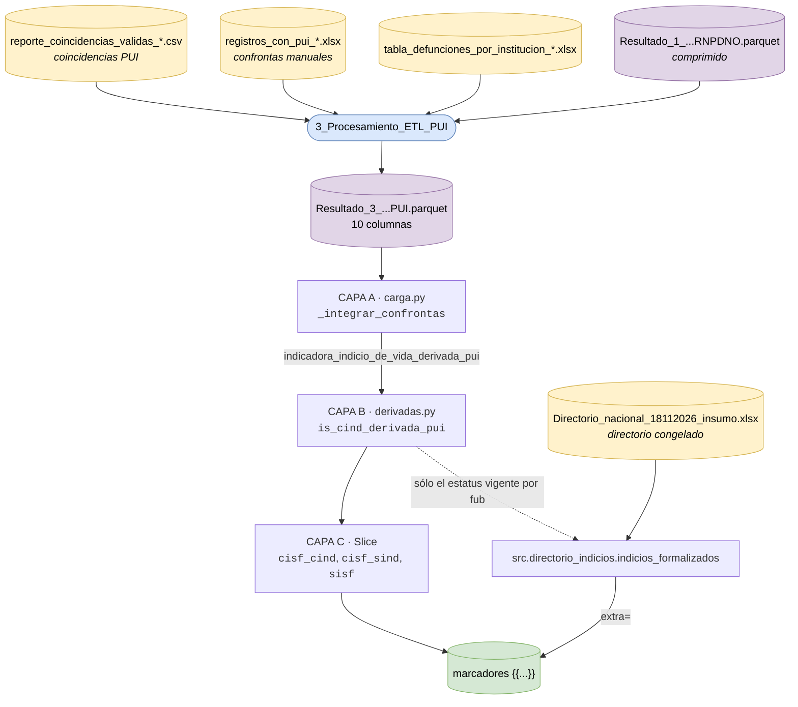
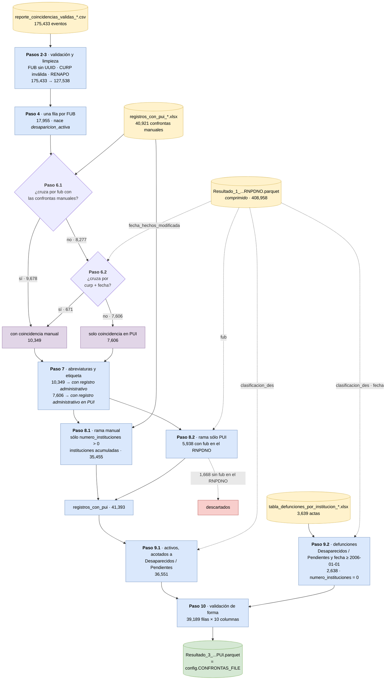

# 8. Indicios de vida: del ETL de PUI al indicador

Todo lo que en el proyecto se llama "indicio de vida" sale de aquí. Este capítulo sigue el
dato desde los archivos que llegan a `input/pui/` hasta los marcadores `{{...}}` que
imprime la plantilla.

## 8.0. Dos cosas distintas con el mismo nombre

Antes de nada, la confusión que hay que quitarse de encima: **en el repositorio conviven
dos "indicios de vida" que no son el mismo dato y no se calculan igual.**

| | `cind` / `sind` | `fmz` (lámina 12) |
|---|---|---|
| **Qué es** | bandera del universo: esta persona tiene registro administrativo posterior a su desaparición | cuántos indicios de un corte congelado ya derivaron en una localización |
| **De dónde sale** | `input/pui/` → notebook 3 → `Resultado_3_*.parquet` | `input/domicilios_y_numeros_contacto/Directorio_nacional_18112026_insumo.xlsx` |
| **¿Pasa por el pipeline?** | sí: CAPA A la integra, CAPA B la convierte en bandera | **no**: es una foto fija que se cruza aparte |
| **¿Se recalcula cada corrida?** | sí, con la PUI del día | no: el archivo está congelado al 18/11/2026 |
| **Quién lo calcula** | `carga.py` + `derivadas.py` | `src.directorio_indicios.indicios_formalizados` |
| **Dónde aparece** | `..._des_cisf_cind`, `..._des_sisf` | `reg_rn_24jun26-max_loc_fmz` y sus variantes |

Las secciones 8.1 a 8.5 cubren la primera; la 8.6, la segunda.



---

## 8.1. Los insumos del notebook 3

Los cuatro se declaran en `config.py` — **no hay autodetección**— y el cuaderno comprueba
los cuatro de golpe antes de leer nada, para no ir descubriendo faltantes de uno en uno.

| Archivo de entrada | Constante | Qué aporta | Filas (corte 14/09/2026) |
|---|---|---|---:|
| `input/pui/reporte_coincidencias_validas_2026-09-14.csv` | `PUI_COINCIDENCIAS_FILE` | coincidencias administrativas de la PUI: un renglón por evento detectado en otra institución | 175,433 |
| `input/pui/registros_con_pui_13032026.xlsx` | `PUI_REGISTROS_FILE` | confrontas **manuales** del RNPDNO, 5 columnas | 40,921 |
| `input/pui/tabla_defunciones_por_institucion_05052026.xlsx` | `PUI_DEFUNCIONES_FILE` | actas de defunción por institución | 3,639 |
| `output/Resultado_1_Procesamiento_ETL_RNPDNO.parquet` | `ETL_RNPDNO_OUTPUT_FILE` | del RNPDNO ya limpio: `fub`, CURP imputada, `clasificacion_des` y `fecha_hechos_modificada` | 408,958 |

Son los archivos de la corrida vigente; lo que manda es la constante, y cambiar de entrega
es apuntarla al archivo nuevo en `config.py`. La equivalencia con los nombres que usa el
script de R —`coincidencias_admin_con_inactivas`, `registros`, `defunciones_df` y
`comprimido`, que reaparecen más abajo— está en
[1. Fuentes de Información](1_fuentes_de_informacion.md).

**Ésta es la única dependencia entre notebooks de ETL:** el 3 no puede correr sin el
Parquet del 1, porque necesita el RNPDNO para resolver clasificación, fecha de hechos y
CURP. Si falta, el cuaderno se detiene y lo dice.

> ⚠️ **No confundir** `registros_con_pui_DDMMYYYY.xlsx` (insumo, 5 columnas) con
> `registros_con_pui_activos_*.xlsx`, que son **salidas** antiguas del flujo en R.

### La CURP del comprimido es la imputada

```python
PUI_COMPRIMIDO_COLUMN_MAPPING = {
    'curp_victima': ['curp_vic_derivada_rnpdno'],   # la CURP IMPUTADA
    ...
}
```

`curp_victima` no existe con ese nombre en el Parquet del notebook 1: la equivalente es
`curp_vic_derivada_rnpdno`, que `src.cleaning.imputar_curps` rellenó desde los cruces.
**No sirve `curp_vic_rnpdno`**, la CURP original sin imputar: deja sin CURP a los registros
que sólo la tienen por imputación — justo los que el pipeline de R sí resuelve. Esta CURP
llega a la salida en las filas de defunciones (paso 9.2); con la columna equivocada, esas
filas salen con `curp_victima` vacía. El cruce por CURP + fecha del paso 6 no la usa: toma
la CURP de `registros`.

### La descarga del CSV no está automatizada

El ZIP llega a una carpeta de Drive bajo el patrón
`reporte_coincidencias_validas_YYYY-MM-DD.zip`. Hay que bajarlo, descomprimirlo y dejar el
`.csv` en `input/pui/`, y después **apuntar `config.PUI_COINCIDENCIAS_FILE` al archivo
nuevo**: copiarlo a la carpeta no cambia lo que lee el cuaderno.

La fecha del nombre es también la que etiqueta la corrida: `config.PUI_FECHA_CORTE = None`
hace que se derive del propio nombre del CSV (`2026-09-14` → `14092026`). Sólo es una
etiqueta; el archivo de salida tiene nombre fijo.

---

## 8.2. Qué hace el notebook 3, paso por paso

El cuaderno es la traducción a Python de `funcion_actualizar_confrontas_de_pui.R`, y sigue
el script línea por línea, **incluidos sus mensajes de diagnóstico y sus advertencias**.

### El flujo completo de un vistazo

Las cifras son las de la corrida del 14/09/2026. Las flechas punteadas marcan lo que el
`comprimido` sólo **presta** —una columna para resolver un cruce o un filtro—; no aporta
filas al resultado.



Tres cosas que el diagrama deja ver de un golpe y que son fáciles de perder leyendo el
código:

- **El archivo de confrontas manuales entra dos veces**: en el paso 6 como criterio de
  cruce y en el paso 8.1 como fuente de filas. Por eso la rama manual termina con 35,455
  registros y no con los 10,349 que casaron.
- **Las dos ramas se etiquetan distinto en el paso 7 y se vuelven a juntar en el 8**, ya sin
  esa distinción visible más que en `indicadora_coincidencia_manual`.
- **Las defunciones no pasan por ninguno de los cruces anteriores**: entran directas al
  final, con la misma etiqueta que los indicios de vida.

### Alcance deliberado

La función de R devuelve tres objetos; aquí se reproduce sólo uno:

| Salida de R | ¿Se reproduce? | Motivo |
|---|---|---|
| `registros_con_pui_activos` | ✅ sí | es `Resultado_3_*.parquet`, lo que consume `config.CONFRONTAS_FILE` |
| `comprimido_actualizado` | ❌ no | pide `sub_clasificacion` e `indicadora_indicio_de_vida_localizados`, que el notebook 1 todavía no genera |
| `registros_en_pui_no_activos` | ❌ no | sólo existe para alimentar al anterior |

Por eso se omiten los bloques *"Primera modificación en comprimido"* y *"Segunda
modificación: sub_clasificacion"* del script original.

### Paso 0 · equivalencias R → pandas

`dplyr` y `stringr` no se comportan como pandas con los nulos ni con el orden, así que el
cuaderno define los equivalentes exactos antes de tocar los datos:

| Helper | Réplica de | Por qué no vale el de pandas |
|---|---|---|
| `primero` | `dplyr::first()` | `GroupBy.first()` **salta los nulos**; `first()` de R no |
| `paste_unique` | `paste(unique(x), collapse=", ")` | conserva el orden de primera aparición |
| `paste_sorted_unique` | `paste(sort(unique(x)), …)` | — |
| `r_str_replace_all` | `stringr::str_replace_all()` con vector nombrado | aplica los patrones **en secuencia**, no en paralelo: la salida de uno es la entrada del siguiente |
| `conteos_en_orden_de_aparicion` | `table(x)` + reindex | — |
| `clean_names` | `janitor::clean_names()` | — |

### Paso 1 · carga del CSV

Todo se lee **como texto** (`dtype=str`) para no perder los ceros a la izquierda de
`institucion_id` (`"0044"` = RENAPO), que el cuaderno usa como filtro. `solo_mapeadas=False`
conserva las columnas extra: el mapeo fija el mínimo exigido, no el máximo.

### Paso 2 · validaciones de entrada

| Comprobación | Si falla |
|---|---|
| las 16 columnas de `PUI_COINCIDENCIAS_COLUMN_MAPPING` | **error**, ya en la lectura |
| `fase_busqueda ∈ {2, 3}` | **error**, con el conteo de los valores encontrados |
| `curp` vacías | advertencia, el proceso sigue |
| `is_valid` interpretable como lógico | advertencia |

`is_valid` llega como texto (`"True"` / `"False"`) y se convierte a booleano; es lo que más
adelante se renombra `desaparicion_activa`.

### Paso 3 · limpieza de las coincidencias

Cuatro operaciones, en este orden:

1. **FUB sin UUID.** La columna `fub` del CSV concatena el FUB del RNPDNO con el UUID de la
   coincidencia. Se recorta el bloque final de 32 hexadecimales y el guion sobrante:
   ```
   18DA6B13D-9A39-467E-B380-C5BE232F54A3-45D440DB-9731-42CC-9904-EF66E51E59E4
   → 18DA6B13D-9A39-467E-B380-C5BE232F54A3
   ```
   Sin esto **ningún cruce por FUB casaría**.
2. **CURP inválidas conocidas.** Se eliminan las listadas en `input/pui/curps_excluidas.txt`,
   una por renglón. Viven fuera de git porque son datos personales.
3. **RENAPO (`institucion_id == "0044"`).** Fuera las actas de nacimiento
   (`Tipo de Acto: Nacimiento`) y los eventos que contienen `|1`. El resto de RENAPO sí se
   conserva desde el 8 de junio de 2026. Es la limpieza que más filas descarta.
4. **Institución dentro del evento.** A `tipo_evento` se le adjunta la institución entre
   paréntesis, porque después los eventos se concatenan y hay que saber de quién es cada uno.

En el corte del 14/09/2026: **175,433 → 127,538 filas** (se descartan 47,895).

### Paso 4 · agregación por FUB

De un renglón por evento a **un renglón por persona**: 127,538 → **17,955 FUB**. Se
concatenan instituciones y eventos, se cuentan instituciones distintas y se toma el primer
valor del grupo para los campos de contexto (fechas, domicilio).

De aquí sale `desaparicion_activa` (15,938 activas / 2,017 inactivas), que decide qué
sobrevive al paso 9.

> ⚠️ `tramites_repetidos` parte `tipo_evento` por `", "`, y **los propios eventos contienen
> comas** (`"Fecha Registro: 1967-09-23, CURP: …, Tipo de Acto: Nacimiento"`), así que el
> corte no separa eventos completos sino fragmentos. Es el comportamiento del script de R y
> se conserva tal cual para no alterar la salida.

### Paso 6 · cruce con las confrontas manuales

Dos intentos, en cascada:

1. **Por `fub`.** 9,678 casan; 8,277 no.
2. **Por `curp_victima` + `fecha_hechos_modificada`**, sobre los que no casaron. Recupera a
   la misma persona registrada bajo un FUB distinto: 671 más.

Resultado: **10,349 con coincidencia manual** y **7,606 sólo en la PUI**.

### Paso 7 · aquí nace `indicadora_indicio_de_vida`

Se abrevian los nombres de institución y se unen las dos ramas. El valor se asigna así:

| Rama | `indicadora_coincidencia_manual` | `indicadora_indicio_de_vida` |
|---|---|---|
| PUI **y** confronta manual | `coincidencia en PUI y registro manual` | `con registro administrativo` |
| sólo PUI | `solo coincidencia en PUI` | `con registro administrativo en PUI` |

### Paso 8 · pegado con los registros manuales

- De `registros` se descartan las filas con `numero_instituciones == 0`: son defunciones que
  ya venían en ese archivo y se reincorporan en el paso 9 desde su propio insumo.
- Los FUB que están en ambas fuentes **acumulan**: se concatenan los nombres de institución
  y se suman los conteos.
- Los que sólo existen en la PUI se cruzan contra el `comprimido` y **se descartan los que
  no tienen FUB en el RNPDNO** (1,668 de 7,606). Un indicio de vida sobre alguien que no
  está en el registro no le sirve a nadie río abajo.

Total tras el pegado: 41,393 filas.

### Paso 9 · filtro de activos y anexo de defunciones

1. Se conservan las desapariciones **activas** y las de la rama manual (`desaparicion_activa`
   nula, porque no vienen de la PUI y no se sabe su estado).
2. Se acotan a `clasificacion_des ∈ {Desaparecidos, Pendientes}` según el comprimido →
   36,551 filas.
3. Se anexan las **defunciones**: mismo filtro de clasificación, más `fecha_hechos_modificada
   ≥ 2006-01-01` → 2,638 filas. Se les pone `numero_instituciones = 0`, se reescribe
   `defuncion_INE` → `defuncion de INE` y **se les asigna también
   `indicadora_indicio_de_vida = "con registro administrativo"`**.

Total: **39,189 filas**.

> ⚠️ **`cind` no significa literalmente "está vivo".** Las defunciones entran con la misma
> etiqueta que los indicios de vida — el propio cuaderno lo dice al imprimir *"tanto
> defunciones como indicios de vida"*—, así que la lectura correcta de la bandera es **"hay
> registro administrativo posterior a la desaparición"**. Son 2,638 de 39,189 en el corte
> vigente.

### Paso 10 · validación y guardado

Antes de escribir se comprueba: las diez columnas en orden, sin FUB nulos, sin duplicados
**dentro de una misma rama**, y `clasificacion_des` acotada.

El chequeo de duplicados distingue dos casos, porque no son lo mismo:

- **Solape PUI ↔ defunciones.** La misma persona puede tener un trámite en la PUI y un acta
  de defunción; las dos ramas se unen sin deduplicar y salen dos filas. El script de R hace
  exactamente lo mismo. Es esperado: se informa, no se marca como problema.
- **Duplicados dentro de una rama.** Eso sí es anómalo y apunta a FUB repetidos en algún
  insumo (`registros` trae 19 en el corte vigente, y el cuaderno lo advierte al cargarlo).

### Paso 11 *(opcional)* · comparación contra el archivo de R

Si `config.PUI_REFERENCIA_FILE` apunta a la salida del script de R del mismo corte, la
última celda contrasta ambas: FUB compartidos, sobrantes, faltantes y discrepancias columna
por columna. Es la **única entrada opcional** del cuaderno —una verificación, no un insumo—
y con `None` la celda no hace nada.

---

## 8.3. El contrato de salida: 10 columnas

`output/Resultado_3_Procesamiento_ETL_PUI.parquet`. El cuaderno trabaja con los nombres del
script de R (`config.PUI_OUTPUT_COLUMNS`) y los renombra **sólo al exportar**, con
`config.PUI_NOMBRES_EXPORTADOS`, para que el sufijo diga de dónde sale cada columna (ver la
convención en [5. Diccionario](5_diccionario_de_variables.md#convención-de-sufijos)):

| Columna exportada | En el cuaderno | Origen | Descripción |
|---|---|---|---|
| `fub_derivada_pui` | `fub` | ambas | llave de persona |
| `curp_victima_derivada_rnpdno_pui` | `curp_victima` | PUI / comprimido | CURP (imputada cuando viene del comprimido) |
| `indicadora_indicio_de_vida_derivada_pui` | `indicadora_indicio_de_vida` | derivada, paso 7 | `con registro administrativo` · `con registro administrativo en PUI` |
| `institucion_indicadora_de_vida_derivada_pui` | `institucion_indicadora_de_vida` | PUI + manual | instituciones acumuladas, ya abreviadas |
| `numero_instituciones_derivada_pui` | `numero_instituciones` | PUI + manual | suma de ambas ramas; `0` en defunciones |
| `indicadora_coincidencia_manual_derivada_pui` | `indicadora_coincidencia_manual` | derivada, paso 7 | de qué rama vino; nulo en defunciones y en confrontas manuales sin PUI |
| `tipo_tramites_derivada_pui` | `tipo_tramites` | PUI | eventos concatenados, con abreviaturas |
| `tramites_repetidos_derivada_pui` | `tramites_repetidos` | PUI | conteo por evento (ver la advertencia del paso 4) |
| `fecha_evento_derivada_pui` | `fecha_evento` | PUI | primera fecha del grupo; acota el reporte semanal |
| `clasificacion_des_derivada_rnpdno` | `clasificacion_des` | comprimido | `Desaparecidos` · `Pendientes` |

Distribución en el corte del 14/09/2026:

```
indicadora_indicio_de_vida            indicadora_coincidencia_manual
  con registro administrativo    34,561  NaN (defunciones y manuales)  26,127
  con registro administrativo en PUI 4,628  coincidencia en PUI y manual  8,434
                                           solo coincidencia en PUI      4,628
clasificacion_des
  Desaparecidos  32,358
  Pendientes      6,831
```

Las cinco columnas de `registros` son las que fijan el ancho: cinco de ahí, cuatro que
aporta la PUI y `clasificacion_des`, que llega del comprimido. Si `registros` trajera además
su propia `clasificacion_des`, el cruce la duplicaría.

---

## 8.4. Cómo se integra: de `Resultado_3` a `indicadora_indicio_de_vida_derivada_pui`

Lo hace `_integrar_confrontas` en [`src/pipeline/carga.py`](../src/pipeline/carga.py),
dentro de la **CAPA A**, justo después de cargar RNPDNO y BANCI:

```
✅ Confrontas integradas (39,189 FUBs con registro).
```

El mapeo que gobierna la lectura vive en `config.CONFRONTAS_COLUMN_MAPPING`:

```python
CONFRONTAS_COLUMN_MAPPING = {
    'fub': ['fub_derivada_pui', 'fub'],
    'indicadora_registro': ['indicadora_indicio_de_vida_derivada_pui',
                            'indicadora_registro', 'indicadora_indicio_de_vida'],
}
```

El primer alias de cada lista es el nombre que exporta el notebook 3; los demás permiten
seguir leyendo archivos anteriores. La columna llega al universo como
`indicadora_indicio_de_vida_derivada_pui`.

Los cuatro pasos de la integración:

1. **Lectura acotada.** Sólo el FUB y la indicadora, por sus alias. El lector acepta Parquet y
   Excel: `read_parquet` no admite un callable en `columns`, así que para Parquet el
   predicado se aplica sobre los nombres del esquema. Así un perfil puede seguir apuntando a
   un `.xlsx` antiguo.
2. **Deduplicación por `fub`** antes de cruzar, para que el merge no multiplique filas del
   RNPDNO. Es donde se resuelve el solape PUI ↔ defunciones del paso 10.
3. **Merge `left` sobre el RNPDNO** por `fub`. Los FUB sin coincidencia quedan nulos y se
   rellenan con `sin registro administrativo`.
4. **Homologación.** Todo a minúsculas, sin espacios, y
   `"con registro administrativo en pui"` → `"con registro administrativo"`.

> ⚠️ **En el paso 4 se pierde a propósito la distinción entre las dos ramas.** Un registro
> que sólo aparece en la PUI y otro confirmado también por confronta manual quedan
> indistinguibles en el universo: `indicadora_indicio_de_vida_derivada_pui` es **binaria**.
> Si alguna vez hace falta separarlos en un indicador, el dato sigue existiendo en
> `indicadora_coincidencia_manual_derivada_pui` dentro del Parquet, pero habría que traerlo
> en el merge.

> La dependencia que alimenta `fis` / `com` / `por` es la del RNPDNO (corregida por el cruce
> con BANCI), no la de la PUI.

---

## 8.5. De la columna a las banderas y a los marcadores

En la **CAPA B**, [`src/pipeline/derivadas.py`](../src/pipeline/derivadas.py) convierte la
columna en banderas booleanas:

```python
ind = _serie_txt(rn, "indicadora_indicio_de_vida_derivada_pui").str.strip()
out["is_cind_derivada_pui"] = (ind != "sin registro administrativo").to_numpy()
```

`sind` no se guarda: es la negación exacta de `cind` y el rebanado la resuelve al filtrar.

Se evalúa sobre **todo el RNPDNO**, no sólo sobre los desaparecidos: la bandera existe para
las 408,958 filas y es el `Slice` quien decide después a qué subconjunto se aplica.

De ahí salen las dos derivadas que consumen las láminas de *información suficiente*:

```
sisf = ~ccurp & sind                 sin CURP válida NI registro administrativo (is_sisf_derivada_rnpdno_pui)
cisf = ~sisf = ccurp | cind          no se guarda: el rebanado niega is_sisf_*

cisf_cind = cind                     todo `cind` es, por definición, `cisf`
cisf_sind = ccurp & sind             sin indicios, pero identificable por CURP
cisf_cind + cisf_sind = cisf         y   cisf + sisf = total
```

`sisf` se llamaba `sdat` ("sin datos"); se renombró porque se confundía con los faltantes de
campo (`scurp`, `smuni`, `sfnac`). El nombre viejo todavía aparece en marcadores antiguos.

Marcadores que dependen de esta cadena, con los valores de la corrida del 14/09/2026:

| Marcador | Valor | % |
|---|---:|---:|
| `reg_rn_01ene06-max_des_sisf` | 44,413 | 34.4 % |
| `reg_rn_01ene06-max_des_cisf` | 84,751 | 65.6 % |
| `reg_rn_01ene06-max_des_cisf_cind` | 39,125 | 30.3 % |
| `reg_rn_01ene06-max_des_cisf_sind` | 45,626 | 35.3 % |

Los tres últimos se miden contra `reg_rn_01ene06-max_des` con **denominador explícito**, no
con la regla del padre: la lámina los presenta como un reparto del mismo total. Cada uno
tiene además su diferencia y sus deltas contra el corte de marzo (`_ddes` / `_dloc`), que se
describen en [`catalogo_abreviaturas.md`](../catalogo_abreviaturas.md), secciones 9 bis y
9 ter.

### Qué invalida qué

Cambiar el CSV de la PUI y volver a correr el notebook 3 reescribe `Resultado_3_*.parquet`,
lo que cambia la `clave_matching` y **rehace la CAPA A completa** (minutos). Cambiar sólo el
período o el subfiltro de un `Slice` no invalida nada.

---

## 8.6. El otro camino: el directorio congelado de la lámina 12

La lámina 12 del reporte diario **no usa nada de lo anterior**. Su población sale de
`config.DIRECTORIO_INDICIOS_FILE`:

```
input/domicilios_y_numeros_contacto/
    Directorio_nacional_18112026_insumo.xlsx
```

Una foto fija de las personas con indicio de vida al **18/11/2026** —42,220 en el archivo
vigente—, con domicilio y teléfonos, entregada ya hecha desde fuera. Trae 37 columnas y sólo
se usan dos: `FUB` y `Estado de Desaparición`. La hoja se llama `Personas desaparecidas` y
los encabezados empiezan en la fila 2.

La pregunta que responde es otra: **de aquellos indicios, ¿a cuántos les siguió una
localización?** De ahí el token `fmz` = *formalizados*. Lo calcula
`src.directorio_indicios.indicios_formalizados` —un módulo aparte de `src/utils.py` que nada
del pipeline importa, así que editarlo no invalida el caché del matching—, y el RNPDNO sólo
aporta el **estatus vigente de cada FUB**:

| Clasificación en el RNPDNO | Cuenta como |
|---|---|
| `Localizados` | formalizado |
| `Desaparecidos` · `Pendientes` | todavía desaparecido |
| **no cruza con el RNPDNO** | todavía desaparecido |

El último criterio es deliberado: no hay evidencia de localización, y descartarlo inflaría el
porcentaje. Son 115 FUB en la corrida del 06/10/2026.

Antes de tabular se normaliza la entidad (`México` → `Estado de México`, nulo → `Sin
información`) y **el conteo nacional se toma antes de acotar por entidad**; después se
filtra a las 24 entidades de `config.DIRECTORIO_INDICIOS_ESTADOS`, las de la Búsqueda
Generalizada. Las nueve restantes quedan fuera a propósito.

La plantilla trae además una lámina gemela con **las 32 entidades federativas**: el mismo
tabulado, tomado antes de acotarlo a las 24, que sólo deja fuera lo que no es una entidad
("Nacido en el extranjero"). Las 32 salen del catálogo INEGI `config.ENTIDADES`, con los
mismos renombres que el directorio.

| Marcador | Corrida 06/10/2026 | Qué es |
|---|---:|---|
| `reg_rn_24jun26-max_loc_fmz` | se actualiza al ejecutar | formalizados en las 24 entidades |
| `pct_reg_rn_24jun26-max_loc_fmz` | se actualiza al ejecutar | su parte del total del país |
| `reg_rn_24jun26-max_loc_fmz_v2` | se actualiza al ejecutar | los mismos formalizados, **sin acotar**: todo el país |
| `reg_rn_24jun26-max_loc_fmz_v3` | se actualiza al ejecutar | el complemento: los del resto del país |
| `gr_ent_rn_24jun26-max_loc_fmz` | se actualiza al ejecutar | desglose por entidad, apilado |
| `reg_rn_24jun26-max_loc_fmz_v4` | se actualiza al ejecutar | formalizados en las 32 entidades federativas |
| `gr_32ent_rn_24jun26-max_loc_fmz` | se actualiza al ejecutar | su desglose por entidad, apilado |

Las siete cifras salen de **una sola pasada** de `indicios_formalizados`, precisamente para
que no puedan discrepar entre sí, y entran al diccionario de la plantilla por `extra=` en
`Universo.indicadores`, igual que el cruce de MJ y RIPS de la última lámina.

Los nombres conservan `config.DIRECTORIO_INDICIOS_CORTE` (`"24jun26"`) para corresponder con
los marcadores ya existentes en la plantilla; el archivo fuente se actualizó al
`18/11/2026` y su fecha real se informa por separado. La nomenclatura completa está
en [`catalogo_abreviaturas.md`](../catalogo_abreviaturas.md) §9 quáter.

> El repositorio **no documenta quién produce ese archivo ni con qué criterio se marcó cada
> indicio**: se recibe ya hecho. No está garantizado que su población coincida con la de
> `cind`, y los dos números no son comparables sin verificarlo primero.

---

## 8.7. Antes de dar por buena una corrida

| Señal | Qué significa |
|---|---|
| `❌ Faltan N de los 4 insumos` | falta un archivo o `config.py` apunta a otro; si es el comprimido, corre antes el notebook 1 |
| `❌ A <insumo> le faltan N columna(s) exigida(s)` | la entrega cambió de nombres: actualiza el mapeo en `config.py` |
| `¡Atención! … fases de búsqueda no válidas` | el CSV trae fases distintas de 2 y 3; **detiene** el proceso |
| `` `registros` trae N FUB duplicados `` | esperado en pequeñas cantidades; multiplicará filas en los cruces por FUB |
| `ℹ️ N FUB aparecen tanto en la PUI como en defunciones` | esperado, es el comportamiento del script de R |
| `Hay N FUB duplicados dentro de una misma rama` | **anómalo**: revisa los insumos |
| `✅ Confrontas integradas (N FUBs con registro)` | debe coincidir con las filas del Parquet tras deduplicar por `fub` |

Y tres comprobaciones de sentido sobre la salida:

1. `indicadora_indicio_de_vida_derivada_pui` sólo debe tener los dos valores del paso 7.
2. `clasificacion_des_derivada_rnpdno` sólo `Desaparecidos` y `Pendientes`: cualquier otro valor significa
   que el filtro del paso 9 no se aplicó.
3. El conteo de `reg_rn_*_cisf_cind` nunca puede superar las filas del Parquet: es el mismo
   conjunto de FUB, restringido por período y estatus.
